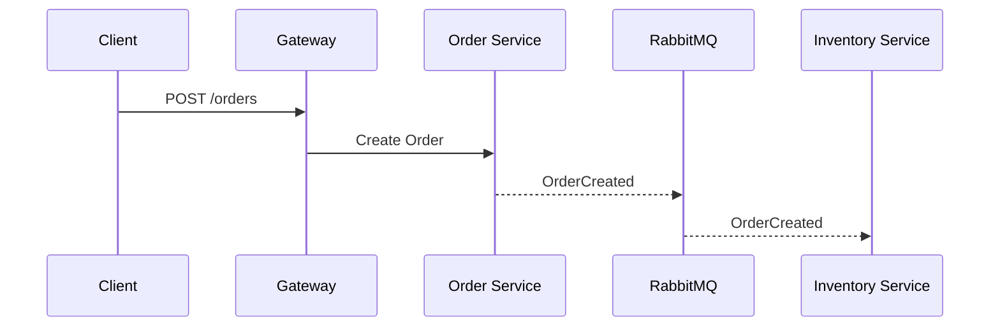

Create the archecture for

2. Event Driven E-Commerce Backend

Difficulty: ⭐⭐⭐⭐⭐

This is NOT another Amazon clone.

Build the backend exactly how modern companies build commerce systems.

Modules
Authentication
Products
Categories
Inventory
Orders
Coupons
Payments
Reviews
Notifications
Microservices
Auth Service

↓

Product Service

↓

Order Service

↓

Payment Service

↓

Notification Service
Technologies
Node.js
Express
MongoDB
PostgreSQL
Redis
RabbitMQ
Docker
Nginx
Advanced Features
Inventory Reservation

Prevent overselling.

Event Driven
Order Created

↓

RabbitMQ

↓

Inventory Updated

↓

Payment Started

↓

Notification Sent

↓

Analytics Updated
Payments
Razorpay
Stripe
Webhooks
Admin Dashboard
Sales analytics
Revenue
Orders
Inventory alerts
Scalability
Redis cache
Rate limiting
Logging
Monitoring
Retry queues
Interview Topics Covered
Microservices
Message queues
Distributed systems
Payment flow
Transactions
Scalability

If your goal is to **impress senior backend interviewers**, then don't build a simple collection of microservices. Build it like a production-grade commerce platform with clear service boundaries, asynchronous communication, and resilience patterns.

---

# High-Level Architecture

```text
                                      Internet
                                          │
                                          │
                                   ┌────────────┐
                                   │   Nginx    │
                                   │Load Balancer│
                                   └─────┬──────┘
                                         │
                                 Rate Limiting
                                         │
                                         ▼
                                API Gateway (Express)
                                         │
                ┌────────────────────────┼────────────────────────┐
                │                        │                        │
                ▼                        ▼                        ▼
          Auth Service           Product Service          Order Service
                │                        │                        │
                │                        │                        │
                ▼                        ▼                        ▼
          MongoDB                 PostgreSQL              PostgreSQL
                │                        │                        │
                └──────────────┐         │         ┌──────────────┘
                               │         │         │
                               ▼         ▼         ▼
                            Redis Cache (Shared)
                               │
                               ▼
                           RabbitMQ Cluster
         ┌────────────────────┼─────────────────────┐
         │                    │                     │
         ▼                    ▼                     ▼
 Inventory Service      Payment Service     Notification Service
         │                    │                     │
 PostgreSQL             Razorpay/Stripe      Email/SMS/Push
         │                    │                     │
         └──────────────┐     │     ┌───────────────┘
                        ▼     ▼     ▼
                 Analytics Service
                        │
                    PostgreSQL

                    Monitoring Stack
       Prometheus → Grafana → Loki → AlertManager
```

---

# Complete Service Architecture

## 1. API Gateway

### Responsibilities

- Authentication middleware
- JWT verification
- Rate limiting
- Request validation
- API versioning
- Reverse proxy
- Logging
- Request tracing

**Tech**

```
Node
Express
Redis
JWT
Helmet
Morgan
Compression
```

---

# 2. Authentication Service

### Database

MongoDB

Reason:

- Flexible user profile
- Social login
- OAuth providers
- Session storage

### Responsibilities

```
Register

Login

Refresh Token

Forgot Password

OTP

RBAC

Permissions

Organizations

Users

Sessions
```

### APIs

```
POST /register

POST /login

POST /refresh

POST /logout

GET /me
```

### Events

Publishes

```
UserCreated

UserUpdated

PasswordChanged
```

Consumes

```
OrderCompleted

RewardGranted
```

---

# 3. Product Service

Database

PostgreSQL

Reason

Products require relational consistency.

Tables

```
Products

Categories

Brands

Images

Attributes

Variants

Pricing
```

Features

```
CRUD

Search

Pagination

Sorting

Filtering

Recommendations

Featured Products
```

Redis

```
Popular Products

Category Cache

Homepage Cache
```

Publishes

```
ProductCreated

ProductUpdated

ProductDeleted
```

Consumes

```
InventoryUpdated
```

---

# 4. Inventory Service

One of the most important services.

Database

PostgreSQL

Tables

```
Inventory

Warehouse

Reservation

Movement

StockLog
```

Responsibilities

```
Reserve inventory

Release inventory

Deduct inventory

Restock

Warehouse sync
```

---

## Inventory Reservation Flow

Instead of reducing stock immediately:

```
Stock = 100

Customer Orders 5

↓

Reserve 5

Available = 95

↓

Payment Success

↓

Deduct permanently

↓

Stock = 95
```

If payment fails

```
Reservation Released

Available = 100
```

No overselling.

---

Events

Publishes

```
InventoryReserved

InventoryReleased

InventoryUpdated

LowStock
```

Consumes

```
OrderCreated

PaymentFailed

PaymentCompleted
```

---

# 5. Order Service

Database

PostgreSQL

Tables

```
Orders

Order Items

Coupons

Shipping

Taxes

Invoices
```

Responsibilities

```
Create Order

Calculate Tax

Apply Coupon

Generate Invoice

Cancel Order

Refund
```

Publishes

```
OrderCreated

OrderCancelled

OrderCompleted
```

Consumes

```
InventoryReserved

PaymentCompleted
```

---

# 6. Payment Service

External Integrations

```
Stripe

Razorpay
```

Tables

```
Payments

Refunds

Webhooks

Payment Logs
```

Responsibilities

```
Create Payment

Verify Payment

Refund

Retry

Webhook Verification
```

Events

Publishes

```
PaymentSuccess

PaymentFailed

RefundCompleted
```

Consumes

```
OrderCreated
```

---

# Webhook Flow

```
Stripe

↓

Webhook

↓

Verify Signature

↓

Save Event

↓

Update Payment

↓

Publish PaymentSuccess
```

Never trust frontend payment status.

---

# 7. Notification Service

Channels

```
Email

SMS

Push

WhatsApp
```

Responsibilities

```
Templates

Retries

Queue

Dead Letter Queue
```

Consumes

```
OrderCreated

PaymentSuccess

RefundCompleted

LowStock
```

---

# 8. Analytics Service

Consumes

```
OrderCreated

PaymentSuccess

RefundCompleted

UserCreated

InventoryUpdated
```

Stores

```
Revenue

Daily Sales

Popular Products

User Growth

Top Categories

Conversion Rate
```

Used by Admin Dashboard.

---

# RabbitMQ Event Bus

```
               RabbitMQ Exchange

                      │
      ┌───────────────┼───────────────┐
      │               │               │
      ▼               ▼               ▼
 Order Queue   Inventory Queue   Payment Queue
      │               │               │
      ▼               ▼               ▼
 Notification Queue   Analytics Queue
```

---

# Order Processing Flow

```
Client

↓

API Gateway

↓

Order Service

↓

Save Order

↓

Publish OrderCreated

↓

RabbitMQ

↓

Inventory Service

↓

Reserve Stock

↓

InventoryReserved

↓

Payment Service

↓

Create Payment

↓

Customer Pays

↓

Webhook

↓

Payment Success

↓

RabbitMQ

↓

Inventory Deduct

↓

Order Completed

↓

Notification

↓

Analytics
```

---

# Redis Usage

```
JWT Blacklist

Session

Product Cache

Rate Limit

Popular Products

Cart Cache

Coupon Cache

Order Status
```

---

# Docker Architecture

```text
docker-compose

├── nginx
├── gateway
├── auth
├── product
├── inventory
├── order
├── payment
├── notification
├── analytics
├── postgres
├── mongodb
├── redis
├── rabbitmq
├── prometheus
├── grafana
└── loki
```

---

# Monitoring Stack

```
Node Services

↓

Prometheus Metrics

↓

Grafana Dashboard

↓

AlertManager

↓

Slack / Email Alerts
```

---

# Logging

Every service emits structured JSON logs:

```
Request ID

Correlation ID

User ID

Service Name

Execution Time

Status

Error Stack
```

Aggregate logs with **Loki** and visualize them in **Grafana**.

---

# Folder Structure

```text
ecommerce-platform/
│
├── api-gateway/
├── auth-service/
├── product-service/
├── inventory-service/
├── order-service/
├── payment-service/
├── notification-service/
├── analytics-service/
│
├── shared/
│   ├── config/
│   ├── logger/
│   ├── rabbitmq/
│   ├── redis/
│   ├── middleware/
│   ├── auth/
│   ├── events/
│   ├── validation/
│   └── utils/
│
├── infrastructure/
│   ├── docker/
│   ├── nginx/
│   ├── monitoring/
│   └── scripts/
│
├── docker-compose.yml
└── README.md
```

## Production-level enhancements

To make this portfolio project resemble a real-world commerce platform, consider adding:

- **Saga orchestration** for distributed transaction management across Order, Inventory, and Payment services.
- **Transactional Outbox Pattern** to ensure database writes and event publishing remain consistent.
- **Dead Letter Queues (DLQ)** with retry policies for failed message processing.
- **Idempotency keys** for order creation and payment endpoints to safely handle retries.
- **Distributed tracing** using OpenTelemetry with Jaeger or Grafana Tempo.
- **Correlation IDs** propagated across HTTP requests and RabbitMQ events for end-to-end debugging.
- **Circuit breakers** and retry policies for inter-service communication.
- **API versioning**, health checks (`/health`, `/ready`), and graceful shutdown handling.
- **CI/CD pipeline** (GitHub Actions) that runs linting, tests, builds Docker images, and deploys services.
- **Comprehensive testing** with unit, integration, contract, and end-to-end tests.

This architecture demonstrates many of the concepts expected from experienced backend engineers: microservice decomposition, asynchronous messaging, inventory reservation, secure payment handling, distributed transactions, caching, observability, and production-ready operational practices.

Now give me low level designe, when can be further user to generate requried code.

That's exactly how you should approach this project. Don't jump into coding. First, create a **Low-Level Design (LLD)** that is detailed enough for an AI assistant (or another developer) to generate code module by module.

I recommend organizing the project into multiple design documents rather than one huge document.

---

# Project Structure

```text
event-driven-ecommerce/

docs/
│
├── 01-System-Overview.md
├── 02-Architecture.md
├── 03-Database-Design.md
├── 04-API-Contracts.md
├── 05-Events.md
├── 06-Service-Communication.md
├── 07-Authentication.md
├── 08-Redis.md
├── 09-RabbitMQ.md
├── 10-Docker.md
├── 11-Logging.md
├── 12-Monitoring.md
├── 13-Folder-Structure.md
├── 14-Coding-Standards.md
│
└── services/
      auth-service.md
      product-service.md
      inventory-service.md
      order-service.md
      payment-service.md
      notification-service.md
      analytics-service.md
```

---

# Level 1

## System Overview

This explains

- Why this project exists
- Business goals
- Functional requirements
- Non-functional requirements

Example

```text
Customer

↓

Browse Products

↓

Add Cart

↓

Create Order

↓

Reserve Inventory

↓

Payment

↓

Order Completed

↓

Notification
```

---

# Level 2

## Architecture Document

Contains

```text
API Gateway

↓

Microservices

↓

RabbitMQ

↓

Redis

↓

Databases

↓

Monitoring
```

Every service responsibilities

Dependencies

Technology stack

Communication

---

# Level 3

## Database Design

Every database gets its own section.

Example

# Product Service

```text
Product

id

name

slug

price

categoryId

status

createdAt

updatedAt
```

Category

Variant

Brand

Image

Indexes

Foreign Keys

Constraints

Relationships

Do this for

- Auth
- Product
- Inventory
- Order
- Payment

---

# Level 4

## API Contracts

This is one of the most important documents.

Every endpoint includes

```http
POST /products
```

Request

```json
{
  "name": "iPhone"
}
```

Response

```json
{
  "id": "..."
}
```

Possible Errors

Validation Rules

Authentication

Rate Limit

Example

Swagger-like documentation.

---

# Level 5

## Event Contracts

RabbitMQ Events

Never leave events undocumented.

Example

OrderCreated

```json
{
  "event": "OrderCreated",
  "orderId": "...",
  "userId": "...",
  "items": []
}
```

InventoryReserved

PaymentSuccess

PaymentFailed

LowInventory

RefundCompleted

Every event should contain

Publisher

Consumer

Routing Key

Exchange

Retry Policy

Dead Letter Queue

TTL

---

# Level 6

## Redis Design

Document

Keys

TTL

Invalidation

Example

```
product:12
```

TTL

```
10 min
```

Who invalidates

Product Service

---

# Level 7

## RabbitMQ Design

Exchanges

Queues

Bindings

Retry Queue

Dead Letter Queue

Example

```text
Order Exchange

↓

Order Created Queue

↓

Inventory Queue

↓

Payment Queue

↓

Notification Queue
```

Routing keys

```
order.created

payment.success

inventory.low
```

---

# Level 8

## Service LLD

Every service gets a dedicated design document.

Example

# Product Service

Contains

Responsibilities

Controllers

Routes

Middlewares

Services

Repositories

DTOs

Entities

Validators

RabbitMQ Consumers

RabbitMQ Producers

Redis Cache

Database Tables

Indexes

Error Handling

Folder Structure

---

Example

```text
ProductController

↓

ProductService

↓

ProductRepository

↓

PostgreSQL
```

---

# Level 9

## Folder Structure

Example

```text
src

controllers

services

repositories

routes

middlewares

validators

dtos

entities

config

rabbitmq

redis

database

events

utils

types

tests
```

---

# Level 10

## Authentication Design

JWT

Refresh Token

Access Token

Roles

Permissions

RBAC

Middleware

Session Storage

Password Hashing

---

# Level 11

## Validation

Every request validation

ProductCreateDTO

OrderDTO

PaymentDTO

CouponDTO

InventoryDTO

Validation rules

Length

Regex

Enums

Nullable

---

# Level 12

## Error Handling

Every API returns same format

```json
{
  "success": false,
  "message": "",
  "errors": []
}
```

Error Codes

400

401

403

404

409

422

429

500

---

# Level 13

## Logging

Every log format

```json
{
  "requestId": "",
  "userId": "",
  "service": "",
  "message": "",
  "level": ""
}
```

---

# Level 14

## Monitoring

Metrics

Health Check

Readiness

Liveness

Prometheus metrics

```
orders_created_total

payment_success_total

inventory_reserved_total
```

---

# Level 15

## Coding Standards

Naming

Error Handling

Imports

DTO Naming

Service Naming

Repository Naming

Comments

TypeScript Rules

ESLint

Prettier

---

# Level 16

## Sequence Diagrams

Example

Order Creation

```text
Client

↓

Gateway

↓

Order Service

↓

Postgres

↓

RabbitMQ

↓

Inventory

↓

Redis

↓

Payment

↓

Webhook

↓

Notification

↓

Analytics
```

Every business flow gets a sequence diagram.

---

# Level 17

## State Machines

Example

Order

```text
Pending

↓

Inventory Reserved

↓

Payment Pending

↓

Paid

↓

Packed

↓

Shipped

↓

Delivered
```

Payment

```text
Pending

↓

Authorized

↓

Captured

↓

Completed
```

Inventory

```text
Available

↓

Reserved

↓

Deducted

↓

Returned
```

---

# Level 18

## AI Coding Prompts

The final layer is a set of implementation specifications that can be fed directly into an AI coding assistant. Each specification should be small enough to generate one feature at a time.

Example:

```text
Task: Implement Product Service

Requirements:
- Use Node.js + Express + TypeScript.
- Follow Controller → Service → Repository pattern.
- Use PostgreSQL with Prisma ORM.
- Validate requests using Zod.
- Implement CRUD endpoints for products.
- Add Redis caching for GET endpoints.
- Publish ProductCreated and ProductUpdated events to RabbitMQ.
- Use structured logging with Pino.
- Write unit tests with Jest.
- Follow the project folder structure and coding standards.
```

## Development Roadmap

I would build this project in the following order:

1. Shared libraries (logger, config, error handling, RabbitMQ, Redis)
2. API Gateway
3. Authentication Service
4. Product Service
5. Inventory Service
6. Order Service
7. Payment Service
8. Notification Service
9. Analytics Service
10. Monitoring, Docker, and CI/CD

This order ensures that each new service builds on stable shared infrastructure and that every component can be implemented, tested, and integrated incrementally. By the end, you'll have a comprehensive design that can drive AI-assisted code generation without requiring major architectural changes.

Now do we have all the required infomation, so that we can start our coding part ?
Or need further more details?

Short answer: **No. We're around 70–80% ready.**

We have a solid architecture and LLD, but if we start coding now, we'll end up making design decisions during implementation, which often leads to refactoring later.

For a project intended to showcase **senior backend engineering skills**, I recommend completing a few more design artifacts first.

---

# Current Status

| Area                    | Status | Ready?                      |
| ----------------------- | ------ | --------------------------- |
| High-Level Architecture | ✅     | Yes                         |
| Low-Level Design        | ✅     | Yes                         |
| Services                | ✅     | Yes                         |
| Database Design         | 🟡     | Basic only                  |
| API Design              | 🟡     | Need complete specs         |
| RabbitMQ Events         | 🟡     | Need schemas                |
| Folder Structure        | ✅     | Yes                         |
| Tech Stack              | ✅     | Yes                         |
| Docker                  | 🟡     | Need implementation details |
| Redis                   | 🟡     | Need cache strategy         |
| Authentication          | 🟡     | Need token lifecycle        |
| Error Handling          | 🟡     | Need standardization        |
| Logging                 | 🟡     | Need format                 |
| Monitoring              | 🟡     | Need metrics                |
| Testing                 | ❌     | Not designed                |
| Deployment              | ❌     | Not designed                |

I'd estimate **75% complete**.

---

# What Is Still Missing?

## 1. Database Schema (Highest Priority)

Instead of:

```text
Product
- id
- name
```

Define everything.

Example:

```sql
Product
---------
id (UUID)
name
slug
description
price
brand_id
category_id
status
created_at
updated_at

Indexes
---------
slug UNIQUE
category_id
status

Relationships
-------------
Category 1:N Product
Brand 1:N Product
Product 1:N Variant
```

Do this for every table.

---

## 2. API Specification

Every endpoint should be fully documented.

Example:

```http
POST /products
```

Headers

```
Authorization

Content-Type
```

Request

```json
{
  "name": "",
  "price": 500
}
```

Response

```json
{
  "success": true,
  "data": {}
}
```

Validation

Errors

Permissions

---

## 3. Event Contracts

This is critical.

Don't just say:

```
OrderCreated
```

Define it:

```json
{
  "eventId": "",
  "eventType": "OrderCreated",
  "occurredAt": "",
  "correlationId": "",
  "payload": {
    "orderId": "",
    "userId": "",
    "items": []
  }
}
```

Also document:

- Exchange
- Routing key
- Consumers
- Retry policy
- Dead Letter Queue

---

# 4. Folder Structure

For every service.

Example

```
product-service

src/

controllers/

services/

repositories/

dtos/

entities/

validators/

middlewares/

events/

rabbitmq/

redis/

config/

tests/
```

---

# 5. Shared Library

Instead of copying code between services.

```
shared

logger

errors

rabbitmq

redis

config

middleware

types

utils

constants
```

---

# 6. Authentication Flow

Document:

```
Register

↓

Login

↓

JWT

↓

Refresh Token

↓

Redis Session

↓

Logout

↓

Token Revoked
```

---

# 7. Redis Strategy

Document every key.

```
product:{id}

TTL

10 minutes

Invalidation

ProductUpdated
```

---

# 8. RabbitMQ Topology

```
Exchange

↓

Queue

↓

Retry Queue

↓

DLQ
```

With routing keys.

---

# 9. Sequence Diagrams

Every business flow.

```
Create Order

Cancel Order

Refund

Login

Payment

Inventory Reservation
```

---

# 10. State Machines

Order

```
Pending

↓

Inventory Reserved

↓

Payment Pending

↓

Paid

↓

Packed

↓

Shipped

↓

Delivered

↓

Returned
```

Payment

```
Pending

↓

Authorized

↓

Captured

↓

Refunded
```

Inventory

```
Available

↓

Reserved

↓

Deducted
```

---

# 11. Testing Strategy

This is usually forgotten.

Document:

- Unit tests
- Integration tests
- Contract tests
- End-to-end tests
- Load tests

---

# 12. Configuration

Create a standard `.env` specification.

Example

```
JWT_SECRET

REDIS_URL

RABBITMQ_URL

DATABASE_URL

STRIPE_SECRET

RAZORPAY_KEY
```

---

# 13. CI/CD

Even if you don't implement deployment immediately, define the pipeline.

```
GitHub Push

↓

Lint

↓

Test

↓

Build Docker

↓

Push Image

↓

Deploy
```

---

# 14. Observability

Every request should include:

```
Request ID

Correlation ID

User ID

Execution Time
```

---

# 15. Coding Standards

Example:

```
Controller

↓

Service

↓

Repository

↓

Database
```

No database access directly from controllers.

---

# When Can We Start Coding?

## Option A (Recommended)

Spend **2–3 days** completing the remaining design documents.

Benefits:

- Minimal refactoring later
- Easier AI-assisted code generation
- Clear implementation path
- Strong documentation for recruiters

---

## Option B (Faster)

Start coding the shared infrastructure and foundational services while documenting details for later services in parallel.

Suggested order:

1. Shared package (logger, config, errors, Redis, RabbitMQ)
2. API Gateway
3. Authentication Service
4. Product Service

By the time those are complete, the remaining design work for Inventory, Order, and Payment can be finalized.

## My Recommendation

Since your goal is to create a **flagship portfolio project**, I'd treat it like a real engineering project:

**Phase 1 – Design**

- Functional requirements
- Database schema
- API contracts
- Event contracts
- Sequence diagrams
- State machines

**Phase 2 – Foundation**

- Monorepo setup
- Shared libraries
- Docker
- CI
- API Gateway

**Phase 3 – Services**

- Auth
- Product
- Inventory
- Order
- Payment
- Notification
- Analytics

This approach will make the codebase cleaner, reduce rework, and produce documentation that demonstrates not only coding ability but also system design and software architecture skills—qualities that senior backend interviewers value.

ok let's start which complete documenation first:
lets start with part 1:

## 1. Database Schema (Highest Priority)

I agree—that's the right place to start.

However, I would make one small adjustment.

Before writing individual table schemas, we should define **database ownership**. In a microservice architecture, this is a critical design decision because **each service owns its own database**, and services never read each other's databases directly.

---

# Document 01 — Database Design

## 1. Database Strategy

### Architecture Principle

Each microservice owns its own database.

No service is allowed to directly access another service's database.

All communication must happen through:

- REST APIs (synchronous)
- RabbitMQ Events (asynchronous)

```text
                     API Gateway
                           │
        ┌──────────────────┼──────────────────┐
        │                  │                  │
        ▼                  ▼                  ▼
 Auth Service       Product Service     Order Service
        │                  │                  │
        ▼                  ▼                  ▼
    MongoDB          PostgreSQL         PostgreSQL
                                            │
                                            │
                    RabbitMQ Event Bus
        ┌──────────────────┼──────────────────┐
        ▼                  ▼                  ▼
 Inventory Service   Payment Service   Notification Service
        │                  │
        ▼                  ▼
   PostgreSQL        PostgreSQL
```

---

# 2. Database Selection

| Service      | Database   | Reason                                                         |
| ------------ | ---------- | -------------------------------------------------------------- |
| Auth         | MongoDB    | Flexible user profiles, OAuth identities, session-related data |
| Product      | PostgreSQL | Relational product catalog, categories, variants               |
| Inventory    | PostgreSQL | Strong transactional consistency                               |
| Order        | PostgreSQL | ACID transactions                                              |
| Payment      | PostgreSQL | Financial consistency                                          |
| Notification | MongoDB    | Flexible templates and delivery logs                           |
| Analytics    | PostgreSQL | Aggregations and reporting                                     |

---

# 3. UUID Strategy

Every table/document uses UUID v4.

Example

```text
id

7b6d8144-f5cb-46ab-b0be-08d44b1d7ef7
```

No auto-increment IDs.

---

# 4. Naming Convention

Tables

```text
snake_case
```

Example

```text
order_items

payment_transactions

inventory_movements
```

Columns

```text
snake_case
```

Example

```text
created_at

updated_at

deleted_at
```

---

# 5. Timestamp Convention

Every table contains:

```sql
created_at

updated_at

deleted_at
```

Soft delete is preferred.

---

# 6. Audit Columns

Every table contains:

```sql
created_by

updated_by

deleted_by
```

Stores the authenticated user ID.

---

# 7. Money

Never use FLOAT.

Always use

```sql
NUMERIC(12,2)
```

Example

```text
1999.99
```

---

# 8. Status Columns

Avoid Boolean flags.

Instead of

```text
is_active
```

Use

```text
status
```

Example

```text
ACTIVE

INACTIVE

DRAFT

ARCHIVED
```

---

# 9. Enumerations

Centralized enums.

Example

```text
Order Status

PENDING

RESERVED

PAYMENT_PENDING

PAID

PACKED

SHIPPED

DELIVERED

CANCELLED

REFUNDED
```

---

# 10. Soft Delete Policy

Never delete production data.

Instead

```sql
deleted_at TIMESTAMP NULL
```

Queries always ignore deleted records.

---

# 11. Optimistic Locking

Critical tables include:

```sql
version
```

Example

```text
version = 4
```

Useful for concurrent inventory updates.

---

# 12. Multi-Tenant Support (Future Ready)

Although the first version is single-tenant, we'll make the schema ready for SaaS expansion.

Most business tables include:

```sql
tenant_id
```

This allows future support for multiple merchants without major schema changes.

---

# 13. Common PostgreSQL Rules

Every table follows:

- UUID primary key
- Foreign key constraints
- Proper indexes
- `CHECK` constraints where applicable
- `NOT NULL` wherever possible
- Default timestamps
- Soft delete support

---

# 14. Common MongoDB Rules

Every collection includes:

```json
{
  "_id": "UUID",
  "createdAt": "...",
  "updatedAt": "...",
  "deletedAt": null
}
```

Indexes are defined for frequently queried fields.

---

# 15. Cross-Service Data Ownership

| Data         | Owner Service | Other Services      |
| ------------ | ------------- | ------------------- |
| User         | Auth          | Read via API/events |
| Product      | Product       | Read via API/events |
| Inventory    | Inventory     | Read via API/events |
| Order        | Order         | Read via API/events |
| Payment      | Payment       | Read via API/events |
| Notification | Notification  | Event-driven only   |
| Analytics    | Analytics     | Event-driven only   |

**Example:** The Order Service stores a `product_id` and a snapshot of product details (name, price at purchase time), but it **does not** query the Product database directly.

---

# 16. Database Design Order

To keep implementation manageable, we'll design the databases in this sequence:

1. Auth Service (MongoDB)
2. Product Service (PostgreSQL)
3. Inventory Service (PostgreSQL)
4. Order Service (PostgreSQL)
5. Payment Service (PostgreSQL)
6. Notification Service (MongoDB)
7. Analytics Service (PostgreSQL)

---

# Next Step

I recommend designing **one service completely at a time**, instead of jumping between services.

We'll produce, for each service:

1. ER Diagram
2. Complete table definitions
3. Columns and data types
4. Constraints
5. Indexes
6. Relationships
7. Sample records
8. Prisma schema
9. SQL migration scripts
10. Repository interfaces

### We should start with **Auth Service (MongoDB)** because every other service depends on authentication, users, roles, and permissions. Once that's finalized, we'll move to the Product Service and continue service by service until the entire data layer is fully specified.

But you still not mention the schema for each requrired table or collection

Exactly—and that's intentional.

What I provided was the **Database Design Principles**, not the **Database Schema** itself.

A complete database schema should contain **every table, every column, every data type, every constraint, every index, and every relationship**. Without that level of detail, we can't reliably generate code.

For example, instead of this:

```text
Product

- id
- name
- price
```

we should define it like this:

```sql
CREATE TABLE products (
    id UUID PRIMARY KEY,

    tenant_id UUID,

    category_id UUID NOT NULL,

    brand_id UUID,

    sku VARCHAR(100) NOT NULL UNIQUE,

    slug VARCHAR(255) NOT NULL UNIQUE,

    name VARCHAR(255) NOT NULL,

    short_description VARCHAR(500),

    description TEXT,

    price NUMERIC(12,2) NOT NULL,

    compare_at_price NUMERIC(12,2),

    currency VARCHAR(10) DEFAULT 'INR',

    tax_rate NUMERIC(5,2) DEFAULT 18,

    status VARCHAR(30) NOT NULL,

    is_featured BOOLEAN DEFAULT FALSE,

    created_at TIMESTAMP DEFAULT CURRENT_TIMESTAMP,

    updated_at TIMESTAMP DEFAULT CURRENT_TIMESTAMP,

    deleted_at TIMESTAMP
);
```

Then define:

- Indexes
- Foreign Keys
- Constraints
- Relationships
- Sample Data
- Prisma Model
- DTOs

Only after that is the schema considered complete.

---

# I also think we should improve the design process.

Instead of documenting service-by-service immediately, I suggest we first identify **all business entities** across the entire system.

## Step 1: Identify Entities

### Auth Service

- Users
- Roles
- Permissions
- Refresh Tokens
- Sessions
- OAuth Accounts
- User Addresses

---

### Product Service

- Categories
- Brands
- Products
- Product Images
- Product Variants
- Product Attributes
- Product Attribute Values
- Product Tags

---

### Inventory Service

- Warehouses
- Inventory
- Inventory Reservations
- Inventory Movements
- Suppliers

---

### Order Service

- Cart
- Cart Items
- Orders
- Order Items
- Coupons
- Coupon Usage
- Shipping Addresses
- Order Status History

---

### Payment Service

- Payments
- Payment Transactions
- Refunds
- Webhook Logs

---

### Notification Service

- Notification Templates
- Notifications
- Email Logs
- SMS Logs
- Push Notifications

---

### Analytics Service

- Daily Sales
- Product Analytics
- Customer Analytics
- Revenue Reports
- Inventory Reports

---

## Step 2: Define Relationships

For example:

```text
Category
    │
    │ 1:N
    ▼
Product
    │
    │ 1:N
    ▼
Product Variant
    │
    │ 1:N
    ▼
Inventory
```

And:

```text
User
    │
    │ 1:N
    ▼
Order
    │
    │ 1:N
    ▼
Order Item
    │
    │ N:1
    ▼
Product Variant
```

This relationship map helps ensure we don't miss any entities or create circular dependencies.

---

## Step 3: Design Every Table

For **every** table or MongoDB collection, we should document:

- Purpose
- Columns/fields
- Data types
- Nullable rules
- Default values
- Primary key
- Foreign keys
- Unique constraints
- Check constraints
- Indexes
- Relationships
- Soft delete policy
- Sample record
- Prisma model (for PostgreSQL) or Mongoose schema (for MongoDB)

---

## My Recommendation

Since this is going to be a **production-grade portfolio project**, I would **not skip a single table**.

I expect we'll end up with roughly:

| Service      | Tables / Collections |
| ------------ | -------------------: |
| Auth         |                  7–9 |
| Product      |                 8–10 |
| Inventory    |                  5–6 |
| Order        |                  7–9 |
| Payment      |                  4–5 |
| Notification |                  3–5 |
| Analytics    |                  5–7 |
| **Total**    |   **40–50 entities** |

Every one of those should be fully documented before implementation.

**I recommend we treat this like a real Software Design Document (SDD)** rather than a simple schema file. Once the SDD is complete, we can generate almost the entire backend service-by-service with very little redesign or rework.

Ok snow create documentt for:

## 2. API Specification

Every endpoint should be fully documented.

I think we should make one important design decision before writing the API document.

**Don't document APIs service-by-service first. Document the API standards first.**

This is how API documentation is written in companies (Amazon, Microsoft, Stripe, Uber, etc.). Every service follows the same conventions.

---

# API Specification Document

**Document Version:** 1.0

**Project:** Event Driven E-Commerce Platform

---

# 1. API Design Principles

## RESTful Standards

Follow REST conventions.

| Action         | Method |
| -------------- | ------ |
| Create         | POST   |
| Read           | GET    |
| Update         | PUT    |
| Partial Update | PATCH  |
| Delete         | DELETE |

Example

```http
POST   /api/v1/products
GET    /api/v1/products
GET    /api/v1/products/{id}
PUT    /api/v1/products/{id}
PATCH  /api/v1/products/{id}
DELETE /api/v1/products/{id}
```

---

# 2. API Versioning

Every endpoint must be versioned.

```
/api/v1
```

Example

```http
/api/v1/products
/api/v1/orders
/api/v1/payments
```

Future

```http
/api/v2/products
```

---

# 3. Base URL

Development

```
http://localhost:3000/api/v1
```

Production

```
https://api.ecommerce.com/api/v1
```

---

# 4. HTTP Headers

## Required

```http
Content-Type: application/json
Accept: application/json
Authorization: Bearer <JWT_TOKEN>
X-Correlation-Id: <UUID>
```

---

# 5. Standard Response Format

Every endpoint returns exactly the same structure.

## Success

```json
{
  "success": true,
  "message": "Product created successfully.",
  "data": {},
  "meta": null,
  "timestamp": "2026-08-05T10:20:00Z",
  "correlationId": "2e1bc0a8..."
}
```

---

## Error

```json
{
  "success": false,
  "message": "Validation failed.",
  "errors": [
    {
      "field": "price",
      "message": "Price must be greater than zero."
    }
  ],
  "timestamp": "2026-08-05T10:20:00Z",
  "correlationId": "2e1bc0a8..."
}
```

---

# 6. Pagination

Every listing API supports pagination.

Example

```
GET /products?page=1&limit=20
```

Response

```json
{
  "success": true,
  "data": [],
  "meta": {
    "page": 1,
    "limit": 20,
    "totalRecords": 1250,
    "totalPages": 63,
    "hasNext": true,
    "hasPrevious": false
  }
}
```

---

# 7. Sorting

Example

```
GET /products?sort=price
```

Descending

```
GET /products?sort=-price
```

Multiple

```
GET /products?sort=price,-createdAt
```

---

# 8. Filtering

Example

```
GET /products?
category=electronics&
brand=apple&
status=ACTIVE&
minPrice=100&
maxPrice=1000
```

---

# 9. Searching

```
GET /products?search=iphone
```

Searchable fields

- name
- SKU
- description
- brand

---

# 10. Authentication

Public APIs

```
POST /auth/login

POST /auth/register

POST /auth/refresh
```

Protected

```
Authorization: Bearer JWT
```

---

# 11. Authorization

Example

```
ADMIN

SELLER

CUSTOMER
```

Endpoint

```
POST /products
```

Allowed

```
ADMIN

SELLER
```

Denied

```
CUSTOMER
```

---

# 12. HTTP Status Codes

| Code | Meaning               |
| ---- | --------------------- |
| 200  | Success               |
| 201  | Created               |
| 204  | No Content            |
| 400  | Bad Request           |
| 401  | Unauthorized          |
| 403  | Forbidden             |
| 404  | Not Found             |
| 409  | Conflict              |
| 422  | Validation Error      |
| 429  | Rate Limited          |
| 500  | Internal Server Error |

---

# 13. Validation Errors

```json
{
  "success": false,
  "message": "Validation failed.",
  "errors": [
    {
      "field": "email",
      "message": "Invalid email."
    },
    {
      "field": "password",
      "message": "Password must contain at least 8 characters."
    }
  ]
}
```

---

# 14. Idempotency

Required for payment and order creation.

Header

```
Idempotency-Key
```

Example

```http
POST /orders
```

```
Idempotency-Key:
2d90cf6b...
```

Duplicate requests return the original response instead of creating duplicate orders.

---

# 15. Correlation ID

Every request contains

```
X-Correlation-Id
```

Generated by the API Gateway if absent.

Used for:

- Logging
- Distributed tracing
- RabbitMQ events
- Monitoring

---

# 16. Request ID

Generated internally.

```
requestId
```

Different from the correlation ID, which spans multiple services.

---

# 17. Rate Limiting

Default

```
100 requests/minute
```

Sensitive endpoints

```
Login

OTP

Register

Payment

Webhook
```

More restrictive limits apply.

---

# 18. Caching

Supported via

```
ETag

If-None-Match
```

Cache-Control

```
max-age=300
```

---

# 19. Content Encoding

Responses are compressed.

```
gzip
```

---

# 20. File Upload

Endpoint

```
POST /uploads
```

Content-Type

```
multipart/form-data
```

Maximum

```
10 MB
```

Supported

- jpg
- png
- pdf
- webp

---

# 21. Date Format

Always use ISO-8601 UTC.

```
2026-08-05T14:20:35Z
```

---

# 22. UUID Format

Every identifier is UUID v4.

```
52c5dc9f-b0f4-4c54-a3fd-e61e7154d50b
```

---

# 23. API Deprecation

Deprecated endpoints return

```
Deprecation: true
```

Along with

```
Sunset:
2027-01-01
```

---

# 24. Security Headers

```
X-Content-Type-Options

X-Frame-Options

Content-Security-Policy

Strict-Transport-Security
```

Configured at the API Gateway.

---

# 25. API Documentation Standard

Every endpoint in the project must follow the same template.

## Endpoint Metadata

```
Service:
Product Service

Module:
Products

Method:
POST

URL:
/api/v1/products

Description:
Create a new product.
```

### Authentication

```
JWT Required:
Yes

Roles:
ADMIN
SELLER
```

### Headers

```http
Authorization: Bearer <token>
Content-Type: application/json
X-Correlation-Id: <uuid>
```

### Path Parameters

| Name | Type | Required | Description        |
| ---- | ---- | -------- | ------------------ |
| id   | UUID | Yes      | Product identifier |

### Query Parameters

| Name   | Type   | Required | Description    |
| ------ | ------ | -------- | -------------- |
| page   | Number | No       | Page number    |
| limit  | Number | No       | Page size      |
| search | String | No       | Search keyword |
| sort   | String | No       | Sorting field  |

### Request Body

```json
{
  "name": "iPhone 17",
  "sku": "IPH17-128-BLK",
  "categoryId": "uuid",
  "price": 99999,
  "currency": "INR",
  "status": "ACTIVE"
}
```

### Success Response (201)

```json
{
  "success": true,
  "message": "Product created successfully.",
  "data": {
    "id": "uuid",
    "name": "iPhone 17"
  }
}
```

### Error Responses

| Status | Description           |
| ------ | --------------------- |
| 400    | Invalid payload       |
| 401    | Unauthorized          |
| 403    | Forbidden             |
| 409    | Duplicate SKU         |
| 422    | Validation failed     |
| 500    | Internal server error |

### Business Rules

- SKU must be unique.
- Product name is required.
- Price must be greater than zero.
- Category must exist.
- Currency must be supported.

### Events Published

- `ProductCreated`

### Cache Impact

- Invalidate product list cache.
- Invalidate category product cache.

### Audit

Record:

- User ID
- Correlation ID
- Request ID
- Timestamp

---

## Next Step (Recommended)

This document defines **how every API should look**, but it intentionally doesn't enumerate all endpoints.

The next document should be **Service-wise API Contracts**, where we define **every endpoint** for every microservice.

For example:

1. **Auth Service** — ~12 endpoints
2. **Product Service** — ~18 endpoints
3. **Inventory Service** — ~10 endpoints
4. **Order Service** — ~15 endpoints
5. **Payment Service** — ~12 endpoints
6. **Notification Service** — ~8 endpoints
7. **Analytics Service** — ~10 endpoints

That will give us a complete API inventory with approximately **85–100 fully specified endpoints**, each using the template above. Once those contracts are complete, the backend implementation can proceed with minimal ambiguity.

Next: ## 3. Event Contracts

Excellent. This is one of the most important documents in the entire project.

Many developers write things like:

```
OrderCreated
PaymentSuccess
InventoryUpdated
```

That's **not an Event Contract**.

A proper Event Contract defines:

- Who publishes the event
- Who consumes it
- Event schema
- Exchange
- Routing key
- Queue
- Version
- Retry policy
- Dead Letter Queue
- Idempotency
- Ordering guarantees

This document becomes the "API documentation" for asynchronous communication.

---

# Event Contracts Document

**Project:** Event-Driven E-Commerce Platform

**Version:** 1.0

---

# 1. Purpose

This document defines every event exchanged between microservices using RabbitMQ.

Goals:

- Loose coupling
- Event-driven communication
- Reliable messaging
- Version compatibility
- Event traceability

---

# 2. Messaging Architecture

```
                  RabbitMQ

                Topic Exchange

                        │

    ┌────────────┬──────────────┬────────────┐

    ▼            ▼              ▼            ▼

 Inventory    Payment     Notification   Analytics

    Queue        Queue         Queue        Queue
```

Every service owns its queues.

Services never consume another service's queue.

---

# 3. Exchange Naming Convention

```
domain.exchange
```

Examples

```
order.exchange

product.exchange

inventory.exchange

payment.exchange

notification.exchange
```

---

# 4. Routing Key Convention

```
domain.entity.action
```

Examples

```
order.created

order.cancelled

payment.success

payment.failed

inventory.reserved

inventory.released

product.updated
```

---

# 5. Queue Naming Convention

```
service.event.queue
```

Examples

```
inventory.order-created.queue

payment.inventory-reserved.queue

notification.payment-success.queue

analytics.order-created.queue
```

---

# 6. Event Envelope (Mandatory)

Every event follows the same structure.

```json
{
  "eventId": "uuid",
  "eventType": "OrderCreated",
  "eventVersion": "1.0",
  "occurredAt": "2026-08-05T12:10:00Z",

  "correlationId": "uuid",
  "causationId": "uuid",

  "producer": "order-service",

  "tenantId": "uuid",

  "payload": {}
}
```

---

# 7. Metadata Fields

| Field         | Description                   |
| ------------- | ----------------------------- |
| eventId       | Unique event identifier       |
| eventType     | Event name                    |
| eventVersion  | Schema version                |
| occurredAt    | UTC timestamp                 |
| correlationId | Trace request across services |
| causationId   | Parent event ID               |
| producer      | Publishing service            |
| tenantId      | Multi-tenant support          |
| payload       | Business data                 |

---

# 8. Event Versioning

Current

```
1.0
```

Future

```
1.1

2.0
```

Breaking changes require a new version.

Never modify an existing schema.

---

# 9. Delivery Guarantees

RabbitMQ provides

```
At Least Once Delivery
```

Consumers must therefore be idempotent.

Duplicate events are expected.

---

# 10. Event Ordering

Ordering is guaranteed only within a queue.

Never assume global ordering across queues.

---

# 11. Retry Strategy

Failed messages

```
Main Queue

↓

Retry Queue

↓

Retry after 30 seconds

↓

Main Queue

↓

Fail Again

↓

Retry after 5 minutes

↓

Fail Again

↓

Dead Letter Queue
```

Maximum retries

```
5
```

---

# 12. Dead Letter Queue

Every queue has a DLQ.

Example

```
payment.success.dlq

order.created.dlq
```

Messages are never silently discarded.

---

# 13. Idempotency

Consumers store processed event IDs.

```
eventId

↓

Already Processed?

↓

Yes

↓

Ignore

↓

No

↓

Process Event
```

This prevents duplicate side effects.

---

# 14. Event Naming

Past tense.

Correct

```
OrderCreated

InventoryReserved

PaymentSucceeded

CouponApplied
```

Incorrect

```
CreateOrder

ReserveInventory

PaymentSuccess
```

---

# 15. Common Event Schema

Every payload includes business identifiers only.

Avoid sending entire database rows.

Example

```json
{
  "orderId": "uuid",
  "userId": "uuid"
}
```

---

# 16. Event Catalog

## Auth Service

Publishes

```
UserRegistered

UserUpdated

UserDeleted

PasswordChanged

RoleAssigned
```

Consumes

```
OrderCompleted
```

---

## Product Service

Publishes

```
ProductCreated

ProductUpdated

ProductDeleted

ProductPriceChanged

CategoryCreated
```

Consumes

```
InventoryUpdated
```

---

## Inventory Service

Publishes

```
InventoryReserved

InventoryReleased

InventoryDeducted

InventoryAdjusted

LowStockDetected
```

Consumes

```
OrderCreated

OrderCancelled

PaymentSucceeded

PaymentFailed
```

---

## Order Service

Publishes

```
OrderCreated

OrderConfirmed

OrderCancelled

OrderCompleted

OrderRefunded
```

Consumes

```
InventoryReserved

InventoryReleased

PaymentSucceeded

PaymentFailed
```

---

## Payment Service

Publishes

```
PaymentCreated

PaymentSucceeded

PaymentFailed

PaymentRefunded
```

Consumes

```
OrderCreated
```

---

## Notification Service

Publishes

```
EmailSent

SmsSent

PushNotificationSent
```

Consumes

```
OrderCreated

OrderCompleted

PaymentSucceeded

PaymentFailed

LowStockDetected
```

---

## Analytics Service

Consumes every business event.

```
OrderCreated

OrderCompleted

PaymentSucceeded

UserRegistered

InventoryAdjusted

ProductCreated
```

---

# 17. Event Specifications

---

## Event

```
OrderCreated
```

Producer

```
order-service
```

Consumers

```
inventory-service

payment-service

notification-service

analytics-service
```

Exchange

```
order.exchange
```

Routing Key

```
order.created
```

Queue

```
inventory.order-created.queue

payment.order-created.queue

notification.order-created.queue

analytics.order-created.queue
```

Payload

```json
{
  "orderId": "uuid",
  "userId": "uuid",
  "items": [
    {
      "productId": "uuid",
      "variantId": "uuid",
      "quantity": 2,
      "unitPrice": 1999.99
    }
  ],
  "couponId": "uuid",
  "totalAmount": 3999.98,
  "currency": "INR"
}
```

Business Rules

- Order already persisted.
- Inventory not yet reserved.
- Payment not started.

---

## Event

```
InventoryReserved
```

Producer

```
inventory-service
```

Consumers

```
payment-service

analytics-service
```

Routing Key

```
inventory.reserved
```

Payload

```json
{
  "orderId": "uuid",
  "reservationId": "uuid",
  "expiresAt": "2026-08-05T12:30:00Z"
}
```

---

## Event

```
PaymentSucceeded
```

Producer

```
payment-service
```

Consumers

```
order-service

inventory-service

notification-service

analytics-service
```

Payload

```json
{
  "paymentId": "uuid",
  "orderId": "uuid",
  "transactionId": "txn_123456",
  "provider": "stripe",
  "amount": 3999.98,
  "currency": "INR"
}
```

Business Rules

- Payment verified.
- Webhook signature validated.
- Payment persisted before publishing.

---

## Event

```
PaymentFailed
```

Consumers

```
order-service

inventory-service

notification-service
```

Business Rule

Inventory reservation must be released.

---

## Event

```
InventoryReleased
```

Consumers

```
analytics-service
```

Reason

```
Payment Failure

Order Cancelled

Reservation Timeout
```

---

# 18. Event Lifecycle

```
OrderCreated

↓

InventoryReserved

↓

PaymentCreated

↓

PaymentSucceeded

↓

InventoryDeducted

↓

OrderConfirmed

↓

NotificationSent

↓

AnalyticsUpdated
```

Failure path

```
OrderCreated

↓

InventoryReserved

↓

PaymentFailed

↓

InventoryReleased

↓

OrderCancelled

↓

NotificationSent
```

---

# 19. Correlation & Tracing

Every published event must preserve:

```
Correlation ID

Request ID

User ID

Tenant ID
```

This allows end-to-end tracing across HTTP requests, RabbitMQ messages, logs, and monitoring systems.

---

# 20. Event Documentation Template

Every new event added to the system must include:

- Event Name
- Version
- Description
- Producer Service
- Consumer Services
- Exchange
- Routing Key
- Queue Names
- JSON Payload Schema
- Validation Rules
- Business Preconditions
- Postconditions
- Retry Policy
- Dead Letter Queue
- Idempotency Requirements
- Ordering Requirements
- Example Payload

---

## Recommended Improvement

For a truly production-grade architecture, I recommend adding **three additional design documents before coding the event system**:

1. **Message Flow Diagrams** – Visual sequence diagrams showing exactly how events move between services for scenarios like checkout, cancellation, refund, and inventory timeout.
2. **Saga Design Document** – Defines the orchestration/choreography of distributed transactions and compensation steps (e.g., releasing inventory if payment fails).
3. **Transactional Outbox Pattern** – Documents how each service reliably publishes events only after its local database transaction commits, preventing lost or inconsistent events.

These three documents, together with the API Specification and Event Contracts, will give you a production-quality blueprint that can be used to implement the services with minimal ambiguity.

Next : # 4. Folder Structure

Perfect. This is where many projects become difficult to maintain. Since this project is intended to showcase **Senior Backend Engineering** skills, the folder structure should be **feature-oriented**, **layered**, **consistent across all services**, and **easy to scale**.

I recommend using **Node.js + Express + TypeScript + Prisma + RabbitMQ + Redis** with a **Monorepo**. This is closer to how large engineering teams organize microservices.

---

# Document 04 - Folder Structure

**Project:** Event-Driven E-Commerce Platform

**Version:** 1.0

---

# 1. Repository Structure

```text
event-driven-ecommerce/

├── apps/
│   ├── api-gateway/
│   ├── auth-service/
│   ├── product-service/
│   ├── inventory-service/
│   ├── order-service/
│   ├── payment-service/
│   ├── notification-service/
│   └── analytics-service/
│
├── packages/
│   ├── config/
│   ├── logger/
│   ├── database/
│   ├── rabbitmq/
│   ├── redis/
│   ├── auth/
│   ├── events/
│   ├── validation/
│   ├── middleware/
│   ├── errors/
│   ├── utils/
│   ├── constants/
│   ├── types/
│   └── testing/
│
├── infrastructure/
│   ├── docker/
│   ├── nginx/
│   ├── rabbitmq/
│   ├── redis/
│   ├── monitoring/
│   ├── kubernetes/
│   └── scripts/
│
├── docs/
├── .github/
├── package.json
├── turbo.json
├── tsconfig.base.json
└── README.md
```

---

# 2. Why Monorepo?

Advantages:

- Shared libraries
- Consistent coding standards
- Easier refactoring
- Shared TypeScript types
- Shared validation schemas
- One CI/CD pipeline
- Independent service deployment

---

# 3. Service Structure

Every microservice follows **exactly the same layout**.

```text
product-service/

src/

├── app.ts
├── server.ts

├── config/

├── routes/

├── controllers/

├── services/

├── repositories/

├── dtos/

├── validators/

├── entities/

├── interfaces/

├── middleware/

├── events/

├── consumers/

├── producers/

├── cache/

├── database/

├── utils/

├── constants/

├── types/

├── errors/

├── health/

└── tests/
```

Every service should look identical.

---

# 4. Source Folder

```text
src/

app.ts
server.ts
```

app.ts

- Express app
- Middlewares
- Routes

server.ts

- Starts HTTP server
- Database connection
- RabbitMQ connection
- Redis connection

---

# 5. Config

```text
config/

app.config.ts

database.config.ts

redis.config.ts

rabbitmq.config.ts

logger.config.ts

swagger.config.ts
```

Only configuration.

No business logic.

---

# 6. Routes

```text
routes/

product.routes.ts

category.routes.ts

brand.routes.ts

index.ts
```

Responsibilities

- Register endpoints
- Apply middleware
- Call controllers

No business logic.

---

# 7. Controllers

```text
controllers/

ProductController.ts

CategoryController.ts
```

Responsibilities

- Parse request
- Validate DTO
- Call service
- Return response

Controllers never access the database.

---

# 8. Services

```text
services/

ProductService.ts

CategoryService.ts
```

Responsibilities

- Business rules
- Transactions
- Publish events
- Cache invalidation

No HTTP code.

---

# 9. Repositories

```text
repositories/

ProductRepository.ts

CategoryRepository.ts
```

Responsibilities

- Prisma queries
- SQL
- CRUD
- Pagination

Repositories never contain business rules.

---

# 10. DTOs

```text
dtos/

CreateProduct.dto.ts

UpdateProduct.dto.ts

ProductResponse.dto.ts
```

Responsibilities

- Request models
- Response models
- API contracts

---

# 11. Validators

```text
validators/

createProduct.validator.ts

updateProduct.validator.ts
```

Use

- Zod

or

- Joi

Validation happens before controllers.

---

# 12. Entities

```text
entities/

Product.entity.ts

Category.entity.ts
```

Domain models used by the service layer.

---

# 13. Interfaces

```text
interfaces/

Product.interface.ts

Pagination.interface.ts
```

Shared contracts.

---

# 14. Middleware

```text
middleware/

auth.middleware.ts

error.middleware.ts

requestId.middleware.ts

logger.middleware.ts

rateLimiter.middleware.ts
```

Shared Express middleware.

---

# 15. Events

```text
events/

ProductCreated.event.ts

ProductUpdated.event.ts
```

Only event definitions.

---

# 16. Consumers

```text
consumers/

InventoryUpdated.consumer.ts

ProductDeleted.consumer.ts
```

Consumes RabbitMQ messages.

---

# 17. Producers

```text
producers/

ProductProducer.ts
```

Publishes RabbitMQ events.

Never publish directly from services.

---

# 18. Cache

```text
cache/

product.cache.ts

category.cache.ts
```

Redis logic only.

---

# 19. Database

```text
database/

prisma/

seed/

migrations/
```

Prisma schema

Migration files

Seed data

---

# 20. Utils

```text
utils/

slug.ts

currency.ts

pagination.ts

date.ts
```

Pure utility functions.

---

# 21. Constants

```text
constants/

roles.ts

status.ts

routes.ts

events.ts
```

Avoid magic strings.

---

# 22. Types

```text
types/

express.d.ts

rabbitmq.ts
```

Custom TypeScript types.

---

# 23. Errors

```text
errors/

AppError.ts

ValidationError.ts

ConflictError.ts
```

Custom exception classes.

---

# 24. Health

```text
health/

health.controller.ts

health.service.ts
```

Endpoints

```http
GET /health

GET /ready

GET /live
```

Required for orchestration platforms like Kubernetes.

---

# 25. Tests

```text
tests/

unit/

integration/

contract/

fixtures/

mocks/
```

Structure

```text
tests/

unit/

ProductService.test.ts

integration/

ProductApi.test.ts

contract/

ProductEvent.test.ts
```

---

# 26. Shared Packages

The `packages/` directory contains reusable code consumed by all services.

```text
packages/

config/

logger/

rabbitmq/

redis/

validation/

middleware/

errors/

auth/

events/

database/

utils/

constants/

types/

testing/
```

Each package is versioned and imported like a normal dependency.

Example

```ts
import { logger } from "@ecommerce/logger";
import { publishEvent } from "@ecommerce/rabbitmq";
import { AppError } from "@ecommerce/errors";
```

---

# 27. Infrastructure

```text
infrastructure/

docker/

docker-compose.yml

nginx/

rabbitmq/

redis/

monitoring/

prometheus/

grafana/

loki/

tempo/

scripts/
```

Contains only deployment and operational assets.

---

# 28. Naming Conventions

| Component             | Convention       | Example             |
| --------------------- | ---------------- | ------------------- |
| Files                 | kebab-case       | `product.routes.ts` |
| Classes               | PascalCase       | `ProductService`    |
| Variables             | camelCase        | `productRepository` |
| Constants             | UPPER_SNAKE_CASE | `MAX_RETRY_COUNT`   |
| Environment Variables | UPPER_SNAKE_CASE | `JWT_SECRET`        |
| Routes                | kebab-case       | `/product-variants` |

---

# 29. Dependency Flow (Strict Rule)

Dependencies always move downward.

```text
HTTP Request
      │
      ▼
Routes
      │
      ▼
Controllers
      │
      ▼
Services
      │
      ▼
Repositories
      │
      ▼
Database
```

Additional interactions:

```text
Services
   ├── Publish Events → Producers
   ├── Cache Operations → Cache
   ├── Validation → Validators
   └── Domain Errors → Errors
```

Rules:

- Controllers never call repositories.
- Repositories never publish events.
- Consumers call services, not repositories.
- Producers are the only layer that interacts with RabbitMQ publishers.

---

# 30. Recommended Improvements

To make the project even closer to production standards, I recommend these refinements:

### Feature-based modules inside each service

Instead of one large `controllers/`, `services/`, and `repositories/` directory, organize by feature:

```text
src/

modules/

├── products/
│   ├── product.controller.ts
│   ├── product.service.ts
│   ├── product.repository.ts
│   ├── product.routes.ts
│   ├── product.dto.ts
│   ├── product.validator.ts
│   └── product.events.ts
│
├── categories/
├── brands/
└── variants/
```

This scales much better as services grow.

### Shared Kernel

Add a `packages/shared-kernel` package for:

- Base entity classes
- Common event envelope types
- Pagination models
- Audit models
- Value objects

### Internal Layering

Adopt a consistent dependency rule:

```text
Route
  ↓
Controller
  ↓
Service
  ↓
Repository
  ↓
Prisma
  ↓
Database
```

with cross-cutting components (logging, caching, messaging, validation) accessed through well-defined abstractions.

---

With this folder structure, every service in the platform has the same organization, making the codebase predictable, maintainable, and suitable for a production-scale microservices architecture.

Next: # 5. Shared Library

This is one of the **most important** documents because it prevents code duplication across services.

A mistake I often see in microservice projects is that every service implements its own logger, Redis client, RabbitMQ wrapper, JWT utilities, validation helpers, and error classes. That quickly becomes difficult to maintain.

In our architecture, **every common concern belongs in a shared package**.

---

# Document 05 - Shared Library Design

**Project:** Event-Driven E-Commerce Platform

**Version:** 1.0

---

# 1. Purpose

The `packages/` directory contains reusable libraries shared across all microservices.

Goals:

- Eliminate duplicate code
- Standardize implementations
- Enforce consistent patterns
- Simplify maintenance
- Enable independent versioning of shared packages

---

# 2. Package Structure

```text
packages/

├── config/
├── logger/
├── database/
├── rabbitmq/
├── redis/
├── auth/
├── validation/
├── middleware/
├── errors/
├── events/
├── shared-kernel/
├── constants/
├── types/
├── utils/
└── testing/
```

---

# 3. Package Dependency Rules

Shared packages must **never depend on application services**.

Allowed:

```text
packages
    ↓
apps
```

Forbidden:

```text
apps
    ↓
packages
    ↓
apps
```

No circular dependencies.

---

# 4. Config Package

## Responsibility

Centralized configuration management.

### Structure

```text
config/

src/

env.ts

config.ts

index.ts
```

### Features

- Environment variable loading
- Schema validation
- Typed configuration
- Default values
- Secrets abstraction

Example

```ts
config.database.url;

config.redis.url;

config.jwt.secret;
```

Recommended library

- Zod

---

# 5. Logger Package

## Responsibility

Centralized structured logging.

### Structure

```text
logger/

src/

logger.ts

request-logger.ts

event-logger.ts

index.ts
```

Recommended library

- Pino

Features

- JSON logs
- Correlation ID
- Request ID
- Child loggers
- Log levels
- Pretty logs (development)

Example

```ts
logger.info({
  correlationId,
  requestId,
  service: "order-service",
});
```

---

# 6. Database Package

Purpose

Shared database utilities.

Structure

```text
database/

src/

postgres.ts

mongodb.ts

prisma.ts

transaction.ts
```

Responsibilities

- Prisma client factory
- Mongo connection
- Transaction helpers
- Health checks

Does **not** contain repositories.

---

# 7. RabbitMQ Package

Purpose

Standard RabbitMQ implementation.

Structure

```text
rabbitmq/

src/

connection.ts

publisher.ts

consumer.ts

exchange.ts

queue.ts

retry.ts

dlq.ts

index.ts
```

Responsibilities

- Connection pooling
- Exchange creation
- Queue creation
- Publisher confirms
- Retry handling
- Dead Letter Queue setup
- Message acknowledgment
- Reconnection logic

No business events here.

---

# 8. Redis Package

Structure

```text
redis/

src/

client.ts

cache.ts

lock.ts

rate-limit.ts

index.ts
```

Responsibilities

- Redis client
- Cache helpers
- Distributed locking
- Atomic operations
- TTL utilities

---

# 9. Auth Package

Purpose

Authentication utilities shared across services.

Structure

```text
auth/

src/

jwt.ts

bcrypt.ts

roles.ts

permissions.ts

middleware.ts
```

Responsibilities

- JWT generation
- JWT verification
- Password hashing
- Role checking
- Permission checking

Business logic stays in Auth Service.

---

# 10. Validation Package

Structure

```text
validation/

src/

schemas/

validator.ts

pagination.ts

common.ts
```

Responsibilities

- Shared Zod schemas
- UUID validation
- Email validation
- Pagination validation
- Generic validators

---

# 11. Middleware Package

Structure

```text
middleware/

src/

auth.middleware.ts

logger.middleware.ts

request-id.middleware.ts

correlation.middleware.ts

error.middleware.ts

rate-limit.middleware.ts
```

Reusable Express middleware only.

---

# 12. Errors Package

Structure

```text
errors/

src/

AppError.ts

ValidationError.ts

UnauthorizedError.ts

ForbiddenError.ts

ConflictError.ts

NotFoundError.ts

InternalServerError.ts
```

Every service throws standardized errors.

Example

```ts
throw new ValidationError("Invalid SKU");
```

---

# 13. Events Package

Purpose

Common event infrastructure.

Structure

```text
events/

src/

BaseEvent.ts

EventEnvelope.ts

EventPublisher.ts

EventConsumer.ts

EventVersion.ts
```

Contains only generic event definitions.

Business events remain inside services.

---

# 14. Shared Kernel

Purpose

Common domain building blocks.

Structure

```text
shared-kernel/

src/

BaseEntity.ts

AggregateRoot.ts

ValueObject.ts

AuditFields.ts

Pagination.ts
```

Responsibilities

- Base entity
- Audit metadata
- Pagination models
- Domain abstractions

No business entities.

---

# 15. Constants Package

Structure

```text
constants/

src/

roles.ts

permissions.ts

currencies.ts

countries.ts

status.ts

headers.ts

events.ts
```

Avoid magic strings throughout the codebase.

---

# 16. Types Package

Structure

```text
types/

src/

express.ts

rabbitmq.ts

redis.ts

pagination.ts

events.ts
```

Shared TypeScript interfaces and type aliases.

---

# 17. Utils Package

Structure

```text
utils/

src/

date.ts

uuid.ts

slug.ts

currency.ts

string.ts

object.ts

retry.ts
```

Pure helper functions only.

No external state.

---

# 18. Testing Package

Structure

```text
testing/

src/

factory.ts

faker.ts

mock-rabbitmq.ts

mock-redis.ts

test-db.ts
```

Responsibilities

- Test factories
- Mock clients
- Shared test helpers
- Fixtures

---

# 19. Import Strategy

Every package exposes a single public entry point.

Example

```ts
import { logger } from "@ecommerce/logger";
import { publish } from "@ecommerce/rabbitmq";
import { cache } from "@ecommerce/redis";
import { ValidationError } from "@ecommerce/errors";
```

Never import internal files directly.

Forbidden:

```ts
import { logger } from "@ecommerce/logger/src/logger";
```

---

# 20. Package Standards

Every package must contain:

```text
src/

index.ts

package.json

tsconfig.json

README.md

CHANGELOG.md

LICENSE

tests/
```

---

# 21. Versioning Strategy

Each package follows Semantic Versioning.

Examples:

```text
1.0.0

1.1.0

2.0.0
```

Breaking changes require a major version bump.

---

# 22. Testing Requirements

Every shared package must achieve:

- ≥90% unit test coverage
- Zero dependency on application services
- Type-safe public API
- Backward compatibility within a major version

---

# 23. Package Ownership Matrix

| Package       | Responsibility                    | Used By                            |
| ------------- | --------------------------------- | ---------------------------------- |
| config        | Environment & typed configuration | All services                       |
| logger        | Structured logging                | All services                       |
| database      | Connection utilities              | PostgreSQL & MongoDB services      |
| rabbitmq      | Messaging infrastructure          | All event-driven services          |
| redis         | Cache & distributed locks         | Gateway, Product, Order, Inventory |
| auth          | JWT & authorization helpers       | Gateway & protected services       |
| validation    | Shared validation schemas         | All services                       |
| middleware    | Express middleware                | API Gateway & services             |
| errors        | Standard error classes            | All services                       |
| events        | Generic event framework           | All event publishers/consumers     |
| shared-kernel | Base domain abstractions          | Domain services                    |
| constants     | Shared enums/constants            | All services                       |
| types         | Shared TypeScript contracts       | All services                       |
| utils         | Generic helper functions          | All services                       |
| testing       | Test utilities                    | All services                       |

---

# 24. Design Principles

All shared packages must follow these rules:

- Single Responsibility Principle (one package, one concern)
- Stable public API
- No business logic
- Fully typed exports
- Tree-shakeable where possible
- Independent unit tests
- Minimal dependencies
- Backward-compatible minor releases

---

# 25. Recommended Enhancements

To make the shared libraries even more production-ready, I recommend adding three additional infrastructure packages:

### `observability`

Provides OpenTelemetry integration:

```text
observability/

tracing.ts

metrics.ts

instrumentation.ts
```

Used for distributed tracing and metrics collection.

---

### `security`

Provides reusable security utilities:

- CSRF helpers
- Header builders
- Content Security Policy
- Encryption helpers
- HMAC signature verification
- API key utilities

---

### `resilience`

Provides fault-tolerance primitives:

- Circuit Breaker
- Retry policies
- Exponential backoff
- Timeout wrapper
- Bulkhead pattern

These are especially useful for communication with payment providers and other external systems.

---

## Final Recommendation

Instead of thinking of `packages/` as a miscellaneous utilities folder, treat it as your project's **internal SDK**. Every microservice should rely on this SDK for infrastructure concerns, while keeping business logic within the individual services. This separation makes the architecture cleaner, reduces duplication, and demonstrates production-level engineering practices.

Next: # 6. Authentication Flow

Excellent. This document is one of the most important because **every service depends on authentication**.

For this project, I recommend designing authentication like a modern SaaS platform rather than a simple MERN application.

---

# Document 06 – Authentication & Authorization Design

**Project:** Event-Driven E-Commerce Platform

**Version:** 1.0

---

# 1. Authentication Architecture

Authentication is centralized in the **Auth Service**.

No other service authenticates users directly.

```text
                Client
                   │
                   ▼
             API Gateway
                   │
                   ▼
             Auth Service
                   │
                   ▼
              MongoDB
                   │
                   ▼
               Redis
```

Other services trust the API Gateway after JWT validation.

---

# 2. Authentication Flow

```text
Register
    │
    ▼
Email Verification
    │
    ▼
Login
    │
    ▼
Generate Access Token
Generate Refresh Token
    │
    ▼
Store Refresh Token in Redis
    │
    ▼
Return Tokens
    │
    ▼
Access Protected APIs
    │
    ▼
Access Token Expires
    │
    ▼
Refresh Token API
    │
    ▼
New Access Token
```

---

# 3. Supported Authentication Methods

### Initial Version

- Email + Password
- JWT Authentication

### Future Ready

- Google OAuth
- GitHub OAuth
- Microsoft OAuth
- Apple Sign-In
- Magic Link Login
- Multi-Factor Authentication (MFA)

---

# 4. User Registration

Endpoint

```http
POST /api/v1/auth/register
```

Flow

```text
Validate Request
      │
Check Email Exists
      │
Hash Password
      │
Create User
      │
Publish UserRegistered Event
      │
Send Verification Email
      │
Return Success
```

Password hashing

- bcrypt
- Salt rounds: 12

---

# 5. Email Verification

Token

- UUID
- One-time use
- 24-hour expiry

Flow

```text
User Clicks Link
        │
Validate Token
        │
Mark Email Verified
        │
Delete Verification Token
```

---

# 6. Login Flow

Endpoint

```http
POST /api/v1/auth/login
```

Flow

```text
Validate Credentials
        │
Load User
        │
Check Password
        │
Check Email Verified
        │
Generate JWT
Generate Refresh Token
        │
Store Refresh Token
        │
Return Tokens
```

---

# 7. JWT Design

### Access Token

Contains

```json
{
  "sub": "userId",
  "email": "user@example.com",
  "roles": ["CUSTOMER"],
  "permissions": ["order:create"],
  "tenantId": "tenant-id",
  "sessionId": "session-id",
  "iat": 1722840000,
  "exp": 1722840900
}
```

Expiry

```text
15 minutes
```

Algorithm

```text
RS256
```

Private key signs.

Public key verifies.

---

# 8. Refresh Token

Opaque random string.

Never JWT.

Stored

- Redis
- Hashed in MongoDB (optional for audit/history)

Expiry

```text
30 days
```

---

# 9. Token Rotation

Every refresh rotates the refresh token.

```text
Refresh Request

↓

Validate Token

↓

Generate New Refresh Token

↓

Invalidate Old Token

↓

Store New Token

↓

Return New Pair
```

This prevents replay attacks.

---

# 10. Redis Session Storage

Key

```text
refresh:<sessionId>
```

Value

```json
{
  "userId": "...",
  "deviceId": "...",
  "ip": "...",
  "userAgent": "...",
  "expiresAt": "..."
}
```

TTL

```text
30 Days
```

---

# 11. Logout

Flow

```text
Receive Refresh Token
        │
Delete Redis Session
        │
Blacklist Current Access Token
        │
Return Success
```

---

# 12. Logout All Devices

Flow

```text
Find User Sessions
        │
Delete All Redis Keys
        │
Invalidate Every Refresh Token
```

---

# 13. Password Reset

Flow

```text
Forgot Password
        │
Generate Reset Token
        │
Store Token
        │
Email User
        │
User Resets Password
        │
Delete Token
        │
Invalidate Sessions
```

Reset token expiry

```text
15 Minutes
```

---

# 14. Change Password

Requires

- Current password
- New password

After success

```text
Change Password
       │
Invalidate All Sessions
       │
Publish PasswordChanged Event
```

---

# 15. Session Management

Each login creates a session.

Session metadata

- Session ID
- Device
- Browser
- Operating System
- IP Address
- Created At
- Last Active At

Allows users to manage active sessions.

---

# 16. Role-Based Access Control (RBAC)

Roles

```text
SUPER_ADMIN
ADMIN
SELLER
CUSTOMER
SUPPORT
```

Each role maps to permissions.

Example

```text
ADMIN

product:create
product:update
product:delete
order:view
```

---

# 17. Permission Middleware

Flow

```text
JWT Valid
      │
Extract Permissions
      │
Compare Required Permission
      │
Allowed?
      │
Proceed
```

---

# 18. API Gateway Authentication

The API Gateway:

- Validates JWT
- Verifies signature
- Checks expiration
- Adds user context headers
- Rejects unauthorized requests

Headers forwarded internally

```http
X-User-Id
X-Tenant-Id
X-Roles
X-Permissions
X-Correlation-Id
```

Internal services do **not** re-authenticate the JWT by default; they trust the gateway within the internal network.

---

# 19. Security Rules

Passwords

- Minimum 12 characters
- Uppercase required
- Lowercase required
- Number required
- Special character required

Account lockout

```text
5 failed attempts

↓

15-minute lock
```

Rate limits

| Endpoint        |          Limit |
| --------------- | -------------: |
| Login           |       5/min/IP |
| Register        |      5/hour/IP |
| Forgot Password |   3/hour/email |
| Refresh Token   | 20/min/session |

---

# 20. Token Revocation

Access tokens remain stateless.

For immediate revocation (e.g., logout), store revoked JWT IDs (`jti`) in Redis until the token expires.

Redis key

```text
blacklist:<jti>
```

TTL = remaining token lifetime.

---

# 21. Event Publishing

Auth Service publishes:

```text
UserRegistered
EmailVerified
UserLoggedIn
UserLoggedOut
PasswordChanged
PasswordReset
RoleAssigned
RoleRevoked
```

Analytics and Notification services consume these events.

---

# 22. Authentication Sequence

```text
Client
   │
POST /login
   │
API Gateway
   │
Auth Service
   │
MongoDB (User)
   │
Redis (Session)
   │
Generate JWT + Refresh Token
   │
Return Tokens
   │
Protected API Request
   │
API Gateway validates JWT
   │
Forward user context
   │
Product Service
```

---

# 23. Authentication Database Collections

MongoDB

- users
- roles
- permissions
- refresh_tokens (optional audit)
- email_verifications
- password_reset_tokens
- oauth_accounts
- audit_logs

Redis

- refresh sessions
- revoked JWT IDs
- login attempt counters
- rate-limit buckets

---

# 24. Error Responses

| Code | Description              |
| ---- | ------------------------ |
| 401  | Invalid credentials      |
| 401  | Expired access token     |
| 401  | Invalid refresh token    |
| 403  | Email not verified       |
| 403  | Account locked           |
| 403  | Insufficient permissions |
| 429  | Too many login attempts  |

---

# 25. Future Enhancements

The authentication design intentionally supports future enterprise features without requiring major changes:

- Multi-Factor Authentication (TOTP/WebAuthn)
- OAuth 2.1 / OpenID Connect
- Device trust and "remember this device"
- Single Sign-On (SSO)
- Organization and tenant-based authorization
- Fine-grained Attribute-Based Access Control (ABAC)
- Session anomaly detection
- Risk-based authentication
- API keys for machine-to-machine communication

---

## Recommendation Before Coding

This authentication design is sufficient to implement the **Auth Service**, **API Gateway authentication middleware**, and **authorization middleware**.

However, before writing any code, I recommend completing one more closely related document:

### **Authorization Matrix**

This document lists **every endpoint in every service**, the roles allowed to access it, and the exact permissions required. For example:

| Endpoint                 | Role          | Permission       |
| ------------------------ | ------------- | ---------------- |
| `POST /products`         | ADMIN, SELLER | `product:create` |
| `DELETE /products/{id}`  | ADMIN         | `product:delete` |
| `POST /orders`           | CUSTOMER      | `order:create`   |
| `GET /analytics/revenue` | ADMIN         | `analytics:view` |

That matrix removes ambiguity during implementation and testing, and it integrates directly with the RBAC middleware we've defined above.

Next: # 7. Redis Strategy

Excellent choice. A lot of developers treat Redis as "just a cache," but in a production microservices architecture, Redis is much more than that.

For this project, Redis will be used for **8 different purposes**, not just caching.

---

# Document 07 – Redis Strategy

**Project:** Event-Driven E-Commerce Platform

**Version:** 1.0

---

# 1. Purpose

Redis serves as the distributed in-memory infrastructure for the platform.

Primary responsibilities:

- Application caching
- Session management
- Rate limiting
- Distributed locking
- Idempotency
- Temporary data
- Inventory reservation
- Performance optimization

---

# 2. Redis Architecture

```text
                    Redis Cluster

                           │

     ┌──────────┬──────────┬──────────┬──────────┐

     ▼          ▼          ▼          ▼

 API Gateway  Auth     Product     Inventory

     │          │          │          │

     ▼          ▼          ▼          ▼

 Order      Payment   Notification  Analytics
```

Every service shares the same Redis cluster but uses isolated key namespaces.

---

# 3. Key Naming Convention

```
<service>:<module>:<identifier>
```

Examples

```
auth:session:sessionId

product:product:productId

inventory:reservation:reservationId

order:status:orderId

payment:idempotency:key
```

Avoid generic keys like:

```
user123

token1
```

---

# 4. Cache Categories

| Category         | Purpose           | TTL            |
| ---------------- | ----------------- | -------------- |
| Product Cache    | Product details   | 10 minutes     |
| Category Cache   | Categories        | 30 minutes     |
| Search Cache     | Search results    | 5 minutes      |
| Session Cache    | User sessions     | 30 days        |
| Inventory Cache  | Available stock   | 30 seconds     |
| Coupon Cache     | Coupon validation | 10 minutes     |
| Analytics Cache  | Dashboard metrics | 5 minutes      |
| Rate Limit Cache | Request counters  | Sliding window |

---

# 5. Product Cache

Key

```
product:product:{productId}
```

Value

```json
{
  "id": "uuid",
  "name": "iPhone 17",
  "price": 99999
}
```

TTL

```
10 minutes
```

Invalidation

- ProductUpdated
- ProductDeleted
- PriceChanged

---

# 6. Product List Cache

Key

```
product:list:page=1:limit=20:category=electronics
```

TTL

```
5 minutes
```

Invalidation

- ProductCreated
- ProductUpdated
- ProductDeleted

---

# 7. Category Cache

Key

```
product:category:{categoryId}
```

TTL

```
30 minutes
```

---

# 8. Inventory Cache

Key

```
inventory:stock:{variantId}
```

Value

```json
{
  "available": 98,
  "reserved": 2,
  "updatedAt": "..."
}
```

TTL

```
30 seconds
```

Updated whenever:

- InventoryReserved
- InventoryReleased
- InventoryAdjusted

---

# 9. Inventory Reservation

Temporary reservation

Key

```
inventory:reservation:{reservationId}
```

Value

```json
{
  "orderId": "...",
  "variantId": "...",
  "quantity": 2,
  "expiresAt": "..."
}
```

TTL

```
15 minutes
```

If TTL expires:

```
Reservation expires

↓

Reservation Released

↓

InventoryReleased Event
```

---

# 10. Shopping Cart

Key

```
cart:{userId}
```

TTL

```
7 Days
```

Structure

```json
{
  "items": []
}
```

Although the order service owns carts, Redis provides fast access.

---

# 11. User Sessions

Key

```
auth:session:{sessionId}
```

TTL

```
30 Days
```

Contains

- User ID
- Device
- Browser
- IP
- Expiration

---

# 12. JWT Blacklist

Key

```
auth:blacklist:{jti}
```

TTL

Remaining JWT lifetime.

Used for

- Logout
- Force logout
- Password change

---

# 13. Login Attempt Counter

Key

```
auth:login-attempt:{email}:{ip}
```

TTL

```
15 minutes
```

Value

```
5
```

Automatically expires after the lock window.

---

# 14. Rate Limiting

Gateway

Key

```
gateway:rate:{ip}
```

Algorithm

- Sliding Window
- Token Bucket (future option)

TTL

```
1 minute
```

---

# 15. Idempotency Keys

Payment

Key

```
payment:idempotency:{key}
```

TTL

```
24 hours
```

Value

```json
{
  "paymentId": "...",
  "status": "SUCCESS"
}
```

Duplicate requests return the stored response instead of executing again.

---

# 16. Distributed Locks

Purpose

Prevent concurrent modifications.

Example

```
lock:inventory:{variantId}
```

TTL

```
10 seconds
```

Used by

- Inventory updates
- Stock reservation
- Coupon redemption

Implementation

- `SET key value NX PX`

---

# 17. Coupon Cache

Key

```
coupon:{couponCode}
```

TTL

```
10 minutes
```

Contains

- Status
- Discount
- Expiry
- Remaining usage

---

# 18. Analytics Cache

Key

```
analytics:dashboard
```

TTL

```
5 minutes
```

Stores aggregated dashboard metrics to reduce database load.

---

# 19. Search Cache

Key

```
search:products:{hash}
```

Where `{hash}` is generated from the normalized search query and filters.

TTL

```
5 minutes
```

---

# 20. Cache Invalidation Strategy

| Event             | Keys Invalidated                       |
| ----------------- | -------------------------------------- |
| ProductCreated    | Product lists, category lists          |
| ProductUpdated    | Product, product lists, category lists |
| ProductDeleted    | Product, product lists                 |
| InventoryAdjusted | Inventory cache                        |
| CouponUpdated     | Coupon cache                           |
| OrderCompleted    | Analytics cache                        |

Prefer **event-driven invalidation** over waiting for TTL expiration.

---

# 21. Serialization

Store JSON for structured objects.

Compress only very large payloads.

Avoid caching entire ORM objects.

---

# 22. Redis Data Structures

| Use Case                 | Structure  |
| ------------------------ | ---------- |
| Product cache            | String     |
| Sessions                 | Hash       |
| Rate limiting            | Sorted Set |
| Inventory reservation    | Hash       |
| Locks                    | String     |
| Dashboard metrics        | Hash       |
| Recently viewed products | List       |
| Trending products        | Sorted Set |

---

# 23. Memory Management

Eviction policy

```
allkeys-lru
```

Large caches

- Product lists
- Search results

Never evict

- Sessions
- Locks
- Idempotency keys

These should use dedicated prefixes and capacity planning.

---

# 24. Monitoring Metrics

Track:

- Hit ratio
- Miss ratio
- Evictions
- Memory usage
- Connected clients
- Command latency
- Keyspace size
- Slow log entries

Expose metrics to Prometheus.

---

# 25. Failure Strategy

If Redis is unavailable:

| Feature               | Behavior                                         |
| --------------------- | ------------------------------------------------ |
| Product cache         | Read from database                               |
| Session lookup        | Authentication fails (fail closed)               |
| Rate limiting         | Apply fallback limiter or reject based on policy |
| Inventory reservation | Do not proceed with reservation                  |
| Idempotency           | Return retryable error                           |
| Analytics cache       | Read from database                               |

Critical workflows (authentication, inventory reservation, idempotency) should **not silently bypass Redis**, because that can compromise security or consistency.

---

# 26. Security

- Enable TLS in production.
- Require authentication.
- Disable dangerous commands where possible.
- Separate environments (development, staging, production).
- Never expose Redis directly to the public internet.
- Encrypt sensitive values before storing them if they contain confidential data.

---

# 27. Redis Usage Matrix

| Service      | Redis Usage                                  |
| ------------ | -------------------------------------------- |
| API Gateway  | Rate limiting, request metadata              |
| Auth         | Sessions, revoked tokens, login attempts     |
| Product      | Product cache, category cache, search cache  |
| Inventory    | Stock cache, reservations, distributed locks |
| Order        | Cart cache, order status cache               |
| Payment      | Idempotency keys                             |
| Notification | Template cache (optional)                    |
| Analytics    | Dashboard cache, trending metrics            |

---

# 28. Best Practices

- Prefix every key with the service name.
- Keep values small and focused.
- Define TTLs for every temporary key.
- Prefer event-driven cache invalidation.
- Never use Redis as the primary source of truth.
- Use distributed locks sparingly and with short expirations.
- Monitor hit ratios and memory continuously.
- Document every key pattern before implementation.

---

## Recommendation Before Coding

This Redis strategy is comprehensive enough to implement the shared Redis package and integrate caching into the services.

However, before writing code, I recommend completing the next closely related document:

# **08. RabbitMQ Topology**

That document will define:

- Exchanges
- Queues
- Bindings
- Retry queues
- Dead Letter Queues
- Message TTL
- Consumer acknowledgment strategy
- Prefetch configuration
- Publisher confirms
- Routing rules

Together, the Redis Strategy and RabbitMQ Topology define the core infrastructure that the services rely on for performance and asynchronous communication.

Next: # 8. RabbitMQ Topology

Excellent. This is arguably the **most critical infrastructure document** in an event-driven architecture.

A common mistake is to simply say "we use RabbitMQ" without defining the messaging topology. In production, you need to specify exchanges, queues, bindings, retries, dead-letter queues, acknowledgements, publisher confirms, prefetch settings, and message durability.

---

# Document 08 – RabbitMQ Topology

**Project:** Event-Driven E-Commerce Platform

**Version:** 1.0

---

# 1. Purpose

RabbitMQ is the messaging backbone of the platform.

Responsibilities:

- Asynchronous communication
- Event distribution
- Reliable message delivery
- Retry handling
- Dead Letter Queue (DLQ) processing
- Service decoupling

---

# 2. High-Level Topology

```text
                        RabbitMQ Cluster

                              │

                     Topic Exchanges

                              │

        ┌───────────────┬───────────────┬───────────────┐

        ▼               ▼               ▼               ▼

   order.exchange   payment.exchange product.exchange inventory.exchange
        │               │               │               │
        ▼               ▼               ▼               ▼
     Queues          Queues          Queues          Queues
        │               │               │               │
        ▼               ▼               ▼               ▼
   Microservice    Microservice    Microservice    Microservice
```

Each domain owns its exchange.

---

# 3. Exchange Strategy

Use **Topic Exchanges**.

Reason:

- Flexible routing
- Wildcard support
- Easier expansion

Exchange naming:

```text
order.exchange
product.exchange
inventory.exchange
payment.exchange
auth.exchange
notification.exchange
analytics.exchange
```

All exchanges:

- Durable
- Non-auto-delete

---

# 4. Exchange Configuration

| Property    | Value |
| ----------- | ----- |
| Type        | Topic |
| Durable     | Yes   |
| Auto Delete | No    |
| Internal    | No    |

---

# 5. Queue Naming Convention

```text
<consumer-service>.<event>.queue
```

Examples:

```text
inventory.order-created.queue

payment.inventory-reserved.queue

notification.payment-succeeded.queue

analytics.product-created.queue
```

---

# 6. Queue Configuration

Every business queue:

- Durable
- Lazy mode (for high-volume queues if appropriate)
- Dead Letter Exchange configured
- Retry support
- Manual acknowledgements

---

# 7. Routing Keys

Convention:

```text
<domain>.<entity>.<action>
```

Examples:

```text
order.created

order.cancelled

payment.succeeded

payment.failed

inventory.reserved

inventory.released

product.updated

user.registered
```

Avoid generic routing keys like:

```text
created

updated

event
```

---

# 8. Exchange → Queue Bindings

| Exchange           | Routing Key        | Queue                             |
| ------------------ | ------------------ | --------------------------------- |
| order.exchange     | order.created      | inventory.order-created.queue     |
| order.exchange     | order.created      | payment.order-created.queue       |
| order.exchange     | order.created      | notification.order-created.queue  |
| order.exchange     | order.created      | analytics.order-created.queue     |
| payment.exchange   | payment.succeeded  | order.payment-succeeded.queue     |
| payment.exchange   | payment.succeeded  | inventory.payment-succeeded.queue |
| inventory.exchange | inventory.reserved | payment.inventory-reserved.queue  |

---

# 9. Publisher Flow

```text
Order Service
      │
Publish OrderCreated
      │
order.exchange
      │
Topic Routing
      │
Queues
      │
Consumers
```

Services publish only to exchanges.

They never publish directly to queues.

---

# 10. Consumer Flow

```text
Queue
    │
Receive Message
    │
Validate Schema
    │
Idempotency Check
    │
Execute Business Logic
    │
ACK
```

On failure:

```text
Reject

↓

Retry Queue

↓

DLQ
```

---

# 11. Retry Topology

```text
Main Queue

↓

Failure

↓

Retry Queue (30 sec)

↓

Main Queue

↓

Failure

↓

Retry Queue (5 min)

↓

Main Queue

↓

Failure

↓

Dead Letter Queue
```

Retry delays:

- Retry 1: 30 seconds
- Retry 2: 5 minutes
- Retry 3: 30 minutes
- Retry 4: 2 hours
- Retry 5: 24 hours
- Then → DLQ

---

# 12. Dead Letter Queues

Every business queue has a matching DLQ.

Examples:

```text
inventory.order-created.dlq

payment.order-created.dlq

notification.payment-succeeded.dlq
```

DLQs are durable and monitored.

---

# 13. Retry Queue Naming

```text
<queue>.retry.<delay>
```

Examples:

```text
payment.order-created.retry.30s

payment.order-created.retry.5m

payment.order-created.retry.30m
```

---

# 14. Publisher Confirms

All publishers use **Publisher Confirms**.

Flow:

```text
Publish

↓

RabbitMQ confirms

↓

Success → Continue

Failure → Retry publish
```

Never assume a publish succeeded until confirmed.

---

# 15. Consumer Acknowledgements

Use **manual acknowledgements**.

```text
ACK

NACK

Reject
```

Never use auto-acknowledge in production.

---

# 16. Prefetch Strategy

Configure prefetch to avoid one consumer being overloaded.

Default:

```text
prefetch = 10
```

Adjust by workload:

| Queue Type    | Prefetch |
| ------------- | -------: |
| Payment       |      1–5 |
| Inventory     |       10 |
| Notifications |       50 |
| Analytics     |      100 |

---

# 17. Message Durability

Messages:

- Persistent

Queues:

- Durable

Exchanges:

- Durable

Ensures messages survive broker restarts.

---

# 18. Message Envelope

Every published message uses the standard event envelope:

```json
{
  "eventId": "uuid",
  "eventType": "OrderCreated",
  "eventVersion": "1.0",
  "occurredAt": "2026-08-05T10:20:00Z",
  "correlationId": "uuid",
  "causationId": "uuid",
  "producer": "order-service",
  "tenantId": "tenant-id",
  "payload": {}
}
```

This aligns with the Event Contracts document.

---

# 19. Idempotent Consumers

Every consumer checks whether an event has already been processed.

Recommended storage:

- PostgreSQL table (`processed_events`)
- Redis (short-lived events)

Flow:

```text
Receive Event

↓

Already Processed?

↓

Yes → ACK

↓

No

↓

Process

↓

Store Event ID

↓

ACK
```

---

# 20. Poison Message Handling

Messages that repeatedly fail are moved to the DLQ.

Never delete failed messages automatically.

Operations team can:

- Inspect payload
- Replay after fixing the issue
- Archive if invalid

---

# 21. Ordering

Ordering is guaranteed only within a single queue.

If strict ordering is required (e.g., inventory for the same SKU), ensure related events are processed through the same logical queue/consumer strategy.

Do not assume ordering across different queues.

---

# 22. Monitoring

Track:

- Publish rate
- Consume rate
- Queue depth
- Retry count
- DLQ count
- Consumer lag
- Unacknowledged messages
- Publish failures
- Connection count

Expose metrics to Prometheus and visualize with Grafana.

---

# 23. Security

- TLS between services and RabbitMQ
- Username/password or client certificates
- Separate virtual hosts (vhosts) for environments
- Least-privilege permissions
- Disable guest access in production

---

# 24. RabbitMQ Virtual Hosts

Suggested layout:

```text
/dev

/staging

/production
```

Each environment has:

- Separate exchanges
- Separate queues
- Separate users

No shared messaging resources across environments.

---

# 25. RabbitMQ Topology Summary

| Component           | Strategy                    |
| ------------------- | --------------------------- |
| Exchange Type       | Topic                       |
| Exchange Durability | Durable                     |
| Queue Durability    | Durable                     |
| Message Persistence | Persistent                  |
| ACK Mode            | Manual                      |
| Publisher Confirms  | Enabled                     |
| Retry               | Multi-stage delayed retries |
| DLQ                 | One per business queue      |
| Routing             | Topic routing keys          |
| Prefetch            | Tuned per workload          |
| Idempotency         | Required for every consumer |

---

# 26. Recommended Package Structure

```text
packages/rabbitmq/

src/

├── connection/
│   ├── connection-manager.ts
│   ├── channel-manager.ts
│   └── health-check.ts
│
├── publisher/
│   ├── event-publisher.ts
│   ├── publisher-confirms.ts
│   └── serializer.ts
│
├── consumer/
│   ├── base-consumer.ts
│   ├── ack-handler.ts
│   ├── retry-handler.ts
│   └── idempotency.ts
│
├── topology/
│   ├── exchanges.ts
│   ├── queues.ts
│   ├── bindings.ts
│   └── dead-letter.ts
│
├── types/
├── config/
└── index.ts
```

This provides a reusable messaging SDK for every service.

---

# 27. Missing Production Patterns (Recommended)

Before implementing the messaging layer, I recommend adding three additional architectural patterns that significantly improve reliability:

### Transactional Outbox Pattern

Ensures database updates and event publication remain consistent by writing events to an outbox table within the same database transaction, then publishing them asynchronously.

### Inbox Pattern

Each consumer records processed `eventId`s to guarantee idempotent processing, even if RabbitMQ redelivers messages.

### Saga Pattern

Define compensation flows for distributed transactions:

- Payment fails → Release inventory → Cancel order
- Inventory reservation expires → Cancel pending order
- Refund succeeds → Update order → Notify customer

---

## Recommendation Before Coding

With the following documents completed:

1. Database Schema
2. API Specification
3. Event Contracts
4. Folder Structure
5. Shared Library
6. Authentication Flow
7. Redis Strategy
8. RabbitMQ Topology

you have a solid architectural foundation for the platform.

The next document I would create is:

# **9. Service-to-Service Communication**

This will define:

- Which interactions use synchronous HTTP vs. asynchronous events
- Internal API contracts
- Timeout and retry policies
- Circuit breaker strategy
- Service discovery approach
- Error propagation rules
- Distributed tracing across service boundaries

That document will complete the communication architecture before implementation begins.

Next: # 9. Sequence Diagrams

I would actually **change the order here**.

At an enterprise level, I wouldn't write generic sequence diagrams yet. Instead, I'd create **Business Flow Sequence Diagrams**. These become the blueprint for coding and testing.

For this project, we should document **every major business workflow**.

---

# Document 09 – Sequence Diagrams

**Project:** Event-Driven E-Commerce Platform

**Version:** 1.0

---

# 1. Purpose

This document defines the end-to-end interaction between clients, microservices, databases, Redis, RabbitMQ, and external providers.

Objectives:

- Clarify service responsibilities
- Define synchronous vs asynchronous communication
- Identify transaction boundaries
- Define event publication points
- Support implementation and testing

---

# 2. Sequence Diagram Standards

### Symbols

```text
→   Synchronous HTTP call

⇢   Asynchronous RabbitMQ event

←   Response

[DB] Database operation

[Redis] Cache operation

[External] Third-party API

ACK RabbitMQ acknowledgement
```

---

# 3. User Registration

```text
Client
  │
  │ POST /auth/register
  ▼
API Gateway
  │
  ▼
Auth Service
  │
  ├── Validate request
  ├── Hash password
  ├── Save user [MongoDB]
  ├── Store verification token [Redis]
  ├── Publish UserRegistered ⇢ RabbitMQ
  │
  ▼
Notification Service
  │
  ├── Send verification email
  └── ACK
  │
  ▼
Client
  ← 201 Created
```

---

# 4. User Login

```text
Client
  │
POST /auth/login
  ▼
API Gateway
  ▼
Auth Service
  │
  ├── Find user [MongoDB]
  ├── Verify password
  ├── Create JWT
  ├── Store session [Redis]
  └── Return tokens
  │
Client
  ← Access Token + Refresh Token
```

---

# 5. Product Creation

```text
Admin
  │
POST /products
  ▼
API Gateway
  ▼
Product Service
  │
  ├── Validate DTO
  ├── Save product [PostgreSQL]
  ├── Invalidate cache [Redis]
  ├── Publish ProductCreated ⇢ RabbitMQ
  ▼
Analytics Service
  │
  └── Update product metrics
```

---

# 6. Browse Products

```text
Client
  │
GET /products
  ▼
API Gateway
  ▼
Product Service
  │
  ├── Check Redis
  │
  ├── Cache Hit?
  │      │
  │      ├── Yes → Return response
  │      │
  │      └── No
  │
  ├── Query PostgreSQL
  ├── Store cache
  └── Return response
```

---

# 7. Checkout (Happy Path)

This is the core business flow.

```text
Client
  │
POST /orders
  ▼
API Gateway
  ▼
Order Service
  │
  ├── Validate order
  ├── Save Order [PostgreSQL]
  ├── Publish OrderCreated ⇢
  │
RabbitMQ
  │
  ├──────────────┬─────────────────────┐
  ▼              ▼                     ▼

Inventory     Payment            Notification
 Service       Service             Service

  │             │                    │
Reserve Stock   Create Payment       Send "Order Received"
  │             │
Publish         Call Stripe/Razorpay
InventoryReserved
                │
                ▼
         PaymentSucceeded ⇢
                │
                ▼
Order Service
  │
Mark Order Confirmed
  │
Publish OrderConfirmed ⇢
  │
Notification Service
  │
Send Confirmation Email
```

---

# 8. Checkout (Payment Failure)

```text
Order Service
  │
Publish OrderCreated
  ▼
Inventory Service
  │
Reserve inventory
  ▼
Payment Service
  │
Payment failed
  │
Publish PaymentFailed
  ▼
Inventory Service
  │
Release inventory
  │
Publish InventoryReleased
  ▼
Order Service
  │
Cancel order
  │
Publish OrderCancelled
  ▼
Notification Service
  │
Notify customer
```

---

# 9. Reservation Timeout

```text
Inventory Service
  │
Reservation TTL expires [Redis]
  │
Release stock
  │
Publish InventoryReleased
  ▼
Order Service
  │
Cancel pending order
```

---

# 10. Order Cancellation

```text
Client
  │
DELETE /orders/{id}
  ▼
Order Service
  │
Update order
  │
Publish OrderCancelled
  ▼
Inventory Service
  │
Release inventory
  ▼
Payment Service
  │
If paid → Refund
  ▼
Notification Service
  │
Send cancellation email
```

---

# 11. Refund Flow

```text
Admin
  │
POST /refund
  ▼
Payment Service
  │
Call payment provider
  │
Refund successful
  │
Publish PaymentRefunded
  ▼
Order Service
  │
Update order status
  ▼
Analytics Service
  │
Adjust revenue metrics
```

---

# 12. Inventory Adjustment

```text
Admin
  │
PATCH /inventory
  ▼
Inventory Service
  │
Update PostgreSQL
  │
Update Redis
  │
Publish InventoryAdjusted
  ▼
Analytics Service
```

---

# 13. Coupon Validation

```text
Order Service
  │
Check Redis
  │
Cache miss
  ▼
Coupon Database
  │
Store in Redis
  ▼
Apply discount
```

---

# 14. Webhook Processing

```text
Stripe/Razorpay
  │
POST /webhook
  ▼
Payment Service
  │
Verify signature
  │
Store webhook log
  │
Idempotency check
  │
Publish PaymentSucceeded
```

---

# 15. Low Stock Alert

```text
Inventory Service
  │
Stock < Threshold
  │
Publish LowStockDetected
  ▼
Notification Service
  │
Email Admin
  ▼
Analytics Service
  │
Update dashboard
```

---

# 16. Cache Invalidation

```text
Product Service
  │
Update Product
  │
Delete Redis keys
  │
Publish ProductUpdated
```

---

# 17. Authentication Refresh

```text
Client
  │
POST /auth/refresh
  ▼
Auth Service
  │
Validate refresh token
  │
Rotate refresh token
  │
Store new session
  ▼
Return new access token
```

---

# 18. Retry & DLQ

```text
Consumer
  │
Process event
  │
Failure
  ▼
Retry Queue (30s)
  │
Failure
  ▼
Retry Queue (5m)
  │
Failure
  ▼
Retry Queue (30m)
  │
Failure
  ▼
Dead Letter Queue
```

---

# 19. Distributed Trace

```text
Client
  │
Correlation ID
  ▼
Gateway
  ▼
Order Service
  ▼
RabbitMQ
  ▼
Inventory Service
  ▼
Payment Service
  ▼
Notification Service
```

The same `Correlation ID` is propagated through every HTTP request and event.

---

# 20. Sequence Diagram Index

| Flow                       | Status |
| -------------------------- | ------ |
| User Registration          | ✔      |
| Login                      | ✔      |
| Product Creation           | ✔      |
| Product Browsing           | ✔      |
| Checkout (Success)         | ✔      |
| Checkout (Payment Failure) | ✔      |
| Reservation Timeout        | ✔      |
| Order Cancellation         | ✔      |
| Refund                     | ✔      |
| Inventory Adjustment       | ✔      |
| Coupon Validation          | ✔      |
| Payment Webhook            | ✔      |
| Low Stock Alert            | ✔      |
| Cache Invalidation         | ✔      |
| Token Refresh              | ✔      |
| Retry & DLQ                | ✔      |
| Distributed Tracing        | ✔      |

---

# Recommended Improvements

For an interview-quality and production-grade project, I recommend **three additional artifacts** that complement these sequence diagrams:

### 1. Mermaid Sequence Diagrams

Convert each flow into Mermaid syntax, for example:



These can be rendered directly in GitHub and documentation sites.

---

### 2. Saga Diagrams

Create dedicated diagrams for distributed transactions showing:

- Forward actions
- Compensation actions
- Timeout handling
- Failure recovery

Examples:

- Checkout Saga
- Refund Saga
- Order Cancellation Saga

---

### 3. State Transition Diagrams

Document lifecycle states for major entities.

For example, Order:

```text
PENDING
   │
   ▼
INVENTORY_RESERVED
   │
   ▼
PAYMENT_PENDING
   │
   ├── Payment Success → CONFIRMED → SHIPPED → DELIVERED
   │
   └── Payment Failure → CANCELLED
```

Do the same for:

- Payment
- Inventory Reservation
- Product
- Coupon

These diagrams make implementation of business rules much clearer.

---

## Before Coding

After completing these sequence diagrams, the next document I would produce is **10. Saga & Transaction Design**.

That document defines:

- Transaction boundaries
- Compensation logic
- Timeout handling
- Rollback strategy
- Outbox/Inbox integration

It's the final major architectural document needed before implementing the event-driven workflows.

NEXT: # 10. State Machines

This is an excellent next step. In fact, I would place **State Machines before Saga Design**, because the Saga implementation depends on well-defined state transitions.

One improvement I'd make to the architecture is to define **state machines for every business entity**, not just orders.

---

# Document 10 – State Machine Design

**Project:** Event-Driven E-Commerce Platform

**Version:** 1.0

---

# 1. Purpose

This document defines the lifecycle of every stateful entity in the platform.

Objectives:

- Prevent invalid state transitions
- Simplify business logic
- Improve consistency across services
- Support Saga orchestration
- Provide a single source of truth for workflows

---

# 2. General Rules

Every state machine must define:

- Initial state
- Valid transitions
- Invalid transitions
- Triggering event/API
- Responsible service
- Side effects
- Published events

No state may be changed directly in the database without passing through its state machine.

---

# 3. Order State Machine

## States

```text id="6a8m1o"
PENDING

INVENTORY_RESERVED

PAYMENT_PENDING

CONFIRMED

PROCESSING

SHIPPED

DELIVERED

CANCELLED

REFUND_PENDING

REFUNDED
```

---

## Happy Path

```text id="vnwz1r"
PENDING
    │
    ▼
INVENTORY_RESERVED
    │
    ▼
PAYMENT_PENDING
    │
    ▼
CONFIRMED
    │
    ▼
PROCESSING
    │
    ▼
SHIPPED
    │
    ▼
DELIVERED
```

---

## Cancellation Path

```text id="v1es3v"
PENDING
    │
    ▼
CANCELLED
```

```text id="tefmnw"
PAYMENT_PENDING
      │
      ▼
CANCELLED
```

```text id="e4h00t"
CONFIRMED
      │
      ▼
REFUND_PENDING
      │
      ▼
REFUNDED
```

---

## Transition Table

| Current State      | Trigger            | Next State         | Service   |
| ------------------ | ------------------ | ------------------ | --------- |
| PENDING            | Inventory Reserved | INVENTORY_RESERVED | Inventory |
| INVENTORY_RESERVED | Payment Started    | PAYMENT_PENDING    | Payment   |
| PAYMENT_PENDING    | Payment Success    | CONFIRMED          | Order     |
| PAYMENT_PENDING    | Payment Failed     | CANCELLED          | Order     |
| CONFIRMED          | Warehouse Accepts  | PROCESSING         | Order     |
| PROCESSING         | Shipment Created   | SHIPPED            | Order     |
| SHIPPED            | Delivery Confirmed | DELIVERED          | Order     |
| CONFIRMED          | Refund Requested   | REFUND_PENDING     | Payment   |
| REFUND_PENDING     | Refund Success     | REFUNDED           | Payment   |

---

# 4. Payment State Machine

## States

```text id="mvjlwm"
CREATED

PROCESSING

AUTHORIZED

CAPTURED

FAILED

CANCELLED

REFUND_PENDING

REFUNDED
```

---

## Flow

```text id="cf4m5h"
CREATED
    │
    ▼
PROCESSING
    │
    ├── Failure
    │
    ▼
FAILED

PROCESSING
    │
    ▼
AUTHORIZED
    │
    ▼
CAPTURED
```

Refund

```text id="hvm7fe"
CAPTURED
    │
    ▼
REFUND_PENDING
    │
    ▼
REFUNDED
```

---

## Transition Table

| Current        | Trigger          | Next           |
| -------------- | ---------------- | -------------- |
| CREATED        | Payment Started  | PROCESSING     |
| PROCESSING     | Authorized       | AUTHORIZED     |
| AUTHORIZED     | Capture Success  | CAPTURED       |
| PROCESSING     | Failure          | FAILED         |
| CAPTURED       | Refund Requested | REFUND_PENDING |
| REFUND_PENDING | Refund Completed | REFUNDED       |

---

# 5. Inventory Reservation State Machine

## States

```text id="q0xfg0"
CREATED

RESERVED

RELEASED

EXPIRED

CONSUMED
```

---

## Flow

```text id="jyy98t"
CREATED
    │
    ▼
RESERVED
    │
    ├── Payment Success
    │
    ▼
CONSUMED
```

Failure

```text id="z5o7ae"
RESERVED
    │
    ├── Payment Failed
    ├── Order Cancelled
    ├── Timeout
    │
    ▼
RELEASED
```

Timeout

```text id="x45o2w"
RESERVED
    │
TTL Expired
    ▼
EXPIRED
```

---

# 6. Product State Machine

## States

```text id="s6swtw"
DRAFT

ACTIVE

OUT_OF_STOCK

ARCHIVED

DISCONTINUED
```

---

## Flow

```text id="x74y7v"
DRAFT
   │
Publish
   ▼
ACTIVE
   │
Stock = 0
   ▼
OUT_OF_STOCK
   │
Restocked
   ▼
ACTIVE
```

End of life

```text id="ykm2t0"
ACTIVE
   │
Archive
   ▼
ARCHIVED
```

---

# 7. Coupon State Machine

## States

```text id="gchjki"
DRAFT

ACTIVE

PAUSED

EXPIRED

DISABLED
```

---

## Flow

```text id="wxoqd0"
DRAFT

↓

ACTIVE

↓

EXPIRED
```

---

# 8. Notification State Machine

## States

```text id="8oljsf"
QUEUED

PROCESSING

SENT

FAILED

RETRYING
```

---

## Flow

```text id="utjlwm"
QUEUED
   │
   ▼
PROCESSING
   │
   ├── Success
   │
   ▼
SENT
```

Failure

```text id="m57mng"
PROCESSING

↓

FAILED

↓

RETRYING

↓

PROCESSING
```

---

# 9. Shipment State Machine

## States

```text id="3iqysn"
CREATED

PICKED

PACKED

SHIPPED

DELIVERED

RETURNED
```

---

# 10. User State Machine

## States

```text id="m2h08k"
REGISTERED

EMAIL_VERIFIED

ACTIVE

LOCKED

DISABLED
```

Flow

```text id="shjlwm"
REGISTERED

↓

EMAIL_VERIFIED

↓

ACTIVE
```

---

# 11. Saga State Machine

Each checkout transaction also has its own state.

```text id="dnj6f9"
STARTED

ORDER_CREATED

INVENTORY_RESERVED

PAYMENT_PROCESSING

COMPLETED

FAILED

COMPENSATING

ROLLED_BACK
```

---

# 12. Invalid Transition Rules

Examples

Order

```text id="ihwrn8"
DELIVERED

↓

PENDING

❌ Not Allowed
```

Payment

```text id="t97l7w"
FAILED

↓

AUTHORIZED

❌ Not Allowed
```

Product

```text id="vx0nm4"
ARCHIVED

↓

DRAFT

❌ Not Allowed
```

Invalid transitions should return:

```http id="mlr96t"
409 Conflict
```

or

```http id="x87dmj"
422 Unprocessable Entity
```

depending on the API semantics.

---

# 13. Event Mapping

| Transition             | Published Event   |
| ---------------------- | ----------------- |
| Order → CONFIRMED      | OrderConfirmed    |
| Order → CANCELLED      | OrderCancelled    |
| Payment → CAPTURED     | PaymentSucceeded  |
| Payment → FAILED       | PaymentFailed     |
| Reservation → RELEASED | InventoryReleased |
| Product → ACTIVE       | ProductActivated  |
| Product → OUT_OF_STOCK | ProductOutOfStock |
| Coupon → EXPIRED       | CouponExpired     |

---

# 14. Persistence Rules

Every state transition must:

1. Validate the current state.
2. Execute the business rule.
3. Persist the new state in the database.
4. Record the transition in an audit/history table.
5. Publish the corresponding domain event using the Transactional Outbox pattern.

A transition is not considered complete until all five steps succeed.

---

# 15. Audit Trail

Maintain immutable history tables or collections.

Example:

```text id="i2k30g"
OrderStateHistory

-------------------------

id

orderId

previousState

newState

reason

changedBy

correlationId

timestamp
```

The same pattern applies to:

- PaymentStateHistory
- InventoryReservationHistory
- CouponStateHistory

---

# 16. State Transition Guard

Every transition passes through a guard.

```text id="nuwsf8"
Current State
      │
      ▼
Is Transition Allowed?
      │
  ┌───┴────┐
  │        │
 Yes       No
  │        │
  ▼        ▼
Update   Throw InvalidStateTransitionError
State
```

No service should update state directly without this validation.

---

# 17. State Machine Implementation Pattern

Each aggregate should expose transition methods instead of allowing arbitrary updates.

Example responsibilities:

- Validate current state
- Check business preconditions
- Apply transition
- Record audit information
- Return events to publish

This keeps business rules centralized instead of scattering `if/else` statements throughout services.

---

# 18. Monitoring Metrics

Track:

- Orders per state
- Average time spent in each state
- Payment success/failure rates
- Inventory reservation expiration rate
- Notification retry count
- State transition failures
- Invalid transition attempts

These metrics help identify bottlenecks and operational issues.

---

# 19. State Machine Summary

| Entity                | Initial State | Terminal States                       |
| --------------------- | ------------- | ------------------------------------- |
| Order                 | PENDING       | DELIVERED, CANCELLED, REFUNDED        |
| Payment               | CREATED       | CAPTURED, FAILED, REFUNDED, CANCELLED |
| Inventory Reservation | CREATED       | CONSUMED, RELEASED, EXPIRED           |
| Product               | DRAFT         | ARCHIVED, DISCONTINUED                |
| Coupon                | DRAFT         | EXPIRED, DISABLED                     |
| Notification          | QUEUED        | SENT, FAILED                          |
| Shipment              | CREATED       | DELIVERED, RETURNED                   |
| User                  | REGISTERED    | DISABLED                              |
| Checkout Saga         | STARTED       | COMPLETED, ROLLED_BACK                |

---

# 20. Recommended Improvements

To make the implementation even more maintainable, I recommend:

### Declarative State Definitions

Define transitions in configuration rather than embedding them in conditionals.

Example concept:

```text
Order:
PENDING -> INVENTORY_RESERVED
INVENTORY_RESERVED -> PAYMENT_PENDING
PAYMENT_PENDING -> CONFIRMED | CANCELLED
...
```

This makes transitions easier to validate and test.

### State Machine Testing

Create table-driven tests for every valid and invalid transition.

For each entity:

- Valid transition tests
- Invalid transition tests
- Event publication tests
- Audit history tests
- Authorization tests

### Visualization

Generate Mermaid state diagrams from the same transition definitions used in code so the documentation stays synchronized with implementation.

---

## Next Recommended Document

The next logical document is:

# **11. Saga & Distributed Transaction Design**

That document will define:

- Choreography vs. orchestration
- Checkout saga
- Refund saga
- Cancellation saga
- Compensation actions
- Timeout handling
- Transactional Outbox integration
- Inbox/idempotency strategy
- Failure recovery

Once that is complete, you'll have the complete behavioral model needed to implement the event-driven workflows.

Next: # 11. Testing Strategy

This is a great next step. However, I would **move Testing Strategy later in the implementation phase**.

For a production-grade microservices project, the order I recommend is:

1. Architecture ✅
2. APIs ✅
3. Events ✅
4. Infrastructure ✅
5. State Machines ✅
6. **Saga & Distributed Transactions** ⬅️ _(still missing)_
7. Security
8. Observability
9. Deployment
10. **Testing Strategy**

The reason is that your tests should validate the **final architecture**, including sagas, outbox, inbox, retries, and observability. Otherwise you'll end up rewriting many tests.

That said, here's the testing strategy document.

---

# Document 11 – Testing Strategy

**Project:** Event-Driven E-Commerce Platform

**Version:** 1.0

---

# 1. Purpose

This document defines the testing standards for every service, shared package, and infrastructure component.

Objectives:

- Prevent regressions
- Validate business rules
- Verify distributed workflows
- Ensure event contracts remain compatible
- Support continuous integration

---

# 2. Testing Pyramid

```text
                 E2E Tests
                     ▲
             Integration Tests
                     ▲
              Contract Tests
                     ▲
               Component Tests
                     ▲
                 Unit Tests
```

Target distribution:

| Test Type   | Approx. Share |
| ----------- | ------------: |
| Unit        |           65% |
| Component   |           10% |
| Integration |           15% |
| Contract    |            5% |
| End-to-End  |            5% |

---

# 3. Test Structure

```text
tests/

├── unit/
├── integration/
├── contract/
├── component/
├── e2e/
├── fixtures/
├── factories/
├── mocks/
├── helpers/
└── performance/
```

---

# 4. Unit Testing

Scope:

- Services
- Validators
- Utilities
- State machines
- Domain logic

Never mock the unit under test.

Mock:

- Database
- Redis
- RabbitMQ
- External APIs

Example:

```text
ProductService

✓ Create Product

✓ Update Product

✓ Delete Product

✓ Invalid Price

✓ Duplicate SKU
```

---

# 5. Repository Tests

Use a real test database.

Verify:

- CRUD
- Transactions
- Index usage
- Pagination
- Filtering
- Sorting

---

# 6. API Integration Tests

Run against:

- Express application
- Test PostgreSQL
- Test MongoDB
- Test Redis

Verify:

- HTTP status codes
- Authentication
- Authorization
- Validation
- Database persistence

---

# 7. Event Testing

Every published event must verify:

- Exchange
- Routing key
- Payload
- Version
- Event metadata

Example:

```text
OrderCreated

↓

order.exchange

↓

order.created
```

---

# 8. Consumer Tests

Verify:

- Successful processing
- Duplicate event handling
- Retry behavior
- DLQ routing
- Manual ACK
- Manual NACK

---

# 9. Contract Testing

Purpose:

Ensure producers and consumers agree on event schemas.

Verify:

- Required fields
- Data types
- Event version
- Backward compatibility

This prevents breaking changes between services.

---

# 10. End-to-End Tests

Validate complete business workflows.

Core scenarios:

1. Register → Verify Email → Login
2. Browse Products
3. Add to Cart
4. Checkout
5. Payment Success
6. Payment Failure
7. Refund
8. Order Cancellation
9. Inventory Timeout
10. Password Reset

---

# 11. Saga Tests

Every saga requires:

### Happy Path

```text
Order

↓

Inventory Reserved

↓

Payment Success

↓

Order Confirmed
```

### Compensation Path

```text
Order

↓

Inventory Reserved

↓

Payment Failed

↓

Inventory Released

↓

Order Cancelled
```

### Timeout Path

```text
Reservation

↓

TTL Expired

↓

Release Inventory

↓

Cancel Order
```

---

# 12. State Machine Tests

For every entity:

Verify:

- Valid transitions
- Invalid transitions
- Terminal states
- Event publication
- Audit history

Example:

| Current         | Trigger         | Expected     |
| --------------- | --------------- | ------------ |
| PENDING         | Payment Success | ❌ Invalid   |
| PAYMENT_PENDING | Payment Success | ✅ CONFIRMED |

---

# 13. Authentication Tests

Verify:

- Registration
- Login
- Refresh token rotation
- Logout
- Logout all devices
- Password reset
- Email verification
- Account lockout
- JWT expiration
- Revoked tokens

---

# 14. Authorization Tests

For every endpoint:

Verify:

- Authorized roles
- Unauthorized roles
- Missing JWT
- Invalid JWT
- Expired JWT
- Missing permissions

---

# 15. Redis Tests

Verify:

- Cache hit
- Cache miss
- Cache invalidation
- TTL expiration
- Distributed locks
- Session storage
- Idempotency keys

---

# 16. RabbitMQ Tests

Verify:

- Publisher confirms
- Consumer ACK
- Consumer NACK
- Retry queue
- Dead Letter Queue
- Duplicate delivery
- Message ordering assumptions

---

# 17. Database Tests

Verify:

- Migrations
- Foreign keys
- Unique constraints
- Transactions
- Rollbacks
- Soft deletes
- Optimistic locking (if used)

---

# 18. Performance Tests

Measure:

- API latency
- Throughput
- Concurrent users
- Queue processing rate
- Database response time
- Cache hit ratio

Suggested scenarios:

| Scenario         | Target                               |
| ---------------- | ------------------------------------ |
| Product search   | <200 ms (95th percentile)            |
| Checkout         | <500 ms (excluding external payment) |
| Login            | <150 ms                              |
| Event processing | <100 ms average queue latency        |

---

# 19. Load Testing

Representative workloads:

- 1,000 concurrent product searches
- 100 concurrent checkouts
- Inventory reservation bursts
- Payment webhook spikes
- Notification fan-out

---

# 20. Security Testing

Verify:

- SQL injection
- NoSQL injection
- XSS
- CSRF (if browser-based)
- JWT tampering
- Replay attacks
- Rate limiting
- Authorization bypass

---

# 21. Failure Testing

Simulate:

- RabbitMQ unavailable
- Redis unavailable
- Database unavailable
- Payment provider timeout
- Slow consumers
- Duplicate events
- Network partitions between services

Document expected behavior for each failure.

---

# 22. Test Data Strategy

Use:

- Factories
- Seed scripts
- Deterministic datasets

Avoid depending on production-like shared databases.

Each test should be isolated and repeatable.

---

# 23. CI Requirements

Every pull request must execute:

- Linting
- Type checking
- Unit tests
- Integration tests
- Contract tests

Before release:

- End-to-end tests
- Performance smoke tests

---

# 24. Coverage Targets

| Layer            |                   Target |
| ---------------- | -----------------------: |
| Domain services  |                     ≥95% |
| State machines   | 100% transition coverage |
| Controllers      |                     ≥80% |
| Repositories     |                     ≥80% |
| Shared libraries |                     ≥90% |
| Overall project  |                     ≥85% |

Coverage should be used as a health indicator, not the sole measure of quality.

---

# 25. Recommended Tooling

| Area             | Tool                 |
| ---------------- | -------------------- |
| Test Runner      | Vitest or Jest       |
| HTTP Testing     | Supertest            |
| Mocking          | Vitest/Jest mocks    |
| Contract Testing | Pact (or equivalent) |
| Load Testing     | k6                   |
| API Collections  | Postman / Bruno      |
| Test Containers  | Testcontainers       |
| Fake Data        | Faker                |

---

# 26. Quality Gates

A change cannot be merged unless:

- All tests pass
- No contract-breaking changes
- Type checking succeeds
- Linting succeeds
- No critical security findings
- Coverage thresholds are met
- Documentation updated if APIs or events changed

---

# 27. Test Matrix

| Layer           | Unit | Integration | Contract | E2E      |
| --------------- | ---- | ----------- | -------- | -------- |
| Auth            | ✅   | ✅          | ✅       | ✅       |
| Product         | ✅   | ✅          | ✅       | ✅       |
| Inventory       | ✅   | ✅          | ✅       | ✅       |
| Order           | ✅   | ✅          | ✅       | ✅       |
| Payment         | ✅   | ✅          | ✅       | ✅       |
| Notification    | ✅   | ✅          | ✅       | Optional |
| Analytics       | ✅   | ✅          | Optional | Optional |
| Shared Packages | ✅   | N/A         | N/A      | N/A      |

---

# 28. Testing Best Practices

- Tests must be deterministic.
- Avoid sleeps; wait for observable conditions.
- One assertion focus per test where practical.
- Mock only external boundaries.
- Verify observable behavior, not implementation details.
- Keep fixtures small and readable.
- Run tests in parallel where isolation permits.

---

# Recommendation

This testing strategy is strong enough to guide implementation across all services.

However, **before writing tests**, I recommend creating these remaining design documents:

1. **Saga & Distributed Transaction Design**
2. **Observability & Monitoring**
3. **Deployment & DevOps**
4. **CI/CD Pipeline**
5. **Disaster Recovery & Backup**
6. **Performance & Scalability Guidelines**

Those documents define the runtime behavior that your tests will ultimately verify. Once they are complete, you'll have a comprehensive engineering blueprint for the entire platform.

Next: # 12. Configuration

Excellent. Configuration is one of the most overlooked aspects of backend architecture. In production microservices, configuration is not just `.env` files—it includes validation, secret management, feature flags, environment-specific overrides, and runtime configuration.

This document defines how every service in the platform manages configuration consistently.

---

# Document 12 – Configuration Management

**Project:** Event-Driven E-Commerce Platform

**Version:** 1.0

---

# 1. Purpose

This document defines the configuration strategy for all services.

Objectives:

- Environment-specific configuration
- Strong validation at startup
- Secure secret management
- Consistent configuration across services
- Support local development and production deployments

---

# 2. Configuration Principles

- Never hardcode configuration values.
- Validate all configuration during application startup.
- Fail fast if required values are missing or invalid.
- Store secrets outside the codebase.
- Keep configuration immutable after startup.
- Separate application configuration from business data.

---

# 3. Environment Strategy

Supported environments:

```text
local
development
testing
staging
production
```

Each environment has its own configuration values.

---

# 4. Configuration Sources (Priority Order)

Configuration is loaded in the following order (highest priority first):

| Priority | Source                      |
| -------- | --------------------------- |
| 1        | Environment Variables       |
| 2        | Secret Manager (production) |
| 3        | `.env.local`                |
| 4        | `.env.<environment>`        |
| 5        | Default values in code      |

Environment variables always override file-based configuration.

---

# 5. Repository Structure

```text
services/

auth-service/
    .env.example
    .env.development
    .env.test

product-service/
    .env.example

order-service/
    .env.example

packages/

config/
    src/
        schema/
        loaders/
        validators/
        defaults/
```

Never commit:

```text
.env.production

.env.local
```

---

# 6. Configuration Categories

Every service exposes configuration in logical groups:

```text
Application

HTTP Server

Database

Redis

RabbitMQ

Authentication

Logging

Observability

Payment

Storage

Email

Feature Flags
```

---

# 7. Required Variables

## Application

```text
NODE_ENV

SERVICE_NAME

SERVICE_VERSION

PORT

HOST
```

---

## MongoDB

```text
MONGO_URI

MONGO_DB_NAME
```

---

## PostgreSQL

```text
POSTGRES_HOST

POSTGRES_PORT

POSTGRES_DATABASE

POSTGRES_USER

POSTGRES_PASSWORD
```

---

## Redis

```text
REDIS_HOST

REDIS_PORT

REDIS_PASSWORD

REDIS_DB
```

---

## RabbitMQ

```text
RABBITMQ_HOST

RABBITMQ_PORT

RABBITMQ_USERNAME

RABBITMQ_PASSWORD

RABBITMQ_VHOST
```

---

## JWT

```text
JWT_PRIVATE_KEY

JWT_PUBLIC_KEY

JWT_ACCESS_EXPIRES

JWT_REFRESH_EXPIRES
```

---

## Stripe

```text
STRIPE_SECRET_KEY

STRIPE_WEBHOOK_SECRET
```

---

## Razorpay

```text
RAZORPAY_KEY_ID

RAZORPAY_KEY_SECRET
```

---

## Email

```text
SMTP_HOST

SMTP_PORT

SMTP_USERNAME

SMTP_PASSWORD

EMAIL_FROM
```

---

## AWS

```text
AWS_REGION

AWS_ACCESS_KEY

AWS_SECRET_KEY

S3_BUCKET
```

---

# 8. Shared Configuration Package

Every service uses the same shared configuration package.

```text
packages/config

src/

├── load-config.ts
├── validate-config.ts
├── schema/
├── types.ts
├── defaults.ts
└── index.ts
```

Responsibilities:

- Load configuration
- Validate values
- Export typed configuration
- Hide direct access to `process.env`

---

# 9. Validation

Configuration must be validated before the HTTP server starts.

Validation includes:

- Required fields
- Type checking
- Range validation
- Enum validation
- URL validation

Example:

```text
PORT

✓ Integer

✓ 1–65535
```

If validation fails:

```text
Application Startup

↓

Configuration Validation

↓

Validation Failed

↓

Exit Process
```

---

# 10. Typed Configuration

Avoid:

```ts
process.env.PORT;
```

Instead:

```text
config.server.port

config.database.host

config.redis.host
```

This provides type safety and centralized access.

---

# 11. Feature Flags

Feature flags allow gradual rollout.

Examples:

```text
ENABLE_REVIEWS

ENABLE_ANALYTICS

ENABLE_RECOMMENDATIONS

ENABLE_COUPONS

ENABLE_NEW_CHECKOUT
```

Feature flags should be read once at startup unless a dynamic flag service is introduced.

---

# 12. Secrets Management

Development:

- `.env.local`

Production:

- Kubernetes Secrets
- AWS Secrets Manager
- HashiCorp Vault (future option)

Never store secrets in Git.

---

# 13. Configuration Caching

Configuration is loaded once during startup and remains immutable.

Do not repeatedly read environment variables during request processing.

---

# 14. Service Configuration Matrix

| Service      | Database   | Redis    | RabbitMQ | External APIs    |
| ------------ | ---------- | -------- | -------- | ---------------- |
| Auth         | MongoDB    | ✓        | ✓        | Email            |
| Product      | PostgreSQL | ✓        | ✓        | Storage          |
| Inventory    | PostgreSQL | ✓        | ✓        | —                |
| Order        | PostgreSQL | ✓        | ✓        | —                |
| Payment      | PostgreSQL | ✓        | ✓        | Stripe, Razorpay |
| Notification | MongoDB    | Optional | ✓        | SMTP             |
| Analytics    | PostgreSQL | ✓        | ✓        | —                |

---

# 15. Logging Configuration

Variables:

```text
LOG_LEVEL

LOG_PRETTY

LOG_JSON

LOG_REQUEST_BODY

LOG_RESPONSE_BODY
```

Production defaults:

- JSON logging enabled
- Pretty printing disabled
- Sensitive fields redacted

---

# 16. Rate Limiting Configuration

```text
RATE_LIMIT_WINDOW_MS

RATE_LIMIT_MAX_REQUESTS

LOGIN_RATE_LIMIT

REGISTER_RATE_LIMIT
```

Allows tuning without code changes.

---

# 17. CORS Configuration

```text
CORS_ORIGINS

CORS_METHODS

CORS_HEADERS

CORS_CREDENTIALS
```

Origins should be explicit in production.

---

# 18. Upload Configuration

```text
MAX_UPLOAD_SIZE

ALLOWED_FILE_TYPES

UPLOAD_PROVIDER

S3_BUCKET
```

Validate file size and MIME types before processing.

---

# 19. Observability Configuration

```text
PROMETHEUS_ENABLED

OTEL_ENABLED

JAEGER_ENDPOINT

METRICS_PORT
```

These settings control metrics and distributed tracing.

---

# 20. Health Check Configuration

```text
HEALTH_CHECK_TIMEOUT

READINESS_TIMEOUT

LIVENESS_TIMEOUT
```

Used by orchestration platforms such as Kubernetes.

---

# 21. Retry Configuration

RabbitMQ:

```text
MAX_RETRY_ATTEMPTS

RETRY_DELAY_MS
```

HTTP:

```text
HTTP_RETRY_COUNT

HTTP_TIMEOUT_MS
```

Keep retry behavior configurable.

---

# 22. Environment Variable Naming

Use uppercase with underscores.

Example:

```text
ORDER_SERVICE_PORT

PAYMENT_SERVICE_PORT

AUTH_SERVICE_PORT
```

Avoid inconsistent naming conventions.

---

# 23. Example `.env.example`

```text
NODE_ENV=development

SERVICE_NAME=order-service

PORT=3003

POSTGRES_HOST=localhost

POSTGRES_PORT=5432

POSTGRES_DATABASE=ecommerce

POSTGRES_USER=postgres

POSTGRES_PASSWORD=password

REDIS_HOST=localhost

REDIS_PORT=6379

RABBITMQ_HOST=localhost

RABBITMQ_PORT=5672

JWT_PUBLIC_KEY=...

JWT_PRIVATE_KEY=...
```

This file documents required variables without exposing secrets.

---

# 24. Startup Flow

```text
Application Start
      │
Load Environment Variables
      │
Load Secret Provider
      │
Merge Configuration
      │
Validate Schema
      │
Initialize Logger
      │
Initialize Dependencies
      │
Start HTTP Server
```

The server should not accept requests until configuration validation completes successfully.

---

# 25. Security Rules

- Never log secrets.
- Redact passwords, API keys, and tokens.
- Restrict access to configuration files.
- Rotate secrets periodically.
- Use separate credentials for each environment.
- Avoid sharing credentials between services.

---

# 26. Configuration Checklist

| Item                       | Status |
| -------------------------- | ------ |
| Typed configuration        | ✔      |
| Startup validation         | ✔      |
| Secret management          | ✔      |
| Feature flags              | ✔      |
| Environment separation     | ✔      |
| `.env.example` provided    | ✔      |
| Sensitive logging disabled | ✔      |
| Immutable runtime config   | ✔      |

---

# 27. Future Enhancements

As the platform grows, configuration can evolve to support:

- Dynamic feature flag services
- Runtime configuration refresh for non-sensitive settings
- Service mesh integration
- Multi-region configuration
- Centralized configuration service

---

## Recommendation

This configuration strategy is sufficient to implement the shared `packages/config` module used by every microservice.

### One addition I'd strongly recommend

Introduce a **configuration manifest** for each service, for example:

```yaml
service: order-service

required:
  - POSTGRES_HOST
  - POSTGRES_DATABASE
  - REDIS_HOST
  - RABBITMQ_HOST

optional:
  - LOG_PRETTY
  - METRICS_PORT

defaults:
  LOG_LEVEL: info
  HTTP_TIMEOUT_MS: 5000
```

This manifest can drive validation, documentation, and even automatic generation of `.env.example` files, ensuring all services stay consistent as the platform evolves.

At this point, your documentation is becoming implementation-ready. The remaining high-priority architecture documents I'd complete before writing production code are:

1. **Saga & Distributed Transaction Design**
2. **Observability & Monitoring**
3. **Deployment Architecture**
4. **CI/CD Pipeline**
5. **Security Architecture**

Next: # 13. CI/CD

Excellent. CI/CD is one of the documents that separates a portfolio project from an enterprise-level backend. A mature pipeline should not only build and deploy code but also enforce quality gates, security scans, and safe deployment strategies.

---

# Document 13 – CI/CD Pipeline Design

**Project:** Event-Driven E-Commerce Platform

**Version:** 1.0

---

# 1. Purpose

This document defines the Continuous Integration and Continuous Deployment strategy for all microservices and shared packages.

Objectives:

- Automate builds and tests
- Prevent regressions
- Enforce code quality
- Secure the software supply chain
- Enable safe, repeatable deployments

---

# 2. Branching Strategy

```text
main
│
├── release/*
│
├── develop
│
├── feature/*
│
├── bugfix/*
│
└── hotfix/*
```

Rules:

- `main` → Production
- `develop` → Integration environment
- `release/*` → Pre-production stabilization
- `feature/*` → New development
- `hotfix/*` → Emergency production fixes

---

# 3. Repository Structure

```text
ecommerce-platform/

.github/
    workflows/

services/
    auth-service/
    product-service/
    inventory-service/
    order-service/
    payment-service/
    notification-service/
    analytics-service/

packages/

docker/

k8s/

scripts/
```

---

# 4. Pipeline Overview

```text
Developer Push
        │
        ▼
GitHub Actions
        │
        ▼
Install Dependencies
        │
        ▼
Lint
        │
        ▼
Type Check
        │
        ▼
Unit Tests
        │
        ▼
Integration Tests
        │
        ▼
Contract Tests
        │
        ▼
Security Scan
        │
        ▼
Build Docker Images
        │
        ▼
Push Container Registry
        │
        ▼
Deploy
```

---

# 5. Pipeline Stages

| Stage             | Required |
| ----------------- | -------- |
| Install           | ✅       |
| Lint              | ✅       |
| Format Check      | ✅       |
| Type Check        | ✅       |
| Unit Tests        | ✅       |
| Integration Tests | ✅       |
| Contract Tests    | ✅       |
| Security Scan     | ✅       |
| Docker Build      | ✅       |
| Image Scan        | ✅       |
| Publish Image     | ✅       |
| Deploy            | ✅       |

---

# 6. Trigger Matrix

| Event            | Pipeline              |
| ---------------- | --------------------- |
| Push to feature  | CI                    |
| Pull Request     | CI + Quality Gates    |
| Merge to develop | Build + Deploy to Dev |
| Merge to release | Deploy to Staging     |
| Merge to main    | Production Release    |
| Tag (`v1.0.0`)   | Release Build         |

---

# 7. Continuous Integration

Each commit performs:

1. Install dependencies
2. Restore cache
3. Lint
4. Format verification
5. Type checking
6. Unit tests
7. Integration tests
8. Contract tests
9. Build application
10. Build Docker image

No deployment occurs during feature branch builds.

---

# 8. Code Quality Gates

Merge is blocked if any of the following fail:

- ESLint
- Prettier check
- TypeScript compilation
- Unit tests
- Integration tests
- Contract tests
- Coverage threshold
- Security scan

---

# 9. Dependency Caching

Cache:

- Node modules
- Package manager cache
- Build cache

Benefits:

- Faster builds
- Reduced CI costs

---

# 10. Docker Build

Each service builds independently.

Example image names:

```text
auth-service:1.0.0

product-service:1.0.0

order-service:1.0.0

payment-service:1.0.0
```

Tag strategy:

```text
latest

develop

staging

v1.0.0

git-sha
```

---

# 11. Container Registry

Recommended:

- GitHub Container Registry (GHCR)
- Docker Hub (development)
- Amazon ECR (AWS deployment)

Images must be immutable once published.

---

# 12. Security Scanning

Perform scans before publishing images.

Checks include:

- Vulnerable dependencies
- Known CVEs
- Secret detection
- Docker image vulnerabilities
- License compliance (optional)

Fail the pipeline for critical vulnerabilities.

---

# 13. Database Migration Strategy

Deployment order:

```text
Deploy Migration Job
        │
Run Database Migrations
        │
Migration Successful?
        │
 ├── No → Rollback Deployment
 │
 └── Yes
        │
Deploy Service
```

Never deploy a service that depends on unapplied schema changes.

---

# 14. Deployment Strategy

Recommended production strategy:

```text
Rolling Update
```

Alternative strategies:

- Blue/Green
- Canary
- Shadow deployments (future)

---

# 15. Environment Promotion

```text
Feature Branch
      │
      ▼
Development
      │
      ▼
Staging
      │
Manual Approval
      ▼
Production
```

Production deployments require approval.

---

# 16. Secrets Management

Secrets are injected by the deployment platform.

Examples:

- Database passwords
- JWT private keys
- Stripe keys
- RabbitMQ credentials

Never store secrets in:

- Git
- Docker images
- Build artifacts

---

# 17. Rollback Strategy

Rollback triggers:

- Failed health checks
- Startup failures
- Migration failures
- High error rate
- Manual rollback

Rollback process:

```text
Deploy Previous Image
        │
Restore Service
        │
Verify Health
```

Database rollback should be planned separately, as not all schema changes are reversible.

---

# 18. Health Verification

After deployment:

- Liveness endpoint
- Readiness endpoint
- Dependency checks
- Smoke tests

Deployment completes only after all checks pass.

---

# 19. Artifact Management

Artifacts:

- Docker images
- Coverage reports
- Test reports
- Build logs
- SBOM (Software Bill of Materials)

Retention policy:

- CI artifacts: 30 days
- Release artifacts: Permanent (or according to organizational policy)

---

# 20. Release Versioning

Use Semantic Versioning:

```text
MAJOR.MINOR.PATCH
```

Examples:

```text
1.0.0

1.1.0

1.1.1

2.0.0
```

---

# 21. Service Deployment Order

To minimize dependency issues:

1. Shared packages
2. Infrastructure changes
3. Auth Service
4. Product Service
5. Inventory Service
6. Order Service
7. Payment Service
8. Notification Service
9. Analytics Service

Independent services may be deployed in parallel where dependencies allow.

---

# 22. Pipeline Metrics

Track:

- Build duration
- Deployment duration
- Test pass rate
- Failure rate
- Rollback frequency
- Lead time for changes
- Mean Time to Recovery (MTTR)

These metrics help improve delivery performance.

---

# 23. Pipeline Security

- Signed commits (optional)
- Protected branches
- Required reviews
- Required status checks
- Least-privilege CI credentials
- Secret masking in logs
- Artifact integrity verification

---

# 24. Release Checklist

Before production:

- All tests pass
- Migrations verified
- Security scan passes
- Images scanned
- Version tagged
- Changelog updated
- Deployment approved
- Monitoring configured

---

# 25. Example GitHub Actions Workflow

Pipeline stages:

```text
Checkout
    │
Install
    │
Lint
    │
Type Check
    │
Unit Tests
    │
Integration Tests
    │
Build
    │
Docker Build
    │
Security Scan
    │
Push Image
    │
Deploy
```

Keep workflows modular by splitting reusable jobs (lint, test, build) into reusable workflow files.

---

# 26. Environment Matrix

| Environment | Purpose                   |               Auto Deploy |
| ----------- | ------------------------- | ------------------------: |
| Local       | Development               |                        No |
| Development | Integration testing       |                       Yes |
| Staging     | Pre-production validation | Yes (from release branch) |
| Production  | Live traffic              |           Manual approval |

---

# 27. Failure Handling

If any mandatory stage fails:

- Stop the pipeline
- Notify the team
- Preserve logs and artifacts
- Do not publish images
- Do not deploy

Partial deployments are not allowed.

---

# 28. Future Enhancements

As the platform evolves:

- Progressive canary deployments
- Automatic rollback based on SLO violations
- Preview environments for pull requests
- GitOps with Argo CD or Flux
- Automated release notes
- Policy-as-code for deployment governance

---

# 29. CI/CD Summary

| Area             | Strategy            |
| ---------------- | ------------------- |
| CI Platform      | GitHub Actions      |
| Containerization | Docker              |
| Registry         | GHCR / ECR          |
| Deployment       | Rolling Update      |
| Versioning       | Semantic Versioning |
| Secrets          | Secret Manager      |
| Quality Gates    | Mandatory           |
| Rollback         | Automated + Manual  |
| Health Checks    | Required            |
| Security Scans   | Mandatory           |

---

# Recommendations for This Project

To make this portfolio project look like something built by a senior backend engineer, I recommend adding these supporting files alongside the documentation:

```text
.github/workflows/
├── ci.yml
├── deploy-dev.yml
├── deploy-staging.yml
├── deploy-production.yml
├── reusable-build.yml
├── reusable-test.yml
└── reusable-security.yml

scripts/
├── build.sh
├── migrate.sh
├── rollback.sh
├── seed.sh
└── health-check.sh
```

This keeps CI/CD concerns modular and mirrors how large engineering teams organize deployment automation.

---

## Next Recommended Document

The next high-priority document should be:

# **14. Observability & Monitoring**

It should cover:

- Structured logging
- Distributed tracing (OpenTelemetry)
- Prometheus metrics
- Grafana dashboards
- Alerting rules
- Correlation IDs
- Health/readiness probes
- SLOs/SLIs
- Incident response

Once that is complete, the project will have a complete production operations blueprint, not just an application architecture.

Next: # 14. Observability

Excellent. This is one of the documents that most portfolio projects completely ignore. In production systems, **observability is as important as the business logic itself**. Without it, diagnosing issues across microservices becomes extremely difficult.

For this project, we'll design observability around the **three pillars**:

1. **Logs**
2. **Metrics**
3. **Distributed Tracing**

with correlation IDs propagated through every request and event.

---

# Document 14 – Observability & Monitoring

**Project:** Event-Driven E-Commerce Platform

**Version:** 1.0

---

# 1. Purpose

This document defines the observability strategy for all services.

Objectives:

- End-to-end request tracing
- Structured logging
- Real-time metrics
- Centralized dashboards
- Alerting
- Faster incident resolution

---

# 2. Observability Architecture

```text
                    Grafana
                       ▲
      ┌────────────────┼────────────────┐
      │                │                │
      ▼                ▼                ▼
  Prometheus       Jaeger         Loki / ELK
      ▲                ▲                ▲
      │                │                │
 ┌────┴────┐     ┌─────┴─────┐     ┌────┴────┐
 │ Services│     │OpenTelemetry│    │Structured│
 │         │     │ Instrument. │    │ Logging  │
 └─────────┘     └─────────────┘    └─────────┘
```

---

# 3. Technology Stack

| Area                | Technology    |
| ------------------- | ------------- |
| Logging             | Pino          |
| Log Aggregation     | Loki (or ELK) |
| Metrics             | Prometheus    |
| Dashboards          | Grafana       |
| Tracing             | OpenTelemetry |
| Trace Visualization | Jaeger        |
| Alerting            | Alertmanager  |

---

# 4. Correlation IDs

Every incoming request receives a **Correlation ID**.

If one already exists:

```http
X-Correlation-Id
```

reuse it.

Otherwise generate a new UUID.

The same ID must flow through:

- HTTP requests
- RabbitMQ events
- Database audit logs
- Background jobs

Example:

```text
Gateway
   │
CorrelationId = abc123
   │
Order Service
   │
RabbitMQ Event
   │
Payment Service
   │
Notification Service
```

---

# 5. Structured Logging

Never use:

```ts
console.log();
```

Instead produce structured JSON logs.

Example:

```json
{
  "timestamp": "2026-08-05T10:30:00Z",
  "level": "info",
  "service": "order-service",
  "correlationId": "abc123",
  "userId": "u-123",
  "orderId": "o-456",
  "message": "Order created"
}
```

---

# 6. Log Levels

| Level | Usage                   |
| ----- | ----------------------- |
| TRACE | Detailed diagnostics    |
| DEBUG | Development debugging   |
| INFO  | Business events         |
| WARN  | Recoverable issues      |
| ERROR | Failed operations       |
| FATAL | Application termination |

Production default:

```text
INFO
```

---

# 7. Log Categories

Log:

- HTTP requests
- HTTP responses
- Database queries (slow only)
- RabbitMQ publish
- RabbitMQ consume
- Authentication
- Payment provider calls
- Inventory updates
- Saga transitions

Avoid excessive logging for high-volume operations.

---

# 8. Sensitive Data

Never log:

- Passwords
- JWTs
- Refresh tokens
- API keys
- Credit card data
- CVV
- OTPs

Redact:

```text
Authorization

Cookie

Set-Cookie

Stripe Secret

Razorpay Secret
```

---

# 9. Metrics

Each service exposes:

```text
GET /metrics
```

Prometheus scrapes these endpoints.

---

# 10. HTTP Metrics

Track:

- Total requests
- Success rate
- Error rate
- Latency
- Request size
- Response size

Example metrics:

```text
http_requests_total

http_request_duration_seconds

http_errors_total
```

---

# 11. Database Metrics

Track:

- Query count
- Slow queries
- Connection pool usage
- Transaction duration
- Failed queries

---

# 12. Redis Metrics

Track:

- Cache hits
- Cache misses
- Memory usage
- Connected clients
- Evictions
- Latency

Application metrics:

```text
cache_hit_total

cache_miss_total
```

---

# 13. RabbitMQ Metrics

Track:

- Published events
- Consumed events
- Retry count
- Queue depth
- DLQ size
- Consumer failures
- Unacked messages

---

# 14. Business Metrics

Track:

Orders:

```text
orders_created_total

orders_completed_total

orders_cancelled_total
```

Payments:

```text
payments_success_total

payments_failed_total

refund_total
```

Inventory:

```text
stock_reserved_total

stock_released_total
```

---

# 15. Tracing

Every HTTP request starts a trace.

Example:

```text
Client

↓

Gateway

↓

Order Service

↓

RabbitMQ

↓

Inventory Service

↓

Payment Service

↓

Notification Service
```

One trace spans the complete workflow.

---

# 16. Trace Context

Each span includes:

- Trace ID
- Span ID
- Parent Span ID
- Service name
- Operation name
- Duration
- Status

---

# 17. Instrumentation

Instrument:

- Express middleware
- Database client
- Redis client
- RabbitMQ publisher
- RabbitMQ consumer
- External HTTP clients

Automatic instrumentation where supported, with manual spans for business operations.

---

# 18. Dashboard Design

### API Dashboard

Widgets:

- Requests/sec
- Error rate
- P95 latency
- P99 latency
- Active requests

---

### Order Dashboard

Widgets:

- Orders created
- Orders confirmed
- Orders cancelled
- Checkout success rate
- Average checkout duration

---

### Payment Dashboard

Widgets:

- Success rate
- Failure rate
- Average payment time
- Refund count
- Provider latency

---

### Infrastructure Dashboard

Widgets:

- CPU
- Memory
- Disk
- Container restarts
- RabbitMQ queue depth
- Redis memory
- PostgreSQL connections

---

# 19. Alerts

Critical alerts:

| Alert                | Condition                     |
| -------------------- | ----------------------------- |
| High error rate      | >5% for 5 minutes             |
| P95 latency          | >500 ms                       |
| RabbitMQ DLQ growth  | Above threshold               |
| Redis unavailable    | Connection failures           |
| Database unavailable | Health check failure          |
| Queue backlog        | Queue depth exceeds threshold |
| Disk space           | <15% free                     |

Alerts should be routed through Alertmanager.

---

# 20. Health Endpoints

Every service exposes:

```text
GET /health

GET /ready

GET /live
```

### `/health`

Overall status.

### `/ready`

Ready to receive traffic.

### `/live`

Process is alive.

---

# 21. Readiness Checks

Verify:

- Database connectivity
- Redis connectivity
- RabbitMQ connectivity
- Required configuration loaded

If any critical dependency is unavailable, readiness should fail.

---

# 22. Slow Operation Logging

Thresholds:

| Operation        | Threshold |
| ---------------- | --------: |
| HTTP Request     |    500 ms |
| Database Query   |    200 ms |
| Redis            |     50 ms |
| RabbitMQ Publish |    100 ms |
| External API     |       2 s |

Operations exceeding thresholds should emit warning logs with timing information.

---

# 23. Error Tracking

Every error should include:

- Error type
- Service
- Correlation ID
- Request path
- User ID (if authenticated)
- Stack trace (non-production or secure logs)

Aggregate recurring errors for trend analysis.

---

# 24. SLI / SLO

Example Service Level Indicators:

| Metric                   |                             Target |
| ------------------------ | ---------------------------------: |
| API Availability         |                              99.9% |
| Checkout Success Rate    |                             ≥99.5% |
| Payment Success          | ≥99% (excluding provider failures) |
| P95 API Latency          |                            <300 ms |
| Event Processing Success |                             ≥99.9% |

These SLOs guide alert thresholds and operational goals.

---

# 25. Incident Response

When an alert fires:

1. Identify affected service.
2. Locate correlation ID.
3. Inspect distributed trace.
4. Review logs.
5. Verify metrics.
6. Determine root cause.
7. Mitigate or roll back.
8. Document the incident.

---

# 26. Observability Checklist

| Feature             | Status |
| ------------------- | ------ |
| Structured Logging  | ✔      |
| Correlation IDs     | ✔      |
| Distributed Tracing | ✔      |
| Metrics             | ✔      |
| Dashboards          | ✔      |
| Alerts              | ✔      |
| Health Checks       | ✔      |
| Readiness Probes    | ✔      |
| Business Metrics    | ✔      |
| Slow Query Logging  | ✔      |

---

# 27. Recommended Project Structure

```text
packages/observability/

src/
├── logger/
│   ├── logger.ts
│   ├── serializers.ts
│   └── redaction.ts
│
├── metrics/
│   ├── registry.ts
│   ├── http.ts
│   ├── business.ts
│   └── rabbitmq.ts
│
├── tracing/
│   ├── tracer.ts
│   ├── middleware.ts
│   ├── propagator.ts
│   └── instrumentation.ts
│
├── health/
│   ├── health.ts
│   ├── readiness.ts
│   └── liveness.ts
│
└── index.ts
```

Every service imports this package instead of implementing observability independently.

---

# 28. Best Practices

- Use structured JSON logs in production.
- Propagate correlation IDs across HTTP and RabbitMQ.
- Measure business metrics, not just infrastructure metrics.
- Keep dashboards focused on actionable information.
- Avoid logging sensitive data.
- Instrument shared libraries to reduce duplicated code.
- Treat observability as a core feature, not an afterthought.

---

## Recommended Next Documents

After completing Observability, the remaining high-priority architecture documents before implementation are:

1. **Saga & Distributed Transaction Design** _(still the most important missing behavioral document)_
2. **Security Architecture**
3. **Deployment Architecture (Docker, Nginx, Kubernetes)**
4. **Performance & Scalability**
5. **Disaster Recovery & Backup**
6. **Operational Runbooks**

At that point, you'll have an architecture package that is very close to what many engineering teams produce before implementing a large-scale microservices platform.

Next: # 15. Coding Standards

Excellent. This is one of the documents that turns a project from "works on my machine" into something that multiple developers can maintain consistently.

For this architecture, I recommend **strict enterprise-level standards** that apply across all services and shared packages.

---

# Document 15 – Coding Standards & Development Guidelines

**Project:** Event-Driven E-Commerce Platform

**Version:** 1.0

---

# 1. Purpose

This document defines coding conventions, architectural rules, and development practices to ensure:

- Consistency
- Maintainability
- Scalability
- Readability
- Testability

These standards apply to every microservice and shared package.

---

# 2. Technology Standards

| Area             | Standard    |
| ---------------- | ----------- |
| Runtime          | Node.js LTS |
| Language         | TypeScript  |
| Framework        | Express.js  |
| Package Manager  | pnpm        |
| ORM (PostgreSQL) | Prisma      |
| ODM (MongoDB)    | Mongoose    |
| Message Queue    | RabbitMQ    |
| Cache            | Redis       |
| Testing          | Vitest      |
| Linting          | ESLint      |
| Formatting       | Prettier    |

---

# 3. TypeScript Rules

Enable strict mode.

Required compiler options:

```text id="1xkmml"
strict

noImplicitAny

strictNullChecks

noUncheckedIndexedAccess

exactOptionalPropertyTypes

noFallthroughCasesInSwitch
```

Never disable strict mode.

---

# 4. Folder Organization

Every service follows the same layout.

```text id="kcnjwb"
src/

controllers/

services/

repositories/

events/

consumers/

publishers/

middleware/

routes/

validators/

dtos/

entities/

config/

utils/

types/

tests/
```

No business logic inside controllers.

---

# 5. Layer Responsibilities

```text id="f3eukl"
Controller
      │
      ▼
Service
      │
      ▼
Repository
      │
      ▼
Database
```

Rules:

- Controllers handle HTTP concerns only.
- Services contain business logic.
- Repositories manage persistence.
- Utilities remain stateless.

---

# 6. Naming Conventions

### Files

```text id="b4q3vi"
order.service.ts

order.controller.ts

order.repository.ts

order.routes.ts
```

### Classes

```text id="lq6sd8"
OrderService

OrderRepository

PaymentConsumer
```

### Interfaces

```text id="s9m3fr"
OrderRepository

PaymentGateway
```

Avoid prefixing interfaces with `I`.

---

# 7. Function Rules

Functions should:

- Perform one responsibility.
- Be deterministic where possible.
- Have descriptive names.
- Avoid hidden side effects.

Prefer:

```text id="9iy5qg"
reserveInventory()
```

Over:

```text id="uj2a2v"
process()
```

---

# 8. Method Length

Recommended maximums:

| Item              |     Limit |
| ----------------- | --------: |
| Function          |  40 lines |
| Controller method |  20 lines |
| Service method    |  60 lines |
| File              | 300 lines |

Extract reusable logic instead of creating very large files.

---

# 9. DTO Standards

Every request and response uses DTOs.

Example:

```text id="3ekb0s"
CreateProductRequest

CreateProductResponse

UpdateProductRequest
```

Never expose database entities directly through APIs.

---

# 10. Validation

Validate at the API boundary.

Validate:

- Required fields
- Types
- Lengths
- Formats
- Business constraints (where appropriate)

Do not rely solely on database constraints.

---

# 11. Error Handling

Use centralized error handling.

Example hierarchy:

```text id="5hjx3q"
ApplicationError

ValidationError

NotFoundError

ConflictError

UnauthorizedError

ForbiddenError

InfrastructureError
```

Never throw raw strings.

---

# 12. Logging

Log:

- Business events
- External API failures
- Unexpected exceptions
- Slow operations

Do not log:

- Passwords
- Tokens
- Secrets
- Card details

---

# 13. Async Rules

Always use:

```text id="j4uxpu"
async / await
```

Avoid mixing:

- Callbacks
- Promise chains
- Async/await

within the same code path.

---

# 14. Dependency Injection

Depend on abstractions, not implementations.

Example:

```text id="djlwmm"
OrderService

↓

PaymentGateway

↓

StripeGateway
```

This simplifies testing and future provider changes.

---

# 15. Database Rules

Repositories are the only layer allowed to access the database.

Services must not execute SQL or ORM queries directly.

Transactions should be explicit and confined to repository or application service boundaries.

---

# 16. Event Publishing

Publish events only after successful business operations.

Use the **Transactional Outbox Pattern**.

Never publish directly inside a database transaction before the transaction commits.

---

# 17. Event Consumers

Every consumer must:

1. Validate schema.
2. Check idempotency.
3. Execute business logic.
4. Persist changes.
5. Acknowledge the message.

---

# 18. Redis Usage

Rules:

- Never treat Redis as the source of truth.
- Always define TTLs for temporary data.
- Prefix all keys with the service name.
- Invalidate cache using domain events.

---

# 19. API Design

REST conventions:

```text id="z6l9rk"
GET /products

POST /products

GET /products/{id}

PATCH /products/{id}

DELETE /products/{id}
```

Use nouns, not verbs.

---

# 20. HTTP Status Codes

| Status | Usage                              |
| ------ | ---------------------------------- |
| 200    | Success                            |
| 201    | Resource created                   |
| 204    | No content                         |
| 400    | Invalid request                    |
| 401    | Authentication required            |
| 403    | Forbidden                          |
| 404    | Not found                          |
| 409    | Conflict                           |
| 422    | Validation/business rule violation |
| 500    | Internal server error              |

---

# 21. Configuration

Never access:

```text id="qjkw8u"
process.env
```

outside the shared configuration package.

Always use:

```text id="5hhchx"
config.database.host

config.redis.port
```

---

# 22. Testing Standards

Every feature should include:

- Unit tests
- Integration tests (where applicable)
- Contract tests (for events/APIs)
- Regression tests for bug fixes

Do not merge untested business logic.

---

# 23. Git Commit Convention

Use Conventional Commits.

Examples:

```text id="kjt0sx"
feat(order): add checkout endpoint

fix(payment): handle webhook retry

refactor(auth): simplify JWT validation

test(product): add repository tests

docs(events): update event contracts
```

---

# 24. Pull Request Rules

Every PR should include:

- Description
- Linked issue (if applicable)
- Test evidence
- API/Event changes
- Migration notes
- Screenshots (for dashboards/docs when relevant)

Keep PRs focused and reviewable.

---

# 25. Code Review Checklist

Reviewers should verify:

- Business logic correctness
- Security
- Performance
- Error handling
- Logging
- Test coverage
- Naming
- Documentation updates
- Backward compatibility

---

# 26. Security Rules

- Never trust client input.
- Validate authorization in every protected endpoint.
- Use parameterized queries/ORM.
- Sanitize uploaded files.
- Redact sensitive data from logs.
- Keep dependencies up to date.

---

# 27. Performance Rules

- Avoid N+1 queries.
- Use pagination for list endpoints.
- Batch related operations where appropriate.
- Cache expensive reads.
- Stream large responses when necessary.
- Profile before optimizing.

---

# 28. Documentation Rules

Every public API should have:

- OpenAPI documentation
- Request examples
- Response examples
- Error responses

Every event should be documented in the Event Contracts document.

---

# 29. Project Checklist

Before merging:

| Requirement                           | Required |
| ------------------------------------- | -------- |
| Lint passes                           | ✔        |
| Type check passes                     | ✔        |
| Tests pass                            | ✔        |
| Documentation updated                 | ✔        |
| Event contracts updated (if needed)   | ✔        |
| API specification updated (if needed) | ✔        |
| Security review completed             | ✔        |

---

# 30. Architecture Rules

Non-negotiable rules:

- No business logic in controllers.
- No direct database access outside repositories.
- No direct `process.env` access.
- No `console.log()` in production code.
- No synchronous filesystem operations in request paths.
- No circular dependencies.
- No shared mutable state between services.
- Every event must have a version.
- Every consumer must be idempotent.
- Every state transition must be validated.

---

# 31. Best Practices

- Prefer composition over inheritance.
- Keep modules cohesive.
- Favor explicit code over clever code.
- Make failure modes obvious.
- Design for observability from the start.
- Keep services loosely coupled through events.
- Write code that is easy to delete and replace.

---

# 32. Recommended Tooling

| Tool               | Purpose                       |
| ------------------ | ----------------------------- |
| ESLint             | Static analysis               |
| Prettier           | Formatting                    |
| Husky              | Git hooks                     |
| lint-staged        | Pre-commit checks             |
| Commitlint         | Commit message validation     |
| Vitest             | Testing                       |
| Dependency Cruiser | Dependency rule enforcement   |
| Madge              | Circular dependency detection |

---

# 33. Definition of Done

A feature is considered complete only when:

- Business requirements are implemented.
- Tests pass.
- Documentation is updated.
- API/Event contracts are updated if changed.
- Observability is included.
- Security considerations are addressed.
- Performance impact has been considered.
- Code review is approved.
- CI pipeline passes.

---

# 34. Coding Standards Summary

| Area           | Standard                  |
| -------------- | ------------------------- |
| Language       | TypeScript (strict)       |
| Architecture   | Layered + Domain-oriented |
| Error Handling | Centralized               |
| Logging        | Structured JSON           |
| Testing        | Multi-layer               |
| Git            | Conventional Commits      |
| Reviews        | Mandatory                 |
| Documentation  | Required                  |
| Events         | Versioned + Idempotent    |
| Configuration  | Typed + Validated         |

---

## Final Recommendation

Before writing production code, there are **three architectural documents** I'd still consider essential:

1. **Saga & Distributed Transaction Design** _(highest priority remaining)_
2. **Deployment Architecture** _(Docker, Nginx, Kubernetes, networking)_
3. **Security Architecture** _(threat model, authentication, authorization, secrets, encryption, API security, infrastructure security)_

After those are complete, you'll have a documentation set that closely resembles what many engineering teams prepare before building a large-scale event-driven commerce platform. At that point, implementation can proceed with much less ambiguity and fewer architectural revisions.

nOW DO EWE HAV ALL THE EQUIRMENT TO START OUR CODING JOURNEY ?

Yes, we are **very close to starting the coding journey**, but I would not start writing production code **yet**.

Right now, we have enough documentation to start the **foundation implementation**, but there are still a few critical architecture documents missing. If we start coding immediately, we will likely redesign some important parts later (especially around transactions, deployment, and security).

Let's evaluate our current readiness.

---

# Current Documentation Status

## ✅ Completed Documents

| #   | Document              | Status       |
| --- | --------------------- | ------------ |
| 1   | Database Schema       | ✅ Completed |
| 2   | API Specification     | ✅ Completed |
| 3   | Event Contracts       | ✅ Completed |
| 4   | Folder Structure      | ✅ Completed |
| 5   | Shared Library Design | ✅ Completed |
| 6   | Authentication Flow   | ✅ Completed |
| 7   | Redis Strategy        | ✅ Completed |
| 8   | RabbitMQ Topology     | ✅ Completed |
| 9   | Sequence Diagrams     | ✅ Completed |
| 10  | State Machines        | ✅ Completed |
| 11  | Testing Strategy      | ✅ Completed |
| 12  | Configuration         | ✅ Completed |
| 13  | CI/CD                 | ✅ Completed |
| 14  | Observability         | ✅ Completed |
| 15  | Coding Standards      | ✅ Completed |

These cover:

- Database design
- API behavior
- Events
- Microservice communication
- Coding rules
- Testing
- Deployment automation
- Monitoring

---

# Missing Documents Before Coding

I would add these **5 final architecture documents**.

---

# 16. Saga & Distributed Transaction Design ⭐⭐⭐⭐⭐

This is the most important missing document.

Why?

Because our system has distributed workflows:

Example:

```text
Customer Checkout

        |
        ▼

Order Service
(Create Order)

        |
        ▼

Inventory Service
(Reserve Stock)

        |
        ▼

Payment Service
(Process Payment)

        |
        ▼

Notification Service
(Send Email)
```

What happens if:

Payment succeeds ❌
but
Inventory fails?

We need compensation:

```
Payment Success

        |
        ▼

Inventory Failed

        |
        ▼

Refund Payment

        |
        ▼

Cancel Order
```

This document will define:

- Saga orchestration
- Saga choreography
- Compensation actions
- Timeout handling
- Retry strategy
- Transaction boundaries
- Outbox pattern
- Idempotency

Without this, order flow implementation is incomplete.

---

# 17. Security Architecture ⭐⭐⭐⭐⭐

We have authentication flow, but not complete security architecture.

Need:

## Authentication

- JWT strategy
- Access token
- Refresh token
- Token rotation
- Revocation

## Authorization

- RBAC
- Permissions
- Admin access

Example:

```
USER

CAN:
  CREATE_ORDER
  VIEW_ORDER


ADMIN

CAN:
  CREATE_PRODUCT
  UPDATE_INVENTORY
  VIEW_ANALYTICS
```

## API Security

Need:

- Rate limiting rules
- CORS policy
- Helmet configuration
- Input sanitization
- Request validation
- CSRF strategy

## Data Security

Need:

- Encryption strategy
- Password hashing
- Secret rotation
- Sensitive data handling

---

# 18. Deployment Architecture ⭐⭐⭐⭐

We have CI/CD, but not infrastructure design.

Need:

```
                    Internet

                       |
                       |

                    Nginx

                       |
        -------------------------------

        |        |        |          |

     Auth    Product   Order    Payment

        |
        |
     RabbitMQ

        |
        |
     Databases

```

Need decisions:

- Docker Compose for local?
- Kubernetes for production?
- AWS architecture?
- Network design?
- Service discovery?
- Load balancing?
- Container scaling?

---

# 19. Performance & Scalability Design ⭐⭐⭐⭐

Need answers for:

## How do we scale Order Service?

Example:

```
Order Service

Instance 1
Instance 2
Instance 3


        |
        |

RabbitMQ
```

Need:

- Horizontal scaling strategy
- Database indexing
- Query optimization
- Caching rules
- Pagination strategy
- Load testing strategy

---

# 20. Disaster Recovery & Backup ⭐⭐⭐

Production systems need failure planning.

Need:

Database:

- Backup frequency
- Restore strategy
- Point-in-time recovery

RabbitMQ:

- Persistent messages
- Queue recovery

Redis:

- Persistence strategy

Application:

- Rollback strategy

---

# After These Documents

We will have:

```
Architecture
      |
      |
      |
      +-- Database
      |
      +-- APIs
      |
      +-- Events
      |
      +-- State Machines
      |
      +-- Transactions
      |
      +-- Security
      |
      +-- Deployment
      |
      +-- Testing
      |
      +-- Monitoring
      |
      +-- CI/CD
      |
      +-- Coding Rules
```

This becomes a complete engineering blueprint.

---

# Then Coding Phase Starts

I would implement in this order:

## Phase 0: Infrastructure Setup

Create:

```
ecommerce-platform

├── docker-compose.yml
├── nginx
├── rabbitmq
├── redis
├── postgres
├── mongodb
└── services
```

---

## Phase 1: Shared Foundation

Build:

```
packages/

├── config
├── logger
├── errors
├── events
├── database
├── validation
├── auth
└── observability
```

---

## Phase 2: Auth Service

Implement:

- Registration
- Login
- JWT
- Refresh tokens
- RBAC
- User management

---

## Phase 3: Product Service

Implement:

- Products
- Categories
- Search
- Filtering
- Redis caching

---

## Phase 4: Inventory Service

Implement:

- Stock management
- Reservation
- Release
- Events

---

## Phase 5: Order Service

Implement:

- Cart
- Checkout
- Order lifecycle
- Saga integration

---

## Phase 6: Payment Service

Implement:

- Stripe
- Razorpay
- Webhooks
- Refunds

---

## Phase 7: Notification Service

Implement:

- Email
- Templates
- Queue consumers

---

## Phase 8: Admin Dashboard

Implement:

- Analytics
- Inventory alerts
- Order management

---

# My Recommendation

Before writing code, complete these three documents first:

1. **#16 Saga & Distributed Transaction Design** ⭐⭐⭐⭐⭐
2. **#17 Security Architecture** ⭐⭐⭐⭐⭐
3. **#18 Deployment Architecture** ⭐⭐⭐⭐

After these three, we can confidently start coding because every major architectural decision will already be finalized.

At that point, we will not just be building a MERN project — we will be building a **production-style event-driven commerce platform suitable for a Senior Backend/MERN Engineer portfolio.**

Ok then next create: \*#16 Saga & Distributed Transaction Design

# Document 16 – Saga & Distributed Transaction Design

**Project:** Event-Driven E-Commerce Platform  
**Version:** 1.0

---

# 1. Purpose

This document defines how the platform manages **distributed transactions** across multiple microservices.

Since our architecture uses independent services:

```text
Order Service
Inventory Service
Payment Service
Notification Service
Analytics Service
```

we cannot use a traditional database transaction:

```sql
BEGIN TRANSACTION

Order DB
Inventory DB
Payment DB

COMMIT
```

because each service owns its own database.

Instead, we use the **Saga Pattern**.

---

# 2. Problem Statement

A checkout flow involves multiple services:

```text
Customer Checkout

        |
        ▼

Order Service

        |
        ▼

Inventory Service

        |
        ▼

Payment Service

        |
        ▼

Notification Service
```

Each service performs a local transaction.

Example:

```
Order Created ✅

Inventory Reserved ✅

Payment Failed ❌
```

Now:

- Inventory is reserved
- Order cannot complete
- Payment failed

We need compensation:

```
Payment Failed

        |
        ▼

Release Inventory

        |
        ▼

Cancel Order
```

---

# 3. Saga Pattern

A Saga is a sequence of local transactions where each transaction publishes an event.

Each step has:

1. Forward action
2. Success event
3. Failure event
4. Compensation action

---

# 4. Saga Architecture Choice

There are two common approaches:

## Choreography

Services communicate through events.

Example:

```
Order Created

       |
       ▼

Inventory Service

       |
       ▼

Inventory Reserved

       |
       ▼

Payment Service
```

Advantages:

- Simple
- Loose coupling

Disadvantages:

- Difficult debugging
- Complex workflows become difficult

---

## Orchestration

A central Saga Orchestrator controls the workflow.

Example:

```
             Saga Orchestrator

                    |
        --------------------------
        |            |            |

    Inventory     Payment     Notification

```

Advantages:

- Clear workflow
- Easier monitoring
- Better failure handling

Disadvantages:

- Additional component

---

# 5. Selected Approach

For this project:

## Hybrid Saga Pattern

Use:

- Orchestration for critical workflows
- Choreography for simple notifications

Example:

Checkout:

```
Order Saga Orchestrator

        |
        |
        +---- Reserve Inventory

        |
        |
        +---- Process Payment

        |
        |
        +---- Confirm Order

        |
        |
        +---- Send Notification
```

Notification:

```
OrderConfirmed Event

        |
        ▼

Notification Service
```

---

# 6. Saga Components

Architecture:

```
                 API Gateway

                      |

                Order Service

                      |

              Saga Orchestrator

        ----------------------------

        |            |             |

 Inventory      Payment       Notification

 Service        Service         Service

```

---

# 7. Saga State Storage

The Saga orchestrator maintains state.

Database:

```
SagaInstance
```

Schema:

```sql
CREATE TABLE saga_instances (

 id UUID PRIMARY KEY,

 saga_type VARCHAR(50),

 transaction_id UUID,

 current_step VARCHAR(100),

 status VARCHAR(30),

 payload JSONB,

 created_at TIMESTAMP,

 updated_at TIMESTAMP

);
```

---

# 8. Saga Status

States:

```
STARTED

RUNNING

COMPLETED

FAILED

COMPENSATING

COMPENSATED
```

Flow:

```
STARTED

   |

RUNNING

   |

COMPLETED
```

Failure:

```
RUNNING

   |

FAILED

   |

COMPENSATING

   |

COMPENSATED

```

---

# 9. Checkout Saga

## Business Flow

Customer places order.

---

## Step 1

Create Order

Service:

```
Order Service
```

Transaction:

```
Create order

Status:
PENDING
```

Event:

```
OrderCreated
```

---

## Step 2

Reserve Inventory

Service:

```
Inventory Service
```

Action:

```
Decrease available stock

Create reservation
```

Success:

```
InventoryReserved
```

Failure:

```
InventoryReservationFailed
```

---

## Step 3

Start Payment

Service:

```
Payment Service
```

Action:

```
Create payment request
```

Success:

```
PaymentSucceeded
```

Failure:

```
PaymentFailed
```

---

## Step 4

Confirm Order

Service:

```
Order Service
```

Update:

```
PENDING

↓

CONFIRMED
```

Event:

```
OrderConfirmed
```

---

## Step 5

Notification

Service:

```
Notification Service
```

Send:

```
Order Confirmation Email
```

---

# 10. Checkout Saga Diagram

```text
Customer

 |
 |
Checkout

 |
 ▼

Order Service

Create Order

 |
 |
OrderCreated

 |
 ▼

Saga Orchestrator

 |
 |
Reserve Inventory

 |
 ▼

Inventory Service

 |
 |
InventoryReserved

 |
 ▼

Payment Service

 |
 |
PaymentSucceeded

 |
 ▼

Order Service

 |
 |
OrderConfirmed

 |
 ▼

Notification Service

```

---

# 11. Compensation Flow

## Scenario

Payment fails.

---

Normal flow:

```
Order Created

        ↓

Inventory Reserved

        ↓

Payment Failed
```

Compensation:

```
Payment Failed

        ↓

Release Inventory

        ↓

Cancel Order
```

---

# 12. Compensation Actions

| Action            | Compensation      |
| ----------------- | ----------------- |
| Create Order      | Cancel Order      |
| Reserve Inventory | Release Inventory |
| Capture Payment   | Refund Payment    |
| Send Email        | No compensation   |

---

# 13. Failure Scenarios

---

## Case 1: Inventory Failure

Flow:

```
Order Created

↓

Inventory Failed

↓

Cancel Order
```

Events:

```
InventoryReservationFailed

OrderCancelled
```

---

## Case 2: Payment Failure

Flow:

```
Inventory Reserved

↓

Payment Failed

↓

Release Inventory

↓

Cancel Order
```

---

## Case 3: Notification Failure

Flow:

```
Order Confirmed

↓

Email Failed
```

Action:

Do NOT rollback.

Reason:

Notification is not a business transaction.

Retry instead.

---

# 14. Retry Strategy

Every distributed operation must support retries.

Example:

```
Payment Request

Attempt 1
   |
Failure

Attempt 2
   |
Failure

Attempt 3
   |
Dead Letter Queue
```

---

# 15. Retry Policy

Example:

```
Retry Count:

1 minute

5 minutes

15 minutes

1 hour
```

Maximum:

```
5 attempts
```

After that:

```
DLQ
```

---

# 16. Idempotency Strategy

Distributed systems create duplicate messages.

Example:

```
PaymentSucceeded

received twice
```

Consumer must handle safely.

---

Each event contains:

```json
{
  "eventId": "123",
  "eventType": "PaymentSucceeded",
  "occurredAt": "2026-08-05",
  "correlationId": "abc"
}
```

---

Consumer table:

```
processed_events
```

Schema:

```sql
CREATE TABLE processed_events (

 event_id UUID PRIMARY KEY,

 consumer VARCHAR(100),

 processed_at TIMESTAMP

);
```

Before processing:

```
Event Exists?

YES
 |
Ignore


NO
 |
Process
```

---

# 17. Transactional Outbox Pattern

Problem:

Database update succeeds but event publishing fails.

Example:

```
Save Order

      ✅

Publish Event

      ❌
```

Solution:

Outbox.

---

Architecture:

```
Order Database


orders table

+

outbox_events table


        |

Outbox Publisher


        |

RabbitMQ

```

---

Outbox Table:

```sql
CREATE TABLE outbox_events (

 id UUID PRIMARY KEY,

 aggregate_type VARCHAR(50),

 aggregate_id UUID,

 event_type VARCHAR(100),

 payload JSONB,

 status VARCHAR(20),

 created_at TIMESTAMP

);
```

---

# 18. Outbox Flow

```
Order Transaction


BEGIN

Create Order

Create Outbox Event

COMMIT


        |

Outbox Worker


        |

RabbitMQ


        |

Consumers

```

---

# 19. Saga Timeout Handling

Every step has timeout.

Example:

Inventory reservation:

```
Timeout:

5 minutes
```

Payment:

```
Timeout:

15 minutes
```

If timeout:

```
Mark Saga Failed

Start Compensation
```

---

# 20. Saga Recovery

If service crashes:

Example:

```
Payment Service crashed

while processing payment
```

Recovery:

```
Saga State Database

        |

Find incomplete saga

        |

Resume from last step
```

---

# 21. Saga Events

Common events:

```
OrderCreated

InventoryReserved

InventoryReleased

PaymentStarted

PaymentSucceeded

PaymentFailed

OrderConfirmed

OrderCancelled

RefundCompleted
```

---

# 22. Event Metadata Standard

Every event:

```json
{
  "eventId": "uuid",

  "eventType": "OrderCreated",

  "version": "1.0",

  "aggregateId": "order-id",

  "timestamp": "ISO_DATE",

  "correlationId": "uuid",

  "payload": {}
}
```

---

# 23. Saga Monitoring

Track:

Metrics:

```
saga_started_total

saga_completed_total

saga_failed_total

saga_compensation_total

saga_duration_seconds
```

Dashboard:

```
Checkout Success Rate

Failed Transactions

Average Completion Time

Compensation Rate
```

---

# 24. Saga Testing Requirements

Must test:

## Happy Path

```
Order

↓

Inventory

↓

Payment

↓

Confirmation
```

## Payment Failure

```
Payment Failed

↓

Inventory Released

↓

Order Cancelled
```

## Duplicate Events

```
Same Event Twice

↓

Processed Once
```

## Service Failure

```
Payment Service Down

↓

Retry

↓

Recovery
```

---

# 25. Saga Rules

Non-negotiable:

✅ Every step must be idempotent.

✅ Every event must have an ID.

✅ Every event consumer must store processed events.

✅ Every state change must be auditable.

✅ Every external API call must support retry.

✅ Compensation must be designed before implementation.

---

# 26. Final Checkout Saga Summary

```text
                 Customer

                    |
                    ▼

             Order Created

                    |
                    ▼

          Reserve Inventory

              |          |

          Success      Failure

              |          |

              ▼          ▼

       Process Payment  Cancel Order

              |

        Success / Failure

              |

       ------------------

       |                |

 Success            Failure

       |                |

Confirm Order     Release Inventory

       |

Send Notification

```

---

# 27. Implementation Components

We will create:

```
services/

saga-service/

src/

├── orchestrators/

│    └── checkout.saga.ts

├── commands/

├── handlers/

├── compensations/

├── state-machine/

├── repositories/

└── workers/

```

---

# 28. Completion Status

| Requirement            | Status |
| ---------------------- | ------ |
| Saga Pattern Selection | ✅     |
| Checkout Workflow      | ✅     |
| Compensation Logic     | ✅     |
| Retry Strategy         | ✅     |
| Timeout Handling       | ✅     |
| Outbox Pattern         | ✅     |
| Idempotency            | ✅     |
| Recovery Strategy      | ✅     |
| Monitoring             | ✅     |
| Testing Strategy       | ✅     |

---

## Next Document

The next recommended architecture document:

# **17. Security Architecture**

It will define:

- Authentication security
- Authorization model
- RBAC permissions
- JWT lifecycle
- Refresh token security
- API security
- Payment security
- Data encryption
- Secrets management
- Threat model

After that, we can finalize deployment architecture and start coding.

Next: #17 Security Architecture

# Document 17 – Security Architecture

**Project:** Event-Driven E-Commerce Platform  
**Version:** 1.0

---

# 1. Purpose

This document defines the security architecture for the Event-Driven E-Commerce Platform.

The goal is to protect:

- User identities
- Customer data
- Payment information
- Business operations
- Internal service communication
- Infrastructure resources

Security must be implemented at every layer:

```text
User Layer
     |
API Layer
     |
Application Layer
     |
Service Layer
     |
Database Layer
     |
Infrastructure Layer
```

---

# 2. Security Principles

The platform follows:

## Principle of Least Privilege

Every user and service receives only required permissions.

Example:

```text
Payment Service

CAN:
    Process Payment

CANNOT:
    Modify Products
    Access User Passwords
```

---

## Defense in Depth

Multiple security layers:

```text
            Internet

               |

          Rate Limiter

               |

          API Gateway

               |

      Authentication

               |

       Authorization

               |

       Service Security

               |

       Database Security
```

---

## Zero Trust Approach

Never trust:

- User input
- Internal services
- Network location
- Existing sessions

Every request must be authenticated and authorized.

---

# 3. Security Architecture Overview

```text
                    Client

                      |
                      |

                 HTTPS/TLS

                      |

                Nginx Gateway

                      |

              Authentication Layer

                      |

        --------------------------------

        |              |               |

      Auth          Order          Payment

      Service       Service        Service


        |

     Databases
```

---

# 4. Authentication Architecture

Authentication is handled by:

```text
Auth Service
```

Responsibilities:

- User registration
- Login
- Password management
- JWT generation
- Refresh token management
- Session management

---

# 5. User Registration Flow

```text
User

 |

Register

 |

Auth Service

 |

Validate Input

 |

Hash Password

 |

Create User

 |

Send Verification Email

```

---

# 6. Password Security

Passwords are never stored directly.

Use:

```text
bcrypt / Argon2
```

Recommended:

```text
Algorithm:

Argon2id
```

Configuration:

```text
Memory Cost
Time Cost
Parallelism
```

---

Stored database example:

```json
{
  "email": "user@example.com",
  "passwordHash": "$argon2id$v=19..."
}
```

---

# 7. JWT Architecture

Use:

- Short-lived Access Token
- Long-lived Refresh Token

---

## Access Token

Purpose:

API authentication.

Lifetime:

```text
15 minutes
```

Contains:

```json
{
  "userId": "123",
  "roles": ["USER"],
  "permissions": ["CREATE_ORDER"]
}
```

---

## Refresh Token

Purpose:

Generate new access tokens.

Lifetime:

```text
7-30 days
```

Stored:

Database + Redis

---

# 8. JWT Flow

```text
Login

 |

Validate Credentials

 |

Generate Access Token

 |

Generate Refresh Token

 |

Store Refresh Token

 |

Return Tokens

```

---

# 9. Refresh Token Rotation

Old refresh tokens are invalidated after use.

Flow:

```text
Refresh Token

        |

Validate

        |

Generate New Tokens

        |

Invalidate Old Token

        |

Store New Token

```

Prevents token replay attacks.

---

# 10. Token Storage

## Web Application

Recommended:

Access Token:

```text
Memory
```

Refresh Token:

```text
HttpOnly Secure Cookie
```

---

Avoid:

```text
localStorage
```

for sensitive tokens.

---

# 11. Token Revocation

Maintain:

```text
revoked_tokens
```

Collection:

```json
{
  "tokenId": "uuid",
  "userId": "123",
  "expiresAt": "date"
}
```

---

Logout:

```text
User Logout

↓

Invalidate Refresh Token

↓

Remove Session

```

---

# 12. Authorization Architecture

Authentication answers:

> Who are you?

Authorization answers:

> What can you do?

---

Implement:

## RBAC

(Role Based Access Control)

Roles:

```text
CUSTOMER

ADMIN

SELLER

SUPPORT
```

---

# 13. Permission Model

Example:

```text
CUSTOMER

VIEW_PRODUCTS
CREATE_ORDER
VIEW_OWN_ORDER


ADMIN

CREATE_PRODUCT
UPDATE_PRODUCT
VIEW_ANALYTICS
MANAGE_USERS


SUPPORT

VIEW_ORDER
PROCESS_REFUND
```

---

# 14. Authorization Flow

```text
Request

 |

JWT Validation

 |

Extract User Role

 |

Check Permission

 |

Allow / Deny

```

---

# 15. API Security

Every API must have:

- Authentication
- Authorization
- Validation
- Rate limiting

---

Example:

```http
POST /api/orders
```

Requires:

```text
Authorization: Bearer JWT
```

Permission:

```text
CREATE_ORDER
```

---

# 16. Input Validation

Never trust user input.

Validate:

- Body
- Query parameters
- URL parameters
- Headers

Example:

```json
{
  "quantity": -10
}
```

Reject:

```text
422 Unprocessable Entity
```

---

# 17. Injection Protection

Prevent:

## SQL Injection

Use:

- Prisma parameterized queries

Bad:

```sql
SELECT * FROM users WHERE id=${id}
```

---

Good:

```typescript
prisma.user.findUnique({
  where: {
    id,
  },
});
```

---

## Mongo Injection

Reject:

```json
{
  "email": {
    "$gt": ""
  }
}
```

Use:

- Schema validation
- Sanitization

---

# 18. XSS Protection

Implement:

- Content Security Policy
- Output escaping
- Input sanitization

Headers:

```text
Content-Security-Policy
X-XSS-Protection
```

---

# 19. CSRF Protection

Required when using cookies.

Protection:

- SameSite cookies
- CSRF tokens
- Origin validation

---

# 20. CORS Policy

Production:

Allowed origins:

```text
https://app.example.com
```

Avoid:

```text
*
```

with credentials.

---

# 21. Security Headers

Use:

```text
Helmet.js
```

Headers:

```text
X-Content-Type-Options

X-Frame-Options

Strict-Transport-Security

Content-Security-Policy
```

---

# 22. Rate Limiting

Protect:

## Authentication

Example:

```text
Login:

5 requests/minute/IP
```

---

## APIs

Example:

```text
General API:

100 requests/minute/user
```

---

Use:

```text
Redis Based Rate Limiter
```

---

# 23. Brute Force Protection

Login protection:

After failures:

```text
5 failed attempts
```

Action:

```text
Account temporarily locked
```

---

Store:

```text
login_attempts
```

Redis:

```text
auth:failed:userId
```

---

# 24. Payment Security

Important rules:

The platform NEVER stores:

- Card numbers
- CVV
- Banking credentials

Payment providers handle sensitive information.

Use:

- Stripe tokens
- Razorpay order IDs
- Webhooks

---

# 25. Payment Webhook Security

Every webhook must verify:

- Signature
- Timestamp
- Event ID

Flow:

```text
Payment Provider

        |

Webhook

        |

Verify Signature

        |

Process Event

```

---

# 26. Service-to-Service Security

Internal communication must be secured.

Options:

## Option 1

JWT Service Tokens

Example:

```text
Order Service

gets token

calls Payment Service
```

---

## Option 2

mTLS

For production environments:

```text
Service A

<encrypted channel>

Service B
```

---

# 27. RabbitMQ Security

Rules:

- Enable authentication
- Use TLS
- Separate users per service
- Restrict permissions

Example:

```text
order-service

CAN:

publish order events


CANNOT:

consume payment events
```

---

# 28. Database Security

Rules:

- Separate database users per service
- Encrypt connections
- Restrict network access
- Enable audit logs

Example:

```text
Order Service User

CAN:
orders database


CANNOT:
payment database
```

---

# 29. Data Encryption

## Encryption In Transit

Use:

```text
TLS 1.3
```

For:

- HTTP
- Database
- RabbitMQ
- Redis

---

## Encryption At Rest

Encrypt:

- Database disks
- Backups
- Object storage

---

# 30. Secret Management

Never store:

```text
.env.production
```

in Git.

Use:

- AWS Secrets Manager
- Kubernetes Secrets
- Hashicorp Vault

Secrets:

- JWT keys
- Database passwords
- Payment keys
- SMTP credentials

---

# 31. Logging Security

Never log:

```text
password

token

secret

credit card

OTP
```

Use:

```text
PII masking
```

Example:

Before:

```text
john@gmail.com
```

After:

```text
j***@gmail.com
```

---

# 32. File Upload Security

For product images:

Validate:

- File type
- File size
- Extension
- Malware scan

Rules:

Allowed:

```text
jpg
png
webp
```

Maximum:

```text
5MB
```

---

# 33. Security Monitoring

Monitor:

- Failed logins
- Suspicious requests
- Permission failures
- Rate limit violations
- Payment failures
- Unusual traffic

---

# 34. Audit Logging

Maintain:

```text
audit_logs
```

Schema:

```sql
CREATE TABLE audit_logs(

id UUID,

user_id UUID,

action VARCHAR(100),

resource VARCHAR(100),

ip_address VARCHAR(50),

timestamp TIMESTAMP

);
```

Examples:

```text
ADMIN_UPDATED_PRODUCT

USER_CHANGED_PASSWORD

REFUND_CREATED
```

---

# 35. Threat Model

## Threat: Stolen JWT

Protection:

- Short expiration
- Refresh rotation
- Revocation

---

## Threat: Brute Force

Protection:

- Rate limiting
- Account lockout

---

## Threat: Data Leak

Protection:

- Encryption
- Access control
- Logging restrictions

---

## Threat: Message Replay

Protection:

- Event IDs
- Idempotency table

---

## Threat: Service Compromise

Protection:

- Least privilege
- Network isolation
- Secret rotation

---

# 36. Security Checklist

| Area                       | Status |
| -------------------------- | ------ |
| Password Hashing           | ✅     |
| JWT Security               | ✅     |
| Refresh Rotation           | ✅     |
| RBAC                       | ✅     |
| API Protection             | ✅     |
| Rate Limiting              | ✅     |
| Input Validation           | ✅     |
| SQL Injection Protection   | ✅     |
| NoSQL Injection Protection | ✅     |
| Payment Security           | ✅     |
| Webhook Verification       | ✅     |
| Secret Management          | ✅     |
| Audit Logging              | ✅     |
| Encryption                 | ✅     |
| Service Security           | ✅     |

---

# 37. Implementation Packages

Create shared security package:

```text
packages/security/

src/

├── jwt/
│   ├── access-token.ts
│   ├── refresh-token.ts
│
├── auth/
│   ├── middleware.ts
│
├── permissions/
│   ├── roles.ts
│
├── encryption/
│
├── sanitization/
│
├── rate-limit/
│
└── index.ts
```

---

# 38. Security Definition of Done

A feature is complete only when:

✅ Authentication considered  
✅ Authorization considered  
✅ Input validation added  
✅ Sensitive data protected  
✅ Logs reviewed  
✅ Tests added  
✅ Security implications documented

---

# 39. Security Architecture Summary

```text
                 Client

                   |

                HTTPS

                   |

              Nginx Gateway

                   |

        Authentication + Authorization

                   |

        ----------------------------

        |            |             |

      Order       Payment       Product

        |            |             |

   Secure DB    Secure DB    Secure DB

                   |

             Audit + Monitoring

```

---

## Next Recommended Document

The next architecture document should be:

# **18. Deployment Architecture**

It will define:

- Docker architecture
- Local development environment
- Nginx gateway
- Kubernetes deployment
- AWS infrastructure
- Networking
- Service discovery
- Scaling strategy
- Production topology

After **Deployment Architecture**, we will have almost everything required to begin implementation.

Next: Security Architecture

We have already completed **#17 Security Architecture** in the previous document.

The completed Security Architecture covers:

✅ Authentication Security

- JWT access/refresh token strategy
- Refresh token rotation
- Token revocation
- Password hashing (Argon2id)

✅ Authorization

- RBAC model
- Permission-based access control
- Admin/User/Seller/Support roles

✅ API Security

- Input validation
- CORS policy
- Helmet security headers
- Rate limiting
- Brute-force protection

✅ Payment Security

- Stripe/Razorpay webhook verification
- No card data storage
- Payment event validation

✅ Service Security

- Service-to-service authentication
- RabbitMQ security
- Database isolation

✅ Data Protection

- Encryption in transit
- Encryption at rest
- Secret management

✅ Monitoring & Compliance

- Audit logs
- Security monitoring
- Threat model

✅ Shared Security Package Design

```text
packages/security/

├── jwt/
├── auth/
├── permissions/
├── encryption/
├── sanitization/
├── rate-limit/
└── index.ts
```

---

The next pending architecture document is:

# **18. Deployment Architecture**

This should define the complete runtime environment:

- Docker architecture
- Docker Compose local setup
- Nginx gateway
- Container networking
- Kubernetes production deployment
- AWS infrastructure
- Service discovery
- Load balancing
- Auto scaling
- Database deployment
- RabbitMQ deployment
- Redis deployment
- Environment separation (dev/staging/prod)
- Production topology

After completing **#18 Deployment Architecture**, we will have the infrastructure blueprint required before starting implementation.

Next: Deployment Architecture

# Document 18 – Deployment Architecture

**Project:** Event-Driven E-Commerce Platform  
**Version:** 1.0

---

# 1. Purpose

This document defines the deployment architecture for the Event-Driven E-Commerce Platform.

It covers:

- Local development environment
- Container architecture
- Production infrastructure
- Networking
- Service deployment
- Scaling strategy
- Infrastructure management

The goal is to create a production-like environment similar to how modern SaaS/e-commerce companies deploy microservice systems.

---

# 2. Deployment Strategy Overview

The platform supports three environments:

```text
                    Development

                         |

                         |

                    Staging

                         |

                         |

                    Production
```

---

# 3. Environment Architecture

## Development

Purpose:

- Local coding
- Debugging
- Feature development

Technology:

- Docker Compose
- Local databases
- Local RabbitMQ
- Local Redis

---

## Staging

Purpose:

- QA testing
- Integration testing
- Release validation

Infrastructure:

- Kubernetes
- Managed databases
- Production-like configuration

---

## Production

Purpose:

- Real customer traffic

Infrastructure:

- Kubernetes cluster
- Load balancer
- Auto scaling
- Monitoring
- Backup strategy

---

# 4. High-Level Production Architecture

```text
                         Users

                           |

                           |

                    Cloud Load Balancer

                           |

                           |

                         Nginx

                    API Gateway Layer

                           |

        -------------------------------------------------

        |              |              |                 |

      Auth          Product        Order          Payment

     Service       Service       Service          Service


        |              |              |

        |              |              |

    PostgreSQL      MongoDB       PostgreSQL


                           |

                    Event Infrastructure


                           |

                        RabbitMQ


                           |

        -------------------------------------------------

        |              |              |

    Inventory     Notification    Analytics


```

---

# 5. Recommended Cloud Architecture

For this portfolio project:

Recommended:

## AWS Architecture

Services:

| Requirement        | AWS Service        |
| ------------------ | ------------------ |
| Compute            | ECS/EKS            |
| Load Balancer      | ALB                |
| Container Registry | ECR                |
| Database           | RDS + DocumentDB   |
| Cache              | ElastiCache Redis  |
| Queue              | Amazon MQ RabbitMQ |
| Storage            | S3                 |
| Monitoring         | CloudWatch         |
| Secrets            | Secrets Manager    |

---

# 6. Container Architecture

Every microservice runs independently.

Example:

```text
auth-service

Container

Port: 4001


product-service

Container

Port: 4002


order-service

Container

Port: 4003

```

---

# 7. Docker Architecture

Every service contains:

```text
service-name/

├── Dockerfile

├── package.json

├── src/

├── tsconfig.json

└── .dockerignore
```

---

# 8. Docker Image Strategy

Use multi-stage builds.

Example:

```dockerfile
FROM node:lts-alpine AS builder

WORKDIR /app

COPY package*.json .

RUN npm install

COPY .

RUN npm run build


FROM node:lts-alpine

WORKDIR /app

COPY --from=builder /app/dist ./dist

CMD ["node","dist/main.js"]
```

Benefits:

- Smaller images
- Faster deployment
- Better security

---

# 9. Local Development Architecture

Docker Compose:

```text
docker-compose.yml


services:

 nginx

 auth-service

 product-service

 order-service

 payment-service

 inventory-service

 notification-service


 postgres

 mongodb

 redis

 rabbitmq

```

---

# 10. Local Network Design

Docker creates internal network:

```text
ecommerce-network


        nginx

          |

 --------------------------------

 |       |       |       |

auth   order  product payment


          |

 --------------------------------

postgres redis mongodb rabbitmq

```

Services communicate using service names:

Example:

```text
postgres://postgres:5432/orders
```

Not:

```text
localhost
```

---

# 11. API Gateway Architecture

Nginx acts as:

- Reverse proxy
- Load balancer
- SSL termination
- Rate limiting layer

Example:

```text
/api/auth

        |

auth-service


/api/products

        |

product-service


/api/orders

        |

order-service

```

---

# 12. Nginx Configuration Responsibility

Nginx handles:

## Routing

```text
/api/auth
      |
      |
auth-service
```

---

## Security Headers

Adds:

- CSP
- HSTS
- X-Frame options

---

## Rate Limiting

Example:

```nginx
limit_req_zone
```

---

## SSL

HTTPS termination:

```text
Client

HTTPS

 |

Nginx

HTTP

 |

Internal Services

```

---

# 13. Kubernetes Architecture

Production deployment:

```text
                 Kubernetes Cluster


                      Ingress


                        |

              ---------------------

              |                   |

          Services             Services


              |

          Deployments


              |

          Containers


              |

          Databases

```

---

# 14. Kubernetes Objects

Each service requires:

## Deployment

Example:

```yaml
auth-service

replicas: 3
```

---

## Service

Provides internal networking.

Example:

```text
auth-service.default.svc.cluster.local
```

---

## ConfigMap

Stores:

- Non-sensitive configuration

Example:

```text
NODE_ENV=production
```

---

## Secret

Stores:

- Passwords
- API keys
- Tokens

---

# 15. Kubernetes Service Layout

Example:

```text
services/

auth-service

    Deployment

    Service


product-service

    Deployment

    Service


order-service

    Deployment

    Service

```

---

# 16. Horizontal Scaling Strategy

Microservices scale independently.

Example:

High traffic:

```text
Order Service


Before:

2 replicas


After:

10 replicas

```

---

Scaling metrics:

- CPU usage
- Memory usage
- Request count
- Queue depth

---

# 17. Auto Scaling

Example:

```text
CPU > 70%

        |

Increase replicas


CPU < 30%

        |

Decrease replicas
```

---

# 18. Database Deployment

## PostgreSQL

Used by:

- Auth Service
- Order Service
- Payment Service

Production:

AWS RDS PostgreSQL

Features:

- Multi-AZ
- Automated backups
- Read replicas

---

## MongoDB

Used by:

- Product Service

Production:

MongoDB Atlas / DocumentDB

---

# 19. Redis Deployment

Purpose:

- Cache
- Sessions
- Rate limiting
- Distributed locks

Production:

AWS ElastiCache Redis

Configuration:

```text
Primary

+

Replica

+

Automatic Failover

```

---

# 20. RabbitMQ Deployment

Production:

Amazon MQ RabbitMQ

or

RabbitMQ Cluster

Architecture:

```text
RabbitMQ Cluster


Node 1

Node 2

Node 3

```

Features:

- Persistent queues
- Mirrored queues
- Dead letter exchanges

---

# 21. File Storage Architecture

Product images:

Do not store inside containers.

Use:

```text
Application

      |

      |

Amazon S3

```

Flow:

```text
Admin Upload

      |

Product Service

      |

S3 Bucket

      |

Store URL

      |

MongoDB

```

---

# 22. Environment Configuration

Structure:

```text
config/

development

staging

production

```

Example:

```env
DATABASE_URL=

REDIS_URL=

RABBITMQ_URL=

JWT_SECRET=

STRIPE_SECRET=

```

---

# 23. Secrets Management

Production secrets:

Never store:

```text
.env
```

Use:

- AWS Secrets Manager
- Kubernetes Secrets

Example:

```text
JWT_PRIVATE_KEY

DATABASE_PASSWORD

STRIPE_SECRET_KEY

```

---

# 24. Deployment Pipeline Flow

```text
Developer


 |

Git Push


 |

GitHub Actions


 |

Build Docker Image


 |

Security Scan


 |

Push to ECR


 |

Deploy Kubernetes


 |

Rolling Update


 |

Health Check


 |

Production Traffic

```

---

# 25. Zero Downtime Deployment

Strategy:

## Rolling Deployment

Example:

Current:

```text
v1

Pod 1
Pod 2
Pod 3

```

Deploy:

```text
v2

Create new pods

Health check

Remove old pods

```

---

# 26. Health Checks

Every service exposes:

```http
GET /health
```

Kubernetes:

```yaml
livenessProbe

readinessProbe
```

---

# 27. Disaster Recovery

Backup strategy:

## Databases

Daily backup

-

Point-in-time recovery

---

## RabbitMQ

Persistent messages

---

## Files

S3 versioning enabled

---

# 28. Production Monitoring Integration

Connected with:

```text
Kubernetes

        |

Prometheus

        |

Grafana

        |

AlertManager

```

Monitor:

- Pods
- CPU
- Memory
- Network
- Errors

---

# 29. Security in Deployment

Implement:

- Private subnets
- Security groups
- Network policies
- IAM roles
- TLS communication
- Secret rotation

---

# 30. Production Network Design

```text
                 Internet


                    |

              Load Balancer


                    |

              Public Subnet


                    |

             Kubernetes Nodes


                    |

              Private Subnet


        ----------------------------

        |             |             |

     Database      Redis       RabbitMQ

```

---

# 31. Deployment Repository Structure

Recommended:

```text
deployment/


├── docker/

│
├── docker-compose.yml


├── nginx/

│   └── nginx.conf


├── kubernetes/

│
│   ├── namespaces/
│
│   ├── deployments/
│
│   ├── services/
│
│   ├── ingress/
│
│   └── secrets/


└── terraform/

    ├── networking/

    ├── database/

    ├── kubernetes/

    └── monitoring/

```

---

# 32. Deployment Checklist

| Feature                  | Status |
| ------------------------ | ------ |
| Docker                   | ✅     |
| Docker Compose           | ✅     |
| Nginx Gateway            | ✅     |
| Kubernetes               | ✅     |
| AWS Architecture         | ✅     |
| Scaling Strategy         | ✅     |
| Database Deployment      | ✅     |
| Redis Deployment         | ✅     |
| RabbitMQ Deployment      | ✅     |
| Secrets Management       | ✅     |
| Zero Downtime Deployment | ✅     |
| Monitoring Integration   | ✅     |

---

# 33. Final Production Architecture

```text
                         USERS

                           |

                    AWS ALB

                           |

                        NGINX

                           |

                 Kubernetes Cluster


 ----------------------------------------------------


 Auth     Product     Order     Payment     Inventory


 ----------------------------------------------------


                 RabbitMQ Cluster


 ----------------------------------------------------


 PostgreSQL     MongoDB     Redis     S3


 ----------------------------------------------------


            Prometheus + Grafana + Logs

```

---

# 34. Implementation Readiness

After completing:

✅ Database Design  
✅ API Specification  
✅ Event Contracts  
✅ Saga Design  
✅ Security Architecture  
✅ Deployment Architecture  
✅ CI/CD  
✅ Observability  
✅ Coding Standards

The architecture phase is now **complete enough to start implementation.**

---

## Next Phase: Coding Journey Begins 🚀

Recommended implementation order:

### Phase 1 — Project Foundation

Create:

```
ecommerce-platform/

├── services/
├── packages/
├── infrastructure/
├── docker-compose.yml
├── nginx/
├── .github/
└── README.md
```

Then build:

1. Monorepo setup
2. Shared packages
3. Docker environment
4. Database initialization
5. RabbitMQ setup
6. Redis setup
7. First service: **Auth Service**

We can now move from **Architecture Phase → Development Phase**.

Are we ready to start our coding journey ?

Yes. **We are ready to start the coding journey.** 🚀

At this point, we have completed enough architecture and design work that we can begin implementation without major uncertainty.

We have effectively completed a **production-level engineering blueprint**.

---

# Project Readiness Assessment

## ✅ Architecture Phase Completed

| Area                     | Status |
| ------------------------ | ------ |
| System Architecture      | ✅     |
| Microservice Boundaries  | ✅     |
| Database Schema          | ✅     |
| API Contracts            | ✅     |
| Event Contracts          | ✅     |
| Folder Structure         | ✅     |
| Shared Libraries         | ✅     |
| Authentication Flow      | ✅     |
| Redis Strategy           | ✅     |
| RabbitMQ Topology        | ✅     |
| Sequence Diagrams        | ✅     |
| State Machines           | ✅     |
| Testing Strategy         | ✅     |
| Configuration Management | ✅     |
| CI/CD Pipeline           | ✅     |
| Observability            | ✅     |
| Coding Standards         | ✅     |
| Saga Pattern             | ✅     |
| Security Architecture    | ✅     |
| Deployment Architecture  | ✅     |

---

# What We Have Decided

## Architecture Style

```text
Event Driven Microservices Architecture
```

---

## Backend Stack

```text
Node.js
+
TypeScript
+
Express.js
```

---

## Databases

```text
PostgreSQL

MongoDB

Redis
```

---

## Messaging

```text
RabbitMQ
```

---

## Infrastructure

```text
Docker

Nginx

Kubernetes

AWS
```

---

## Engineering Practices

```text
DDD Concepts

Saga Pattern

Transactional Outbox

Repository Pattern

Event Driven Communication

Observability First

CI/CD Automation
```

---

# Coding Roadmap

Now we should not start by writing business logic immediately.

We will follow a real company implementation approach.

---

# Phase 0 — Repository Foundation

Goal:

Create the complete project skeleton.

We will implement:

```
event-driven-commerce-platform/

├── services/
│
│   ├── auth-service
│   ├── product-service
│   ├── inventory-service
│   ├── order-service
│   ├── payment-service
│   ├── notification-service
│   └── analytics-service
│
├── packages/
│
│   ├── config
│   ├── logger
│   ├── database
│   ├── errors
│   ├── validation
│   ├── events
│   ├── security
│   └── observability
│
├── infrastructure/
│
│   ├── docker/
│   ├── nginx/
│   ├── rabbitmq/
│   ├── postgres/
│   ├── mongodb/
│   └── redis/
│
├── docker-compose.yml
│
├── package.json
│
├── pnpm-workspace.yaml
│
└── README.md
```

---

# Phase 1 — Development Environment

Setup:

## Monorepo

Using:

```
pnpm workspace
```

Reason:

- Shared packages
- Better dependency management
- Similar to enterprise projects

---

## TypeScript Configuration

Create:

```
tsconfig.base.json
```

Shared by every service.

---

## ESLint + Prettier

Setup:

```
eslint
prettier
husky
lint-staged
commitlint
```

---

# Phase 2 — Infrastructure Setup

Before writing services, run:

```yaml
docker-compose.yml
```

Containing:

```
nginx

postgres

mongodb

redis

rabbitmq

mailhog
```

Then verify:

```
PostgreSQL     ✅
MongoDB        ✅
Redis          ✅
RabbitMQ       ✅
```

---

# Phase 3 — Shared Libraries

Build first.

Because every service depends on them.

Order:

```
1. config

2. logger

3. errors

4. validation

5. database

6. events

7. security

8. observability
```

---

# Phase 4 — Auth Service

First microservice.

Why first?

Because every other service needs identity.

Implementation:

## User Management

```
POST /auth/register

POST /auth/login

POST /auth/refresh

POST /auth/logout
```

---

Features:

✅ Password hashing

✅ JWT

✅ Refresh token rotation

✅ RBAC

✅ Permissions

✅ Redis sessions

---

# Phase 5 — Product Service

Implement:

```
Category

Product

Search

Filters

Pagination

Caching
```

Database:

MongoDB

Cache:

Redis

---

# Phase 6 — Inventory Service

Implement:

```
Stock Management

Reservation

Release

Inventory Events
```

Events:

```
InventoryReserved

InventoryReleased

InventoryFailed
```

---

# Phase 7 — Order Service

Implement:

```
Cart

Checkout

Order lifecycle
```

Integrate:

```
Saga Orchestrator

RabbitMQ

Inventory

Payment
```

---

# Phase 8 — Payment Service

Implement:

```
Stripe

Razorpay

Webhook handling

Refund flow
```

---

# Phase 9 — Notification Service

Implement:

```
Email

Templates

Event consumers

Retry queues
```

---

# Phase 10 — Admin Dashboard

Frontend:

```
React
+
TypeScript
+
Redux Toolkit
+
MUI/Tailwind
```

Features:

```
Sales analytics

Revenue charts

Inventory alerts

Order management
```

---

# How We Should Work During Coding

For every module, we follow:

## Step 1

Create folder structure

↓

## Step 2

Create configuration

↓

## Step 3

Create database models

↓

## Step 4

Create repository layer

↓

## Step 5

Create service layer

↓

## Step 6

Create API controllers

↓

## Step 7

Create tests

↓

## Step 8

Add events

↓

## Step 9

Add observability

↓

## Step 10

Dockerize

---

# First Coding Task

We should start with:

# Phase 0.1 — Initialize Monorepo

We will create:

```
event-driven-commerce-platform
```

Setup:

- Git repository
- pnpm workspace
- root package.json
- TypeScript base config
- ESLint
- Prettier
- Husky
- Commitlint
- Folder structure

---

After that:

# Phase 0.2 — Docker Infrastructure Setup

Then:

# Phase 0.3 — Shared Libraries

Then:

# Phase 1 — Auth Service

---

So yes, we are ready.

The next step is:

## **Let's start: Phase 0.1 — Monorepo Setup & Project Initialization** 🚀

Convert to writing block

Here is the complete project readiness and coding roadmap converted into a reusable documentation format.

# Event-Driven E-Commerce Platform – Implementation Readiness & Coding Roadmap

## Project Status

The architecture phase is complete, and the project is ready to move from **Design Phase → Development Phase**.

We have completed the required production-level documentation required before implementation.

---

# Completed Architecture Documents

| Document                              | Status       |
| ------------------------------------- | ------------ |
| System Architecture                   | ✅ Completed |
| Microservice Boundaries               | ✅ Completed |
| Database Schema                       | ✅ Completed |
| API Specification                     | ✅ Completed |
| Event Contracts                       | ✅ Completed |
| Folder Structure                      | ✅ Completed |
| Shared Libraries Design               | ✅ Completed |
| Authentication Flow                   | ✅ Completed |
| Redis Strategy                        | ✅ Completed |
| RabbitMQ Topology                     | ✅ Completed |
| Sequence Diagrams                     | ✅ Completed |
| State Machines                        | ✅ Completed |
| Testing Strategy                      | ✅ Completed |
| Configuration Management              | ✅ Completed |
| CI/CD Pipeline                        | ✅ Completed |
| Observability                         | ✅ Completed |
| Coding Standards                      | ✅ Completed |
| Saga & Distributed Transaction Design | ✅ Completed |
| Security Architecture                 | ✅ Completed |
| Deployment Architecture               | ✅ Completed |

---

# Final Architecture Decision

## Architecture Style

Event-Driven Microservices Architecture

```
API Gateway

    |

Microservices

    |

RabbitMQ Event Bus

    |

Independent Databases
```

---

# Backend Technology Stack

## Application

```
Node.js
TypeScript
Express.js
```

## Databases

```
PostgreSQL
MongoDB
Redis
```

## Messaging

```
RabbitMQ
```

## Infrastructure

```
Docker
Nginx
Kubernetes
AWS
```

---

# Engineering Patterns

The project follows:

- Domain-driven design principles
- Repository pattern
- Event-driven communication
- Saga pattern
- Transactional Outbox pattern
- Distributed transaction handling
- Centralized observability
- CI/CD automation
- Security-first development

---

# Development Roadmap

## Phase 0 — Repository Foundation

Goal:

Create the enterprise project structure.

```
event-driven-commerce-platform/

├── services/
│
│   ├── auth-service
│   ├── product-service
│   ├── inventory-service
│   ├── order-service
│   ├── payment-service
│   ├── notification-service
│   └── analytics-service
│
├── packages/
│
│   ├── config
│   ├── logger
│   ├── database
│   ├── errors
│   ├── validation
│   ├── events
│   ├── security
│   └── observability
│
├── infrastructure/
│
│   ├── docker
│   ├── nginx
│   ├── rabbitmq
│   ├── postgres
│   ├── mongodb
│   └── redis
│
├── docker-compose.yml
├── package.json
├── pnpm-workspace.yaml
└── README.md
```

---

# Phase 0.1 — Monorepo Setup

Tools:

```
pnpm workspace
TypeScript
ESLint
Prettier
Husky
lint-staged
Commitlint
```

Tasks:

- Initialize repository
- Configure workspace
- Create shared TypeScript configuration
- Configure linting
- Configure formatting
- Add Git hooks
- Add commit standards

---

# Phase 0.2 — Infrastructure Setup

Create local development environment.

Docker services:

```
Nginx

PostgreSQL

MongoDB

Redis

RabbitMQ

Mailhog
```

Verification:

```
PostgreSQL     ✅
MongoDB        ✅
Redis          ✅
RabbitMQ       ✅
```

---

# Phase 0.3 — Shared Libraries

Build common packages before services.

Implementation order:

```
1. Config Package

2. Logger Package

3. Error Handling Package

4. Validation Package

5. Database Package

6. Event Package

7. Security Package

8. Observability Package
```

---

# Phase 1 — Authentication Service

First production service.

Responsibilities:

- User registration
- Login
- JWT generation
- Refresh tokens
- Logout
- RBAC
- Permission management

APIs:

```
POST /auth/register

POST /auth/login

POST /auth/refresh

POST /auth/logout
```

Features:

- Password hashing
- JWT security
- Refresh token rotation
- Redis session management
- Role-based authorization

---

# Phase 2 — Product Service

Responsibilities:

- Product management
- Categories
- Search
- Filtering
- Pagination

Database:

```
MongoDB
```

Cache:

```
Redis
```

---

# Phase 3 — Inventory Service

Responsibilities:

- Stock management
- Inventory reservation
- Inventory release
- Stock validation

Events:

```
InventoryReserved

InventoryReleased

InventoryReservationFailed
```

---

# Phase 4 — Order Service

Responsibilities:

- Cart management
- Checkout
- Order lifecycle
- Saga workflow

Integrations:

```
Inventory Service

Payment Service

RabbitMQ

Saga Orchestrator
```

---

# Phase 5 — Payment Service

Responsibilities:

- Payment processing
- Stripe integration
- Razorpay integration
- Webhook handling
- Refund management

Features:

- Payment retries
- Webhook verification
- Payment events

---

# Phase 6 — Notification Service

Responsibilities:

- Email notifications
- Notification templates
- Event consumers
- Retry handling

Consumes:

```
OrderConfirmed

PaymentSucceeded

OrderCancelled
```

---

# Phase 7 — Admin Dashboard

Frontend stack:

```
React

TypeScript

Redux Toolkit

MUI/Tailwind
```

Features:

```
Sales analytics

Revenue dashboard

Inventory alerts

Order management
```

---

# Development Process For Every Module

Each service/module follows this workflow:

```
1. Define folder structure

        ↓

2. Configure environment

        ↓

3. Create database models

        ↓

4. Implement repository layer

        ↓

5. Implement service layer

        ↓

6. Create controllers/routes

        ↓

7. Add validation

        ↓

8. Add tests

        ↓

9. Add events

        ↓

10. Add observability

        ↓

11. Dockerize service
```

---

# First Implementation Task

Start with:

## Phase 0.1 — Monorepo Setup & Project Initialization

Deliverables:

```
event-driven-commerce-platform

├── package.json
├── pnpm-workspace.yaml
├── tsconfig.base.json
├── eslint configuration
├── prettier configuration
├── husky configuration
├── commitlint configuration
└── initial folder structure
```

---

# Implementation Sequence

Final coding order:

```
Phase 0
|
├── Monorepo Setup
├── Docker Infrastructure
└── Shared Libraries

        ↓

Phase 1
|
└── Auth Service

        ↓

Phase 2
|
└── Product Service

        ↓

Phase 3
|
└── Inventory Service

        ↓

Phase 4
|
└── Order Service

        ↓

Phase 5
|
└── Payment Service

        ↓

Phase 6
|
└── Notification Service

        ↓

Phase 7
|
└── Admin Dashboard
```

---

# Project Goal

Build a production-style Event-Driven E-Commerce Platform demonstrating:

- Microservices architecture
- Backend scalability
- Distributed systems
- Event-driven design
- Payment workflows
- Cloud deployment
- DevOps practices
- Enterprise coding standards

The project will serve as a senior-level MERN/backend engineering portfolio project.

Next step: **Phase 0.1 — Initialize Monorepo & Project Structure**.
